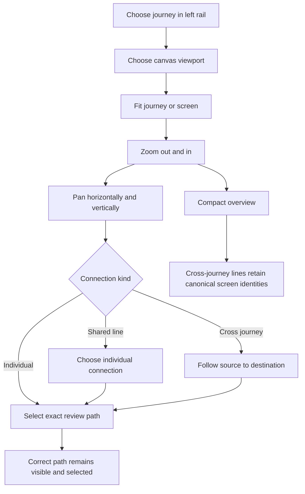
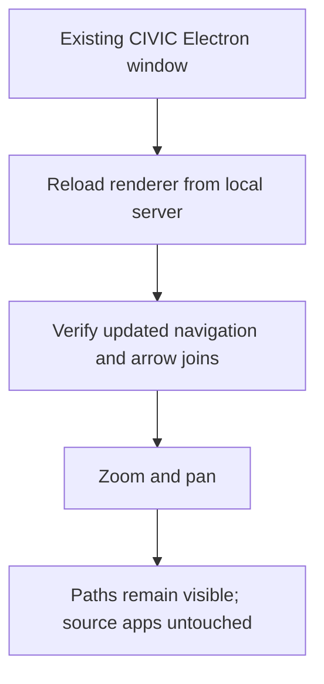
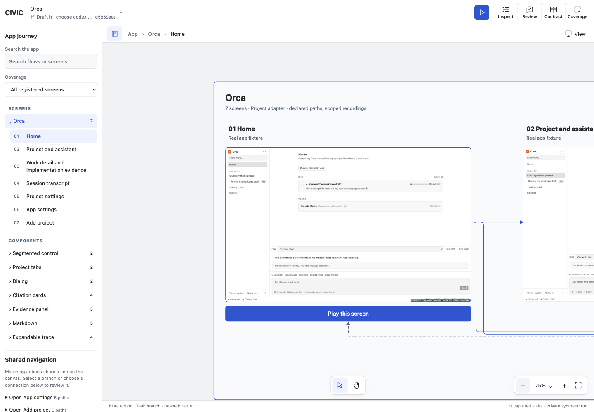
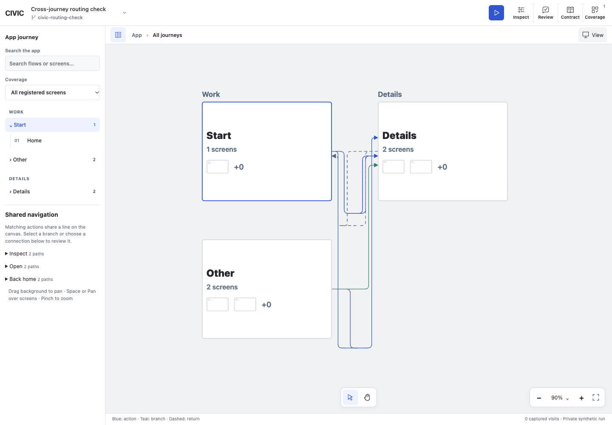

# Dogfood Report — canvas arrows

> Targeted arrow QA of the current `feat/local-current` working tree on 2026-10-18. User scope: all current Orca journeys and viewports, cross-journey routing, zoom/pan persistence, and the running CIVIC Electron app. Preserve existing source apps, reviews and evidence.

## Diff Summary

- Shared connection routing and SVG rendering cover detailed journeys, cross-journey routes, and the compact overview.
- Matching navigation actions share a line while retaining individual review identities.
- Branches now route to the shared line instead of overshooting a fixed join; rounded junctions replace hooks and square seams.
- Electron loads the same renderer from the local CIVIC server; updating its window requires a reload.

## Personas

- **App reviewer** — follow navigation, distinguish conditional/return paths, and select the intended connection at any zoom — inferred from the user's feedback.
- **Developer comparing drafts** — inspect every registered screen/component without changing source app data — inferred from the user's request.
- No Compound Packs are declared. This run uses CUA for browser and native Electron interactions, as required by the available computer-use tooling. It checks the requested working-tree behavior rather than every unrelated change on the branch.

## Flows Tested

## Test Matrix & Results

| # | Flow | Journey / Scenario | Status | Issue | Fix | Commit |
|---|------|--------------------|--------|-------|-----|--------|
| 1 | Detailed canvas | Orca; phone, tablet, desktop, wide desktop; zoom and pan | Pass | 27 paths and four bundles retained in 32 zoom and 32 drag-pan checks across all journeys | - | - |
| 2 | Detailed canvas | Segmented control; all four canvas viewports | Pass | Two screens; no declared component transitions | - | - |
| 3 | Detailed canvas | Project tabs; all four canvas viewports | Pass | Two screens; no declared component transitions | - | - |
| 4 | Detailed canvas | Dialog; all four canvas viewports | Pass | Two screens; no declared component transitions | - | - |
| 5 | Detailed canvas | Citation cards; all four canvas viewports | Pass | Four screens; no declared component transitions | - | - |
| 6 | Detailed canvas | Evidence panel; all four canvas viewports | Pass | Three screens; no declared component transitions | - | - |
| 7 | Detailed canvas | Markdown; all four canvas viewports | Pass | Three screens; no declared component transitions | - | - |
| 8 | Detailed canvas | Expandable trace; all four canvas viewports | Pass | Four screens; no declared component transitions | - | - |
| 9 | Geometry | All 12 preview presets and their rotated dimensions; every registered Orca journey | Pass | 48 app/viewport/orientation combinations including synthetic cross-journey routes; no missing routes, card crossings, non-finite coordinates, backtracks or shared-line overshoots | - | - |
| 10 | Cross-journey | Synthetic fan-in, fan-out, return and conditional paths; all four canvas viewports | Fixed | Cross-journey SVG used the browser's hidden-overflow default | Shared overflow rule; seven connections and three bundles retained through all 12 journey/viewport zoom-pan cases, then four final viewport rechecks | fcb3dc3 |
| 11 | Overview | Same cross-journey routes in compact mode; exact identities retained | Pass | Seven canonical routes and three bundles in every canvas viewport; no card crossings in geometry checks | - | - |
| 12 | Selection | Shared-line chooser to exact review; pan disables selection without removing lines | Pass | `Start / Home → Details / Activity` selects `["start.home","details.activity","Open"]`; all paths retained while panning | - | - |
| 13 | Responsive host | Phone, tablet and desktop host sizes; lines survive resize | Pass | 390×844, 768×1024 and 1440×1000 hosts; all 27 Orca paths and four bundles retained, no document overflow | - | - |
| 14 | Electron | Launch current CIVIC renderer; separate native-window zoom/pan acceptance | Skipped | CIVIC was relaunched with the existing desktop launcher after confirming its old processes had exited. Native automation resolves the shared Electron bundle identity to the separate Orca window, so independent native-window acceptance was not performed | Shared renderer verified in browser; Orca process left running | - |
| 15 | Automated checks | Canvas unit suite, type check, camera/renderer checks and relevant server checks | Pass | 65 tests passed; canvas and shell TypeScript checks and diff whitespace check passed | - | - |

## Pack Compliance

None.

## What Was Fixed

### Cross-journey SVG clipping — `fcb3dc3`

- **Symptom:** the cross-journey layer reported `overflow: hidden`, while detailed and overview layers allowed overflow. Routes and arrowheads near an SVG boundary could be clipped even when panning the containing canvas.
- **Root cause:** `app-cross-flow-edges` omitted the overflow declaration and retained SVG's browser default.
- **Fix:** consolidate overflow and pointer-event declarations for all three connection layers in `packages/shell/styles/app-canvas.css`.
- **Regression verification:** before the fix, computed cross-layer overflow was `hidden` in all 12 journey/viewport checks; after reload it was `visible` in detailed and overview modes in all four canvas viewports. Every check retained seven canonical connections and three bundles. This is a CSS-only change, so the browser-computed style and interaction replay are the meaningful regression checks; no source-string assertion was added.

The earlier shared-router junction correction remains part of the pre-existing working tree and was not swept into this commit.

## Paper Cuts (by persona)

- **Developer comparing drafts** — seven component journeys contain registered screens but no declared links. Their layout and camera persistence passed; these are not evidence of component transition coverage — coverage limitation, not repaired by inventing arrows.
- **App reviewer** — route labels appear on hover, focus, or selection, while shared navigation lists matching actions. At very low zoom the graph is necessarily dense; paths remain rendered with non-scaling strokes rather than being conditionally removed.

## Console Errors

No warning/error entries were observed in either browser QA tab's captured console logs. The scratch geometry loader logged a sandbox-denied development WebSocket attempt and unresolved unrelated virtual imports during dependency scanning; its direct routing-module checks completed all 48 combinations successfully. Those loader messages were not app browser failures.

## Human Verifications

No external interactions were required. CSS viewport emulation does not verify physical phones, tablets, or other browser engines. The native Electron window was not separately automated because the native application selector identifies it as the same app as Orca; only CIVIC's launcher was started, and Orca's own process was not restarted or written to.

## Decisions for a Human

No product or architecture decisions were needed. Independent native Electron interaction acceptance remains unverified; this is not a branch-wide release signoff.

## Learnings

- Keep overflow rules shared across all SVG connection layers; zoom persistence alone cannot detect clipping at a layer's own boundary.
- Verify both rendered identities and actual camera movement: the same path count is insufficient if the pan gesture never moved the scene.
- Use synthetic cross-journey routes to test fan-in, fan-out, returns and conditions when the current app registry declares no cross-journey links. Current Orca has 27 internal routes and zero cross-journey routes.

### Scope and reproducibility

- Current Orca input: 27 screens across eight journeys. Scenario SHA-256: `65421d7bddc76a443c6ee925b2fedb2631964b22d474914a60db0e9d5c7d02a9`; unchanged when checked after the run.
- Geometry: 12 presets × two orientations × two inventories = 48 successful combinations. Inventories: current Orca and the synthetic three-journey fixture. Checked route completeness, finite coordinates, orthogonal segments, card avoidance, backtracks, bus overshoots, and canonical overview IDs.
- Browser: eight Orca journeys × four canvas viewport choices, with zoom and real pointer drag-pan checks for every cell. Cross-journey fixture: three journeys × four choices, plus post-fix detailed/overview checks.
- Zoom range: seven cross-journey paths remained rendered at both 200% and 0.3%, with `vector-effect="non-scaling-stroke"` on painted paths.
- Passed commands: canvas `vitest run` (39), shell `vitest run` (6), canvas server-functions/runtime-service/module-adapter checks (14), shell recording/interaction checks (5), filtered canvas import-boundary check (1), both package `tsc --noEmit` commands, and `git diff --check`.
- The full recursive app/server browser suite was not run: browser work for this task used CUA. No GitHub CI was launched. No changes were made to source apps, project connections, saved reviews, or execution evidence.

### Browser evidence

### Pack candidates

None. The overflow observation is captured here with its concrete regression evidence.

## Final Status

The requested browser arrow surface passed the scoped matrix, including all current Orca journeys, the four canvas viewport choices, all preview-preset geometries, and synthetic cross-journey routes. The CSS clipping fix is committed locally. CIVIC Electron was relaunched against the updated local renderer, with separate native-window interaction acceptance explicitly unverified. This report does not certify unrelated working-tree changes, other source-app behavior, physical devices, or the entire branch for release.
