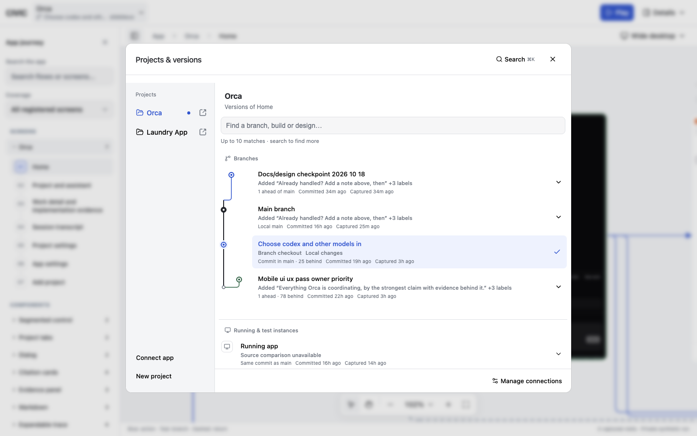
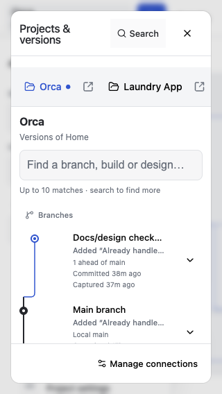
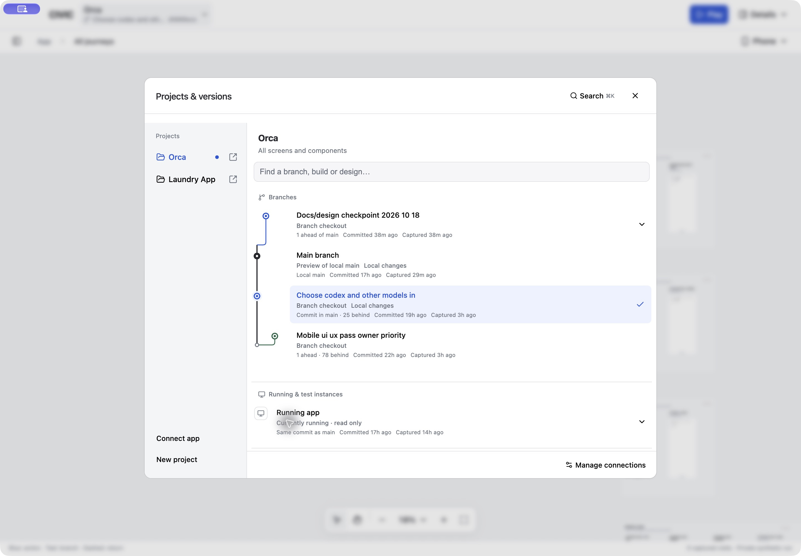
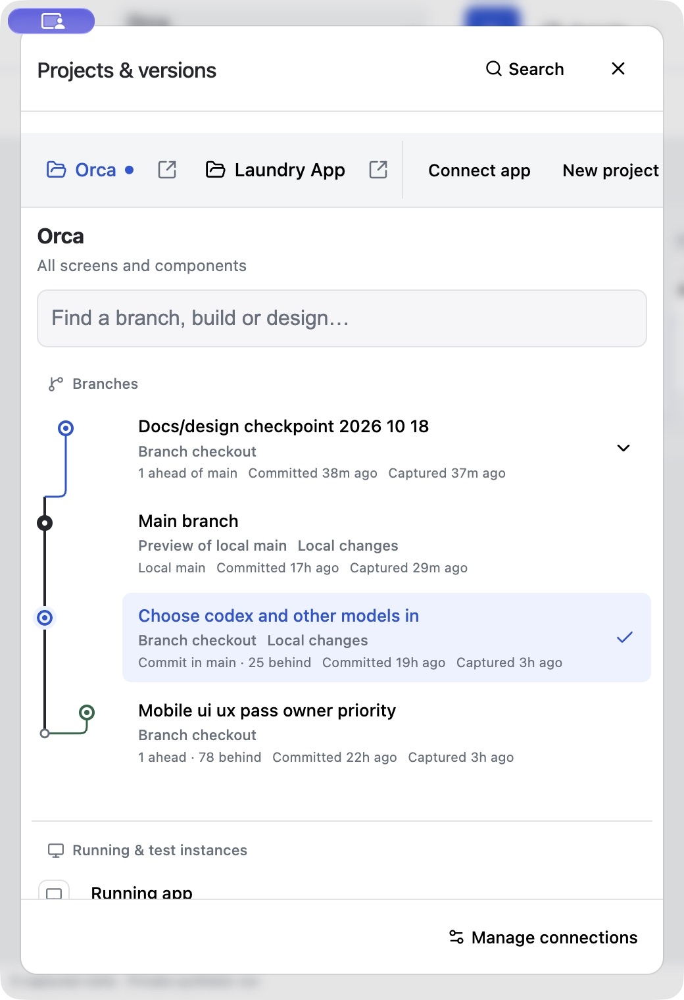
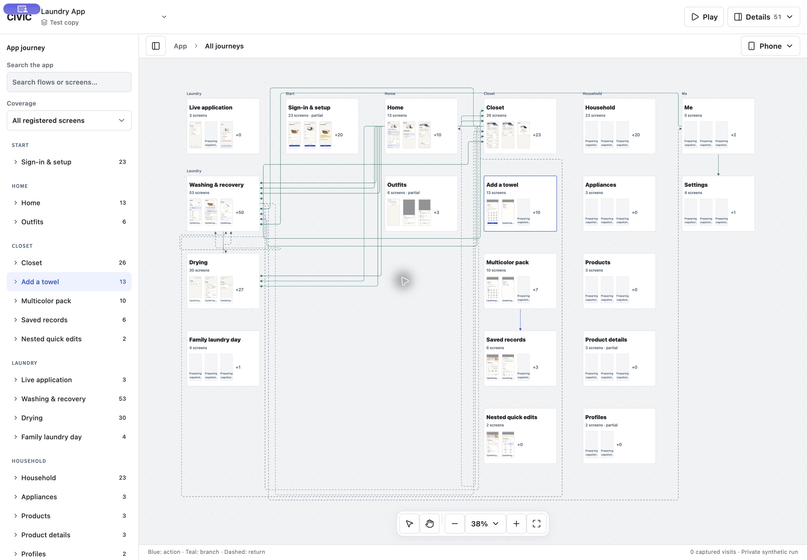

# History lanes and independent project windows

Verified locally on 2026-10-18. CIVIC checkout HEAD: `d924c393630bbe4366baa93c615ab14ae91c3969` with existing uncommitted work preserved.

## Result

- Main has a fixed trunk. Ahead and diverged branches occupy separate lanes with rounded orthogonal joins. Included commits sit on main's trunk; unknown ancestry is disconnected. Unrelated roots cannot share a trunk accidentally.
- Branches are newest first, with verified descendants above ancestors even if commit clocks disagree. Neither the current checkout nor main is pinned first. Code order uses the recorded commit time, never the preview capture time. Grouped equivalent previews use the chosen connection's history.
- The same ordering and rail are reused in source management. Running/test instances occupy their own section, outside branch history, while remaining selectable.
- Each project has an accessible new-window action. Browser links open a separate tab/window; Electron creates a native window. Opening Laundry does not select it in Orca's existing window.
- Independent local project hosts reuse the original connection identities and evidence directories. Each connection has one host; windows share one registry and its write queue. Refreshing an owned host retains its origin. No external source checkout was edited or switched.
- Electron admits additional local origins only after its original authenticated CIVIC server confirms that they are registered project hosts. Renderer sandboxing, context isolation and denied permissions remain intact.

## Historical order checked against Git

| Branch | Recorded commit | Commit time (America/Los_Angeles) |
| --- | --- | --- |
| Docs/design checkpoint | `b2ea7f2b` | Oct 18, 7:31:09 PM |
| Main | `d1d9d02e` | Oct 18, 3:07:44 AM |
| Choose codex | `d5669ece` | Oct 18, 12:47:25 AM |
| Mobile UI | `3a2a09cd` | Oct 17, 9:47:25 PM |

## Acceptance

- Browser modal: 1440×900, 900×700, 520×760, 390×844 and 320×568. No modal overflow; lane assignments and chronological order remain stable as rows wrap.
- Native Electron: desktop and an actual 520×760 resized window. Verified the ordered graph and separate instances section.
- Opened Laundry in a second native Electron window, confirmed its distinct local origin and project header, then closed it and confirmed Orca remained open on its original project.
- Browser Laundry retained its 51 existing proposals; the canonical selection file still points to the same Orca worktree. No feedback, recordings or source files were deleted or moved.
- 59 full canvas unit tests passed before the final connection-history case; all 24 focused project-choice/history tests passed afterward. Canvas and shell type checks passed.
- 48 Node checks passed across project windows, connector/projects, source history, authenticated API and plugin integration. Final affected window/API/project checks passed again after bounded request timeouts were added.
- All eight canvas-host acceptance tests passed. Two stale test selectors were updated to the current icon-based navigation and Details → Inspect menu, retaining their behavioral assertions.
- Generated shell styles, local syntax checks and `git diff --check` passed.

## Limits

New-window actions are local browser/Electron features, hidden on remote/private-proxy URLs. The CIVIC process owns its extra project hosts, with a maximum of eight including the original host; restart CIVIC to release unused hosts. Reopen project windows after restarting the parent server. Physical phones, live Figma and open PR data were not exercised in this pass.

An independently active Orca worktree reported an incompatible dependency catalog. Its existing preview was retained and the error remained visible; that checkout was not modified.

## Evidence

