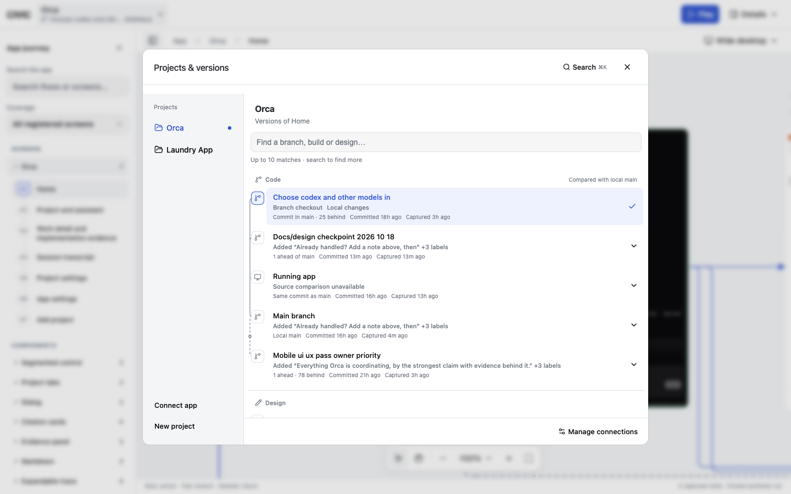
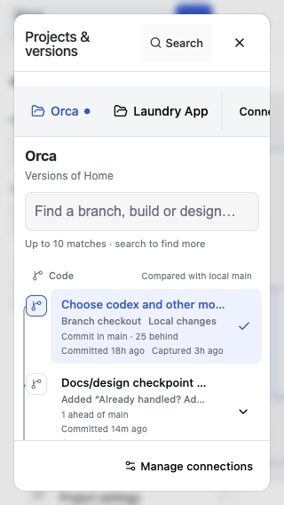
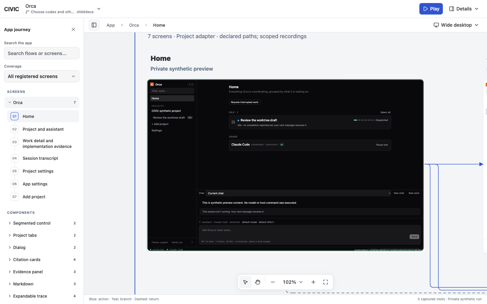
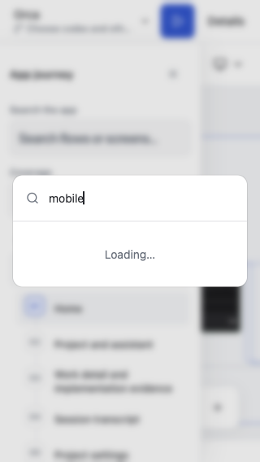
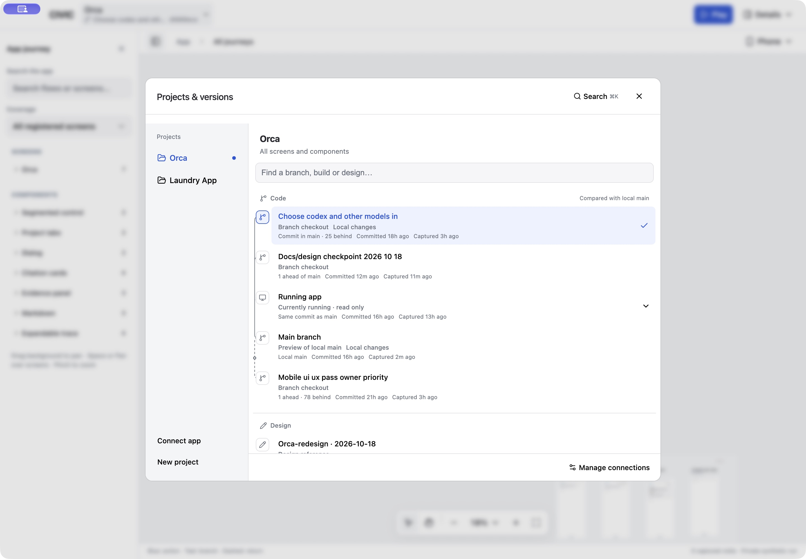
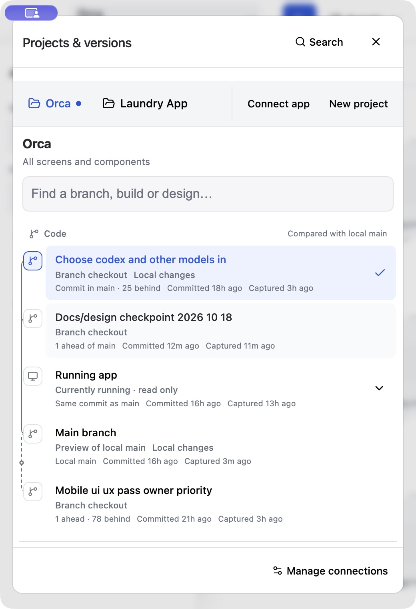

# Projects, versions and inline history

Verified locally on 2026-10-18 against CIVIC on port 3012 and its isolated workspace on port 3013.

The header now opens one Base UI modal for projects and their versions. Project rows are left aligned siblings; Laundry App was never a child of Orca. Browsing a project does not switch the running preview. Version choices retain the selected screen/component scope and the existing active-preview confirmation. Reviews and recordings keep their connection identities.

The shared history rail shows recorded commit relationships, relative age, capture age and status. Missing ancestry stays unknown; imported designs are not assigned invented Git ancestry. Source management uses the same rail for worktrees, PRs and design references. Straight segments and rounded corners reuse the canvas `arrowPath` helper. The journey outline and history nodes share `RailMarker`; journey position is not presented as completed work.

The command menu uses shadcn's `cmdk` pattern inside the existing Base UI Dialog. Command/Control+K searches projects, versions and actions, rendering at most ten results. Version commands retain the normal switching guard.

## Acceptance

- Browser: 1440×900, 900×700, 520×760, 390×844 and 320×568. Final modal bounds stay inside each viewport; the list scrolls with a reachable footer. Fixed a breakpoint override that previously overflowed a 900px window.
- Orca and Laundry project icon positions match. Narrow layouts place projects in a horizontal navigation row.
- Journey markers align on a single vertical rail, including wrapped screen names. Active screen navigation and `aria-current` remain intact.
- History connectors contain straight `L` segments and rounded `Q` corners, without cubic curves. Expanding a version recalculates connector positions.
- Command menu: empty results, project search, keyboard Enter, Escape and focus restoration. Selecting Mobile while a preview is active stages confirmation; Cancel leaves the current checkout selected. Project search browses Laundry without switching the app.
- Native Electron: actual window tested at 1440×1000 and resized to 520×760. Modal, scrolling and Command+K search worked. Keyboard project selection opened Laundry's versions without changing the running Orca app.
- Isolated CIVIC: refreshed and opened the combined picker successfully on 3013.
- 54 canvas tests and 20 connector/project tests passed. Canvas and shell TypeScript checks, generated styles and `git diff --check` passed. The connector loopback test required an unsandboxed rerun after an initial `EPERM` bind error.
- React Doctor reported existing warnings outside this change; its score service was unreachable. No suppressions were added.

## Runtime and limits

Both CIVIC preview servers were restarted with the final backend. Normal Electron was relaunched after native QA. External Orca source worktrees were not edited or switched; existing reviews/evidence were retained.

Live discovery reported zero open Orca PRs and no linked Figma file. PR/design relationship behavior was verified with fixtures; live Figma and open-PR presentation still need connected provider data. Physical phone acceptance was not performed.

## Evidence

