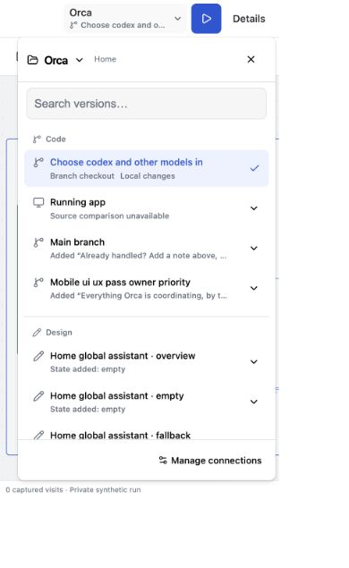
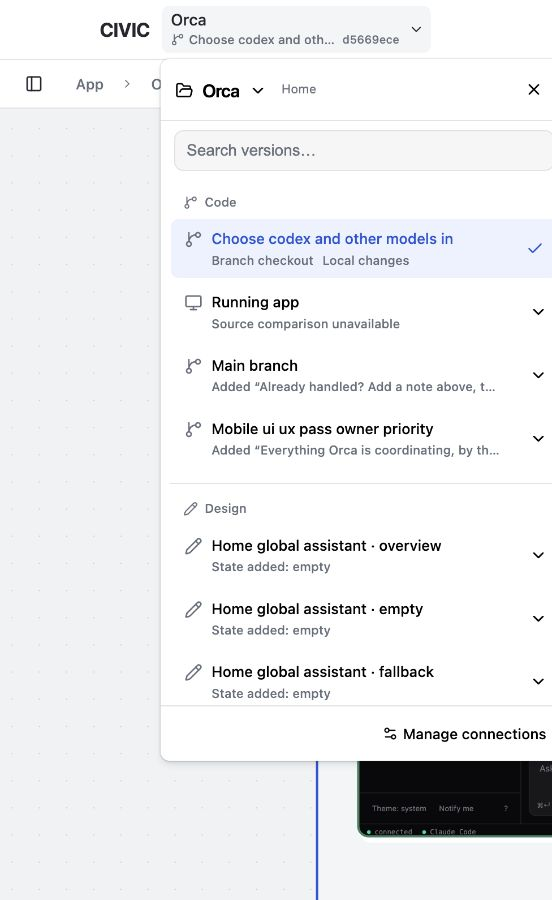

# Picker: Electron refresh and responsive verification

The CIVIC Electron process was refreshed after the branch icons and final responsive styles. Final process: 67194, running `packages/local/desktop.mjs`. The separate Orca Electron process, 80412, was unchanged.

At widths below 480px the header hides the revision hash to leave room for the branch name. Below 400px the Details button keeps its text and omits its icons. Its accessible label and behavior remain unchanged.

The shared renderer was exercised in the existing browser with Electron's `desktop=darwin` title-bar layout:

| Window | Header height | Picker stays inside window | Horizontal header/list overflow |
| --- | --- | --- | --- |
| 1440 × 900 | 53px | Yes | None |
| 900 × 700 | 53px | Yes | None |
| 520 × 760 | 53px | Yes | None |
| 390 × 700 | 53px | Yes | None |
| 320 × 568 | 53px | Yes | None |

Version rows remained 54px tall. At 320px, Main's change disclosure was expanded and the list scrolled to the bottom; the fixed footer stayed visible and the list had no horizontal overflow. The original browser URL and viewport were restored. No version was switched and no product action was executed.

Checks: styles compiled successfully; `git diff --check` passed.

Native verification limit: computer-use app selection resolves the shared Electron bundle to Orca's separate window. No native window-edge dragging or traffic-light interaction was verified. The screenshots below show browser checks of Electron's renderer layout, not native Electron captures.

