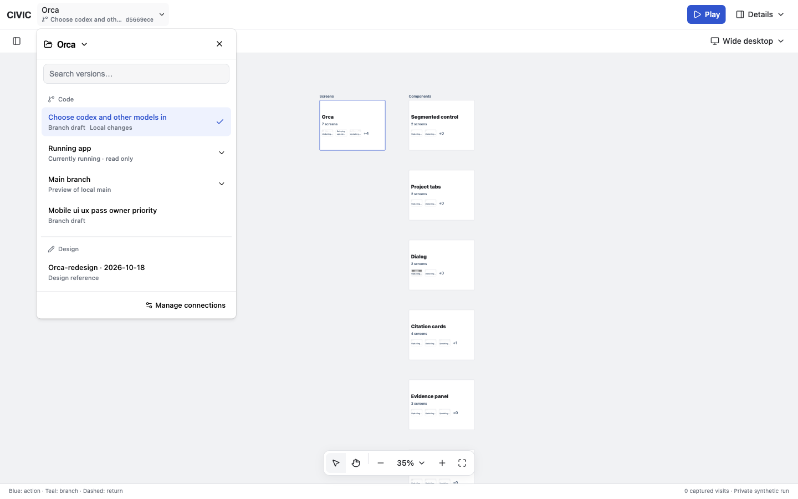
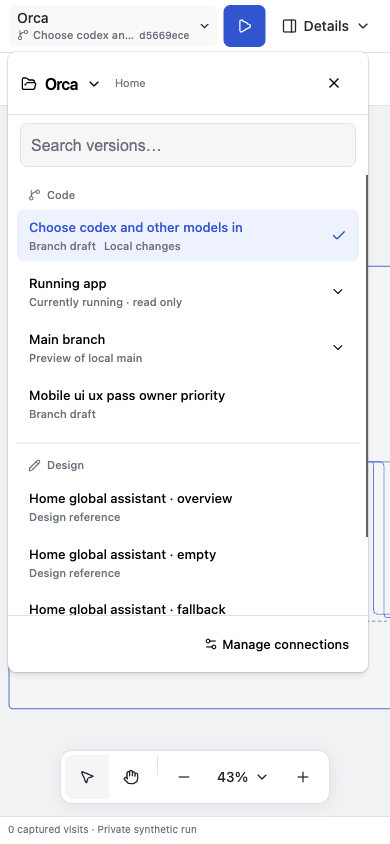

# Project and preview picker

The picker now includes [screen and component change summaries](2026-10-18-scoped-version-changes.md).

Checked 2026-10-18 on `feat/local-current`, HEAD `d924c39`, with existing working-tree changes retained. This supersedes the picker presentation in the earlier shell report.

## Result

- The Orca heading opens project selection. Preview choices use flat rows under Code and Design, with no scroll instructions or individual card borders.
- Running app means the current read-only app connection. Main branch means a preview of local main. Branch drafts use their task names, with local changes identified separately. Revision IDs remain in the shell trigger, connection disclosures and tooltips.
- Backend app versions now group connections with matching recorded content identities. Main and its equivalent local-edit preview share an entry; the running app and its isolated copy share another. Whole-project Orca has five entries for seven connections.
- Alternate preview locations expand from a row's chevron. Their connection keys, runtime boundaries and evidence remain separate. Search reaches connections within a grouped version; primary results and expanded locations are each limited to ten.
- A commit alone never combines versions. Worktree grouping includes repository identity, recorded source-content hash and UI/server/assets; running-copy grouping includes source identity and UI/server/assets. Changed or unknown content remains separate. This adds a logical projection without migrating stored reviews.

## Verification

- 63 tests passed: 46 canvas tests and 17 project/source connector tests. Cases cover matching builds, changed server/CSS/source identities, real Git worktrees, dirty content, missing receipts, isolated credentials, retained evidence, screen matching, distinct design states and search beyond 100 previews.
- Canvas TypeScript, generated shell CSS and `git diff --check` passed.
- Browser checks at 1440×900, 390×844 and 320×720: no picker overflow; 54px preview rows; 44px mobile disclosure targets. The project heading had an 83×44px touch target.
- Project selection opens from the heading. Searching for the test copy selects its isolated location; confirmation explicitly names isolated data. Cancellation preserves the current connection. Empty search recovers through Clear search.
- Final list scrolling reached 94px with a 534px list in a 440px viewport. Escape closed the picker and returned focus to the project trigger. No project switch or app write was performed during browser QA.
- Compared 1,299 pre-existing evidence files: 1,271 were unchanged; 26 mutable latest-fixture pointers and two interaction-state inventories refreshed during normal UI loading. No checked file was deleted. Saved reviews and historical receipts retained their bytes.
- The selected connection remains `orca-worktree-ff7439992141-6bf21f48ee74`. CIVIC servers were refreshed on 3012 and 3013. CIVIC Electron was reopened as PID 96364; Orca's separate process remained PID 80412.

React Doctor's installed 0.9.18 scan retained the three existing camera-effect/sequential-capture warnings. The latest-package lookup and remote score service were unavailable. Native Electron window controls and physical mobile devices were not tested.

## Screenshots

