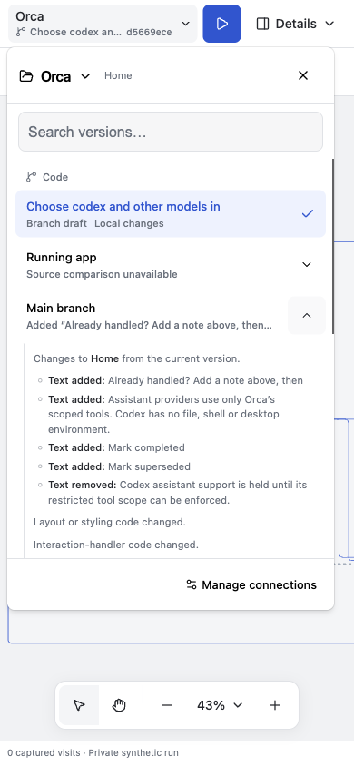
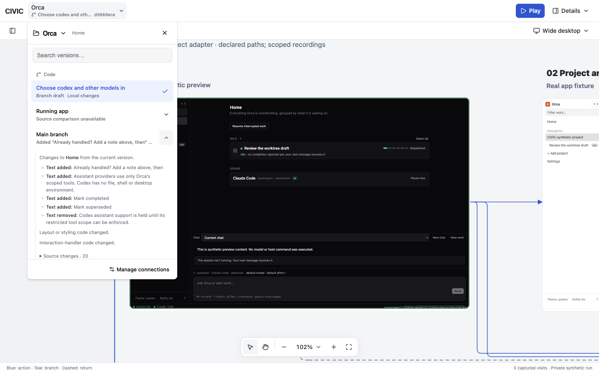

# Screen and component version changes

Checked 2026-10-18 on `feat/local-current`, HEAD `d924c39`, with existing working-tree changes preserved.

## Result

Selecting a registered screen or component scopes the project picker's version summaries to that selection. Expanding a row shows text additions/removals, registered state/action differences, styling/handler changes and before/after source excerpts. Comparisons use the current connection as the baseline. Component switching preserves the selected state, and alternate locations name their states explicitly.

The read-only `changes` project action accepts up to ten registered candidate previews. It validates the app and screen identity and uses the immutable source beside each compiled preview, never an unverified current checkout. The existing Vite parser follows the bound export, lexical references, local imports/re-exports, local prop contracts and literal dynamic imports. Module-resolution candidates are shared with fixture fingerprinting. Shared CSS and recorded dependency/build inputs remain visible separately from component changes.

Comparison traversal is bounded by file, byte, source-unit and time limits. Parsed modules are cached within each traversal. Search is debounced; closing or changing scope aborts abandoned reads. Missing snapshots, unresolved imports, parse failures and traversal limits produce an unavailable result, not an unchanged claim. Namespace dependencies and shared CSS remain conservative. Text and source excerpts are bounded and identify omitted results.

## Verified

- 102 targeted tests passed: 49 canvas, 48 connector and five review-server preservation/access checks. Coverage includes unrelated exports in the same file, shadowed names, imported props, local helpers/barrels, dynamic/cyclic imports, changed build inputs, missing snapshots, escape attempts, resource limits, cancellation and same-state selection.
- Canvas TypeScript, shell CSS generation and `git diff --check` passed. The installed React Doctor scan retained the three existing camera-effect/sequential-capture warnings; its remote score service was unavailable.
- Browser checks at 1440×900, 390×844 and 320×720: inline summaries, expandable text/source changes, bounded code panes, explicit missing-source explanation and no horizontal picker overflow. The narrow phone list measured 296px for both client and scroll width.
- Orca Home versus Main showed added completion controls and provider-picker copy, with the older Codex restriction text removed. The actual ProviderPicker excerpts were opened and inspected.
- Segmented control · codex versus Main reported matching UI code with differing build inputs. Staging a switch retained the Codex state; cancellation preserved the active connection. Component variant locations distinguish claude/codex.
- Source comparison is not a pixel comparison or runtime behavior verification. The legacy running-app/design connections do not have equivalent saved build-source snapshots; their limitations stay explicit.
- Compared 1,747 existing evidence files: 1,731 retained their bytes; 15 mutable latest-fixture pointers and one interaction inventory refreshed through normal loading. No checked review or historical receipt changed or disappeared.
- The selected connection remains `orca-worktree-ff7439992141-6bf21f48ee74`. Main/isolated CIVIC servers were refreshed on 3012/3013 and Electron reopened as PID 47592. Orca's separate Electron process remained PID 80412. Native window controls and physical devices were not exercised.

The original Home URL and browser viewport were restored. No project switch, live Orca write, agent dispatch or review submission was performed during browser checks.

