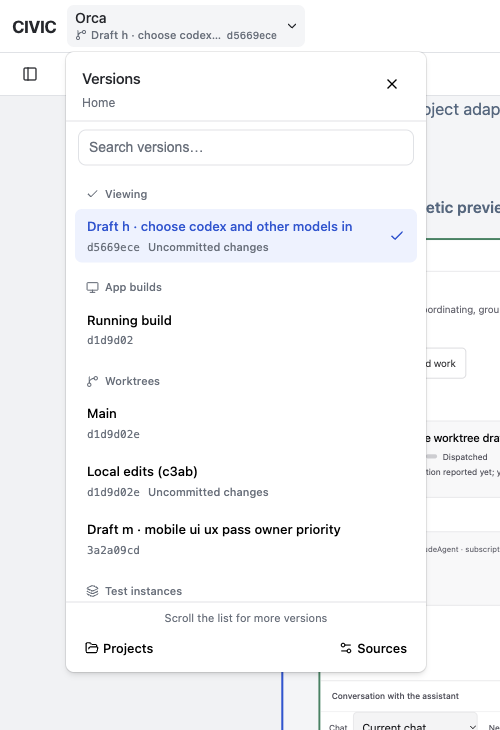
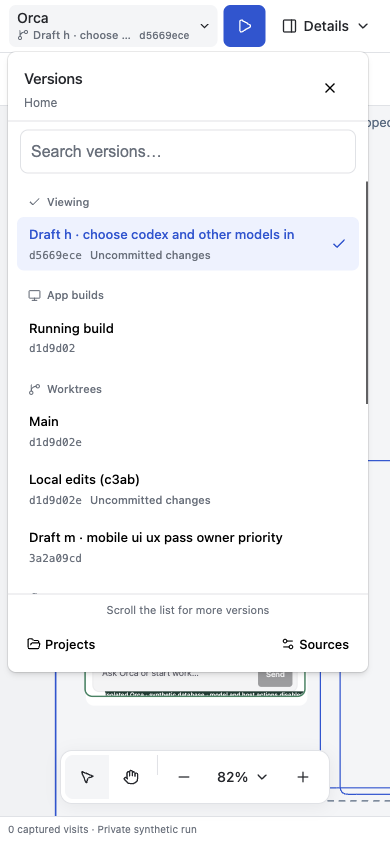
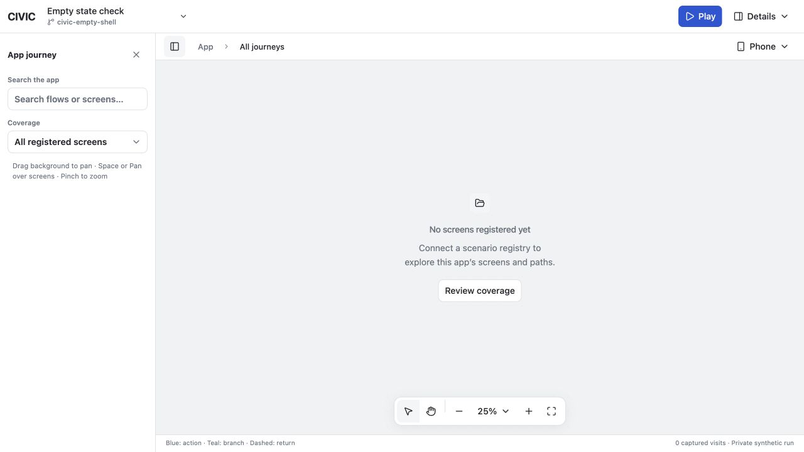

# CIVIC shell and version picker

The picker has a newer [project and preview follow-up](2026-10-18-project-preview-picker.md); the shell checks below describe the earlier 18:26 state.

Checked 2026-10-18 at 18:26 PDT on `feat/local-current`, HEAD `d924c39`, with the existing working-tree changes retained. This report covers the shell changes, not a repository-wide signoff.

## Result

- The shell uses generated shadcn **base-nova** components, Base UI behavior, Lucide icons and shared `--civic-*` tokens. Prefixed, precompiled CSS avoids requiring a Tailwind plugin or global preflight in connected applications.
- One labeled details menu opens the shared panel tabs. One dock contains tools and zoom. The viewport popover and project/version picker use shared overlays and focus handling.
- The project trigger measures 44px tall inside a 53px header, with a vertically centered chevron.
- Versions separate the currently viewed work, app builds, worktrees, test instances and design references. Revision and uncommitted state are secondary metadata. Search retains the ten-preview display limit.
- Only the version list scrolls. Its title, search and Projects/Sources footer remain visible. Selecting during a preview shows the actual version name in a fixed confirmation area; cancelling changes no connection.
- Loading, empty inventory, empty search, missing previews, missing paths, absent reviews and unavailable snapshots have distinct messages. Snapshot retries and historical-image retention stay intact.
- Electron uses the shell header as its custom title bar, keeps native window controls and retains sandbox/context isolation. Its platform marker survives internal navigation.

## Browser checks

Real browser interactions used the main Orca connection and disposable CIVIC fixtures; no project switch, review submission, agent dispatch or live application write was performed.

- Desktop 1440×1000, phone 390×844, and narrow phone 320×720: compact header, controls and panel fit; mobile tool targets measured 44×44px or larger.
- Versions: ten previews; grouped identities; search and clear-search recovery; explicit selection confirmation and cancellation; Escape dismissal returns focus to the project trigger.
- Wheel scrolling moved the version list from 0 to 350.5px. Header remained at y=52, footer at y=593.29, and the canvas transform did not change. The list's scroll height was 762px with a 412px viewport.
- Project dialog fit at x=16…374 on a 390px viewport and returned focus on close.
- All four details tabs opened. The 320px details panel had no horizontal overflow.
- Viewport selection changed the existing Orca preview between phone and wide desktop. Search recovery and the missing-path notice's Coverage action worked.
- Empty fixture: no registered screens displayed an actionable empty state; Review coverage opened the details panel.
- Cross-journey fixture: seven source paths and three bundles remained after zoom and a 150px/90px pan. Selecting a shared branch opened the correct Home → Summary review target.
- Main and cross-journey browser logs contained no warnings or errors during the final checks.

## Automated checks

68 targeted tests passed:

- Canvas Vitest: 42; shell Vitest: 6.
- Runtime, server-function, module-adapter and recording checks: 16.
- Canvas import boundary: 1.
- Historical snapshot, per-viewport cache and saved-review receipt checks: 3.

Canvas and shell TypeScript checks, CSS generation, shadcn configuration resolution, Electron script syntax, and `git diff --check` passed. Engine workspace dependencies were relinked from the frozen lockfile so shell and canvas resolve one React instance.

React Doctor changed-scope findings fell from six to three in the canvas; its score remained 42. Remaining changed-scope diagnostics concern existing camera resize effects and sequential fixture capture. Full scans also report existing camera/ref, loader, example and server/test issues, so no clean repository-wide health result is claimed. Generated Field keys, ToggleGroup context stability and CanvasControls dependencies found during the scan were corrected without suppressions.

## Electron and limits

The final CIVIC Electron launcher was running as PID 61814. Orca's separate Electron process remained PID 80412. Only the owned CIVIC window was refreshed; server, source checkouts, connection identities, review storage and evidence were retained.

Native window-control interactions could not be verified through the available desktop binding, which resolves the shared Electron bundle to Orca. No clicks or quit commands were sent through that binding. Windows/Linux and physical mobile devices were not tested. The updated Electron browser test was syntax-checked, not executed; browser interaction checks used CUA.

Temporary empty/cross-journey tabs and listeners were closed after verification. The main Orca preview was restored to Wide desktop.

## Evidence







Key final-input SHA-256 values:

```text
24b08ea1caa984e60293fdf7a36f43b55e705c743177ae9ae3ea9625682dd373  packages/canvas/src/project-picker.tsx
9402924b951d2d83c3d2440d513b827cb90deed733f054a3632bfb7481b670b0  packages/canvas/src/project-choice.ts
519c3030dd909258b897f899b6ea85be214203f2511ba3cfb13665ef291ef486  packages/shell/styles/ui.generated.css
17c3294ed61a6a72ea2538407aef6f0432e94ec06d7c92f81baf1776cec78caa  packages/pnpm-lock.yaml
9a91e5a0899b5083aa57c2086a5a5a08e34971b6a307fe9357ffd1f4a0e52c53  packages/local/desktop.mjs
```

References: [shadcn Base UI components](https://ui.shadcn.com/docs/components/base), [Base UI](https://base-ui.com/react/overview/quick-start), [Electron custom title bar](https://www.electronjs.org/docs/latest/tutorial/custom-title-bar).
