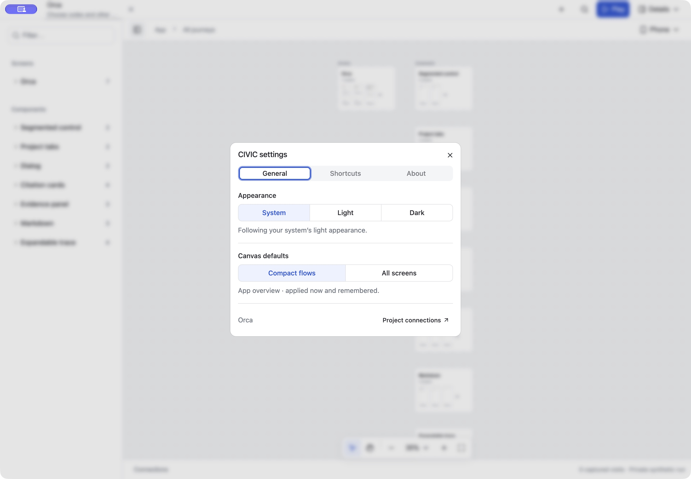
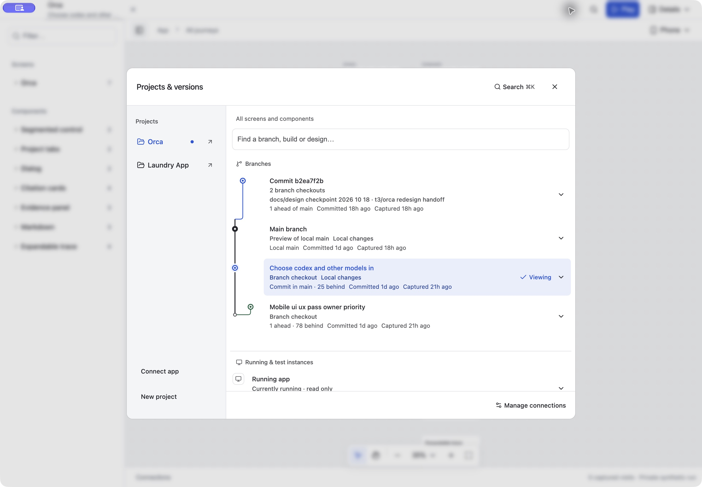

# Installed CIVIC shell update — 2026-10-19

The installed source-backed Electron launcher now loads the migrated shell from this checkout. Electron 44.9.0 is installed through Orca's pnpm dependencies; there is no separate packaged `CIVIC.app` in Applications.

## Installed acceptance

- Inspected the existing CIVIC window and its exact launcher/host processes. It had one Orca checkout tab, no visible unsent draft, and an older host reporting “Version unavailable.”
- Quit that window normally, confirmed its Electron process exited, restarted only its dedicated host on `http://127.0.0.1:38951`, and reopened the same launcher with the same profile and origin. Existing browser hosts on 3012, 3013 and 58966 were preserved.
- The remembered Orca checkout resolved after reopening. Its seven registered screens and component journeys loaded.
- Native `⌘,` opened the new General / Shortcuts / About settings modal with appearance, canvas defaults and project connections.
- The installed picker loaded current branch relationships, grouped commit `b2ea7f2b` under two explicit checkout names, distinguished the running instance and design reference, and retained the selected checkout.
- Closed the picker and left the installed workspace running. No project source, capture store, profile or draft data was removed.

Desktop and narrow-window acceptance of the same source, including 1440, 768, 390 and 360px Electron windows, is recorded in [the shell migration report](2026-10-19-shadcn-shell.md). That earlier report used an isolated Electron profile; the installed-profile restart above is a separate verification.

## Landing gate

The shipping gate is `bin/signoff --no-post` in a clean detached checkout of the committed candidate. Its log is `/private/tmp/civic-signoff-shell-final.log`. This runs the graph, review, crawl, importer, example, civic gate, package and clean-install checks without posting GitHub statuses or dispatching CI. The candidate must pass before merging to main and pushing.

The unrelated untracked root `package.json` is excluded from the commits and stays in the primary checkout. The clean signoff checkout keeps that file out of the verification inputs without moving or stashing it.
