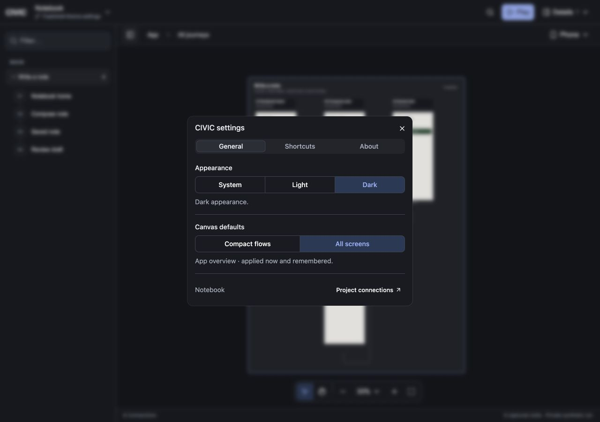
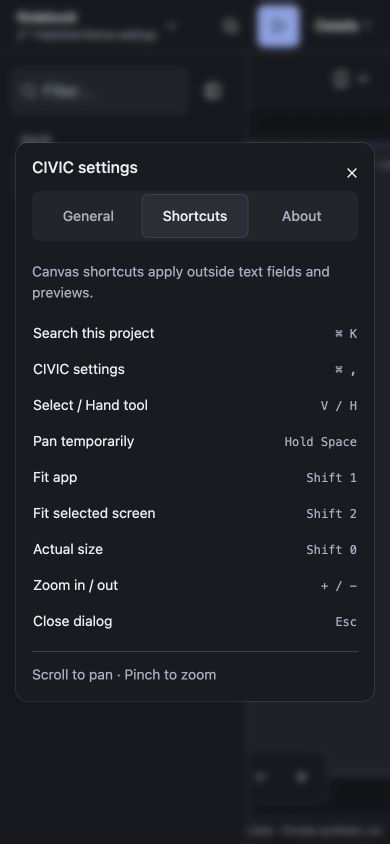
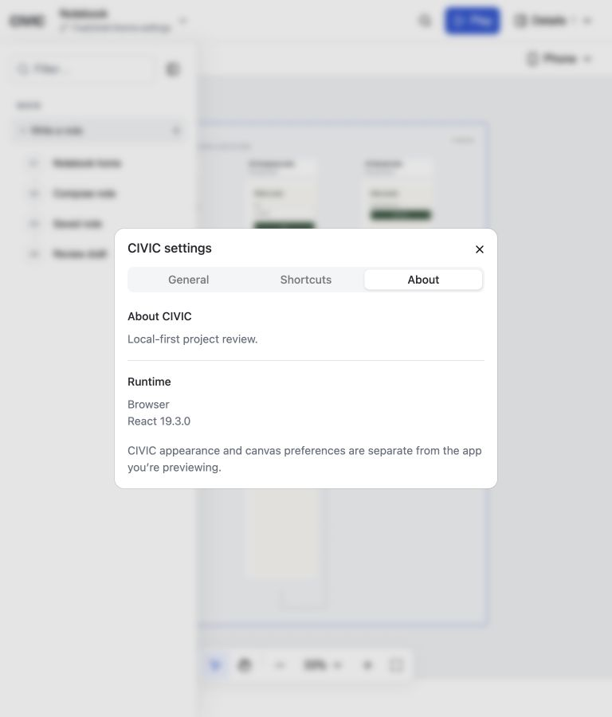
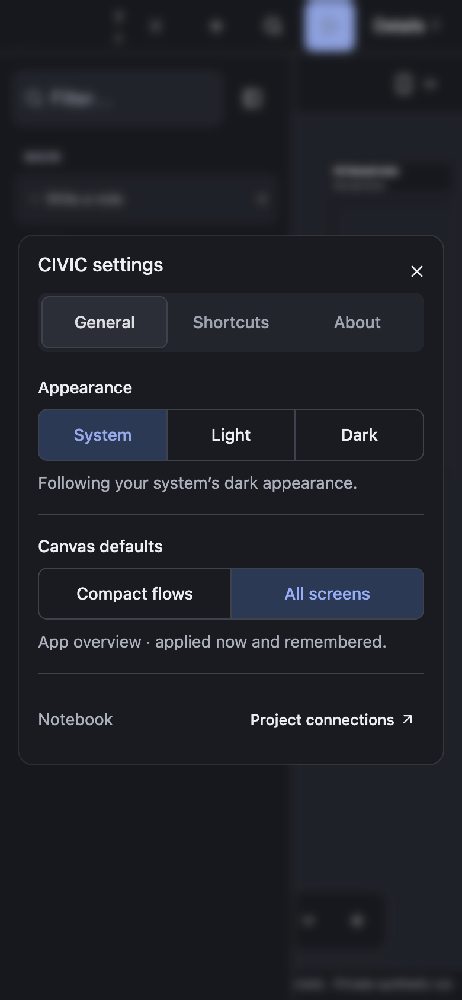

# Compact settings sections

Candidate: uncommitted changes on `feat/shell-theme-settings`, based on `de10c2c5f6a528b1c7537c0e10bc16dd8048c83c`. This extends the [theme/settings acceptance](2026-10-19-theme-settings.md). No dependency was added.

## Result

- **General:** existing System/Light/Dark controls, the existing Compact flows/All screens preference, and a scoped Project connections action.
- **Shortcuts:** a compact reference for search, settings, selection/panning, fit app/selection, actual size, zoom and dialog dismissal. Modifier labels follow the platform; canvas-only shortcuts are identified as such.
- **About:** CIVIC's purpose and actual React runtime version, plus Electron/Chromium versions supplied by the main-frame preload. Older launchers without runtime metadata show Electron without invented version numbers. CIVIC's packages have no authoritative release version, so About does not present the reviewed project's SHA as CIVIC's version.

Canvas defaults call the same controller as command search, apply immediately and use the existing saved preference. Reload and command/settings synchronization are verified. Changing the default preserves the live iframe and its draft. Connections closes settings before opening the current project's existing manager; it does not create a duplicate source-management implementation.

The dialog composes shared shadcn/Base UI Tabs, Fields, ToggleGroups, Separators and Buttons. Narrow tabs retain 44 px targets; short windows scroll without horizontal overflow. Theme overrides and preview appearance remain separate.

## Design-system corrections

The supplied [Blocks](https://ui.shadcn.com/blocks), [Typeset](https://ui.shadcn.com/typeset) and [Directory](https://ui.shadcn.com/docs/directory) references informed the composition discussion. This change uses existing shared parts, without installing a dashboard block or another registry/library.

Two missing preflight assumptions caused visible inconsistency in shared components: inactive tabs inherited a native gray background, and Electron's system-theme change could leave native button text dark against the dark dialog. Tabs now explicitly use a transparent inactive background. A scoped base-layer rule makes shared control text inherit its container color, while semantic component utilities still own selected/destructive/primary colors. Embedded app styles are not globally reset.

The wider application still contains custom shell layouts and legacy styling. This acceptance covers settings and the shared fixes above; it does not claim every CIVIC surface has completed the shadcn layout/typography migration.

## Verification

| Check | Result |
|---|---|
| `pnpm --dir packages check` | TypeScript and local syntax checks passed. |
| `pnpm --dir packages test` | 81 canvas unit, 45 host/browser, 58 connector, 25 shell server, six shell unit and 23 local checks passed. Two existing Orca-source-gated checks skipped. |
| Final `theme-settings.check.mjs` + `shell-layout.check.mjs` | Nine checks passed after the scoped control-text inheritance correction. |
| `pnpm --dir packages/local run test:desktop-settings` | Installed Electron runtime passed, including actual control text colors after a System appearance change. |
| React Doctor, changed scope | No findings in 15 scanned files; score 91. Framework-specific rules were unavailable from the root. |
| `git diff --check` | Passed. |

Browser coverage includes 1280, 768 and 390 px, plus a short 360×480 window. It checks all tabs, modal bounds, touch targets, scrollability, saved defaults, command synchronization, connection handoff, focus restoration, retained preview drafts, blocked storage, reduced motion and inactive-tab contrast. Manual checks cover desktop/narrow General, the shortcut table, About and the connection link in both appearances.

The integrated package run passed before the final scoped CSS text-inheritance correction. The final theme/layout browser checks and Electron run verify that correction. No assertion or accessibility threshold was weakened; tab-transition tests select the named active panel and wait for the preceding dialog to close.

Logs: `/private/tmp/civic-settings-sections-signoff.log`, `/private/tmp/civic-settings-sections-types.log`, `/private/tmp/civic-settings-sections-ui-final.log`, `/private/tmp/civic-settings-sections-electron-verified.log` and `/private/tmp/civic-settings-sections-doctor.log`.

## Electron and limits

Electron 44.9.0 was run from `/Users/taymoor/Projects/orca/node_modules/.pnpm/electron@44.9.0/node_modules/electron/dist/Electron.app/Contents/MacOS/Electron`, loading this checkout's launcher with disposable hosts and profiles. Native Settings, desktop/narrow layouts, source connection handoff, actual runtime metadata, cross-origin project tabs, live themes, persisted defaults after relaunch and existing sandbox/context-isolation guarantees passed.

This is source-loaded installed-runtime acceptance, not a new signed application package. The existing user Electron window and project hosts were preserved. System notifications were emulated without changing global macOS appearance. Windows, Linux, physical touch devices and actual Orca source acceptance were not tested. Temporary manual tabs were closed, viewport overrides reset and the owned visual-test host stopped.

Changes remain uncommitted. No GitHub CI, commit status or publication was dispatched.
