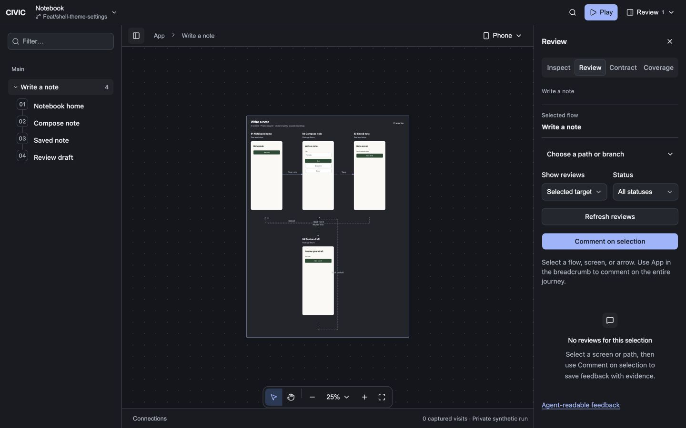
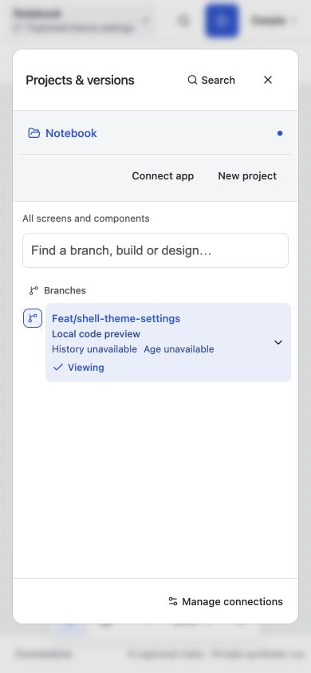
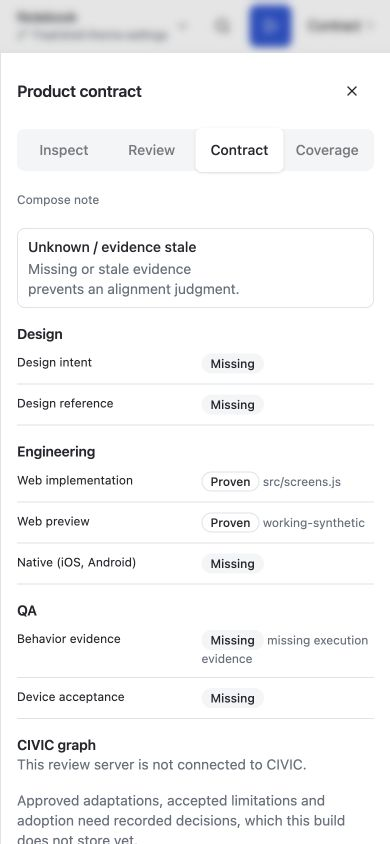
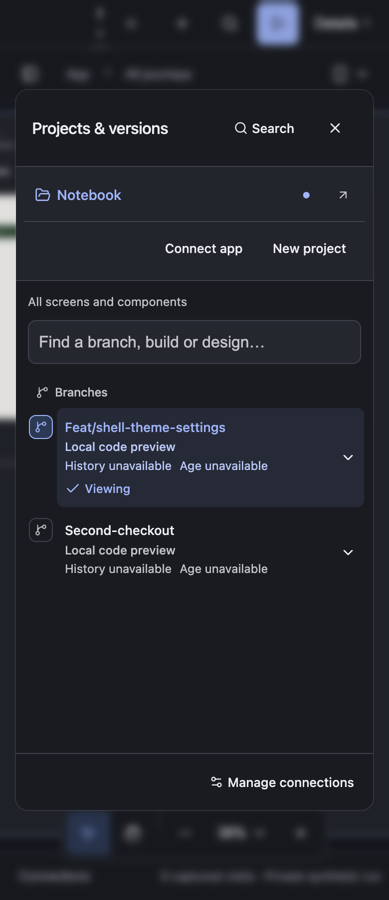

# CIVIC shell migration — 2026-10-19

Implemented and checked in the working tree on `feat/shell-theme-settings`, based on `de10c2c5f6a528b1c7537c0e10bc16dd8048c83c`. This continues the appearance/settings work; it is not a committed-HEAD signoff or publication.

## Result

- Shared shadcn/Base UI controls now cover shell buttons, inputs, selects, textareas, checkboxes, disclosures, fields, progress, status badges and alerts. Breadcrumbs, sidebar parts, sheets, settings tables and command-menu styles use the same component layer and semantic tokens.
- Desktop navigation and details are persistent sidebar landmarks below the title bar. Narrow windows use modal sheets. Closing, reopening, changing details tabs and resizing preserve mounted review drafts. Selecting a screen closes narrow navigation.
- Workspace typography is scoped to CIVIC. Canvas geometry, history graphs, arrow routing and the UI of the reviewed application remain separate concerns.
- Deleted the six superseded stylesheets: canvas `shell.css`, `review.css`, `project-picker.css`; shell `canvas.css`, `canvas-chrome.css`, `app-canvas.css`. Removed the `extension.legacy` / `?legacy=1` workspace route and the obsolete cascade layer. Historical evidence and compatibility data readers remain intact.
- `server/shell-design.check.mjs`, included in `test:host`, rejects raw active-shell controls, the removed stylesheet filenames, old style imports, fallback tokens/cascade and the obsolete route.

References: [shadcn blocks](https://ui.shadcn.com/blocks), [typeset](https://ui.shadcn.com/typeset), [directory](https://ui.shadcn.com/docs/directory), and the configured Base UI/base-nova registry components. Existing CIVIC state owns the canvas and panels; no duplicate sidebar cookie/state system or new dependency was added.

## Verification

| Check | Result |
| --- | --- |
| `pnpm --dir packages run check` | Passed all four package checks. |
| Shell unit/server tests | 7 unit and 25 server tests passed. |
| Connector tests | 58 passed. |
| Canvas unit tests | 81 passed. |
| Canvas host/browser suite | Initial run: 44/47 passed. All three failures were repaired and passed in the 15/15 host, picker and layout recheck. |
| Final layout/source guard | 4/4 passed, including contract badges, sidebar semantics, hidden backdrops and draft retention across resize. |
| Theme/settings browser acceptance | 9/9 passed with layout checks; system changes, persistence, focus, reduced motion, contrast and short-window settings were exercised. |
| Local lifecycle tests | 23 passed; 2 source-dependent actual-worktree tests remained explicitly skipped. |
| Installed Electron 44.9.0 | Final isolated-profile acceptance passed at 1440, 768, 390 and 360px: title-bar bounds, picker bounds/overflow, native Settings, themes, source checkbox interaction, navigation, checkout reuse/persistence and renderer sandbox. |
| Generated styles / diff hygiene | Styles rebuilt with Tailwind 4.3.3; `git diff --check` passed. |

The first browser pass exposed a list-specific scroll assumption, incorrect portal placement and a closed backdrop intercepting clicks. These were fixed in shared code. Later checks caught a test coupled to the removed ordered-list markup, desktop rails incorrectly announcing themselves as dialogs, and a bounding-box assertion sampling an in-progress sheet transition. Assertions retain their bounds and behavior requirements.

The older `test:desktop` script reached a previously running host whose project API rejected current picker actions. It did not establish acceptance. The successful Electron check uses current source and disposable Notebook hosts/profile; it does not reload or replace the existing user Electron session. Initial cached-image misses while fixture captures prepare, and the intentionally rejected invalid appearance preference, appear in its log. No renderer exceptions were observed in the passing check.

React Doctor 0.9.18 reported zero new diagnostics against the base (61 matched pre-existing diagnostics in the canvas scope). Its canvas score is 50 and repository-scope score is 80; those are not a claim that the entire repository is clean. The changed-file scan lists tracked files; TypeScript and browser acceptance also cover the new components. The design detector returned no deterministic findings; visual inspection was still performed.

Logs: `/private/tmp/civic-shell-migration-signoff.log`, `civic-shell-migration-repaired.log`, `civic-shell-migration-final-ui.log`, `civic-shell-migration-ui.log`, `civic-shell-migration-final-types.log`, `civic-shell-migration-shell.log`, `civic-shell-migration-local.log`, `civic-shell-migration-electron-final.log`, and `civic-shell-migration-doctor.json` in the same temporary directory.

The committed-only `bin/signoff` and package-install check were not used to certify this dirty working tree. No commits, pushes, GitHub status posts or CI runs were made. The unrelated root `package.json` and external application source/backends were left untouched.

## Visual evidence






## Final input fingerprints

SHA-256:

```text
6e1a7c8745dd75113c49143ba100e83da2a7647d1e8510b3254633b640b0b407  packages/canvas/src/app-canvas.tsx
cc2eccbc7c7d8788ae07bc9ec20bff7ec0686f3913e91d362dbe2c1702c9a18e  packages/canvas/src/workspace-rails.tsx
51cbb6816ed219285e534970850ab5fb2af50ff5be0063b9f95ca87cfe531608  packages/canvas/src/journey-outline.tsx
43df2be551d2a068347439a5eb2f811d729c67fec05cef9c463cc18c7ee20165  packages/canvas/src/workspace-inspector.tsx
ee48b7ae399b2f1846af5457396b6434d2739d425b9271ac8a310e3ba7a341a5  packages/shell/styles/workspace.css
ff6ed34343b4c9e26fac5b5ddb719c7dd66c2f7c3d026b41bcd7d94437d5b57d  packages/shell/styles/scene.css
e9e30f082b63e2161b0a5f4301d3c71b310bcc43824813b876dbf22338fc5de2  packages/shell/styles/ui.css
b4c2b4989cc26ec151702e0253dd39cfafe2c0179da942cbed8b0ca1fe031dcd  packages/shell/styles/ui.generated.css
2c29b74b82093ef3efcf2864e4422fb6b71882feefa10b36fa2a21c5c689b2f1  packages/canvas/server/shell-design.check.mjs
658570927e465d4270355de2a5b76049da3b53d3c17293567161c3b0459bf16d  packages/canvas/server/shell-layout.check.mjs
cd71265e2852456ef7cd85fb738d4d1103a27074556e380566c595818803ae77  packages/local/desktop-settings.check.mjs
```
