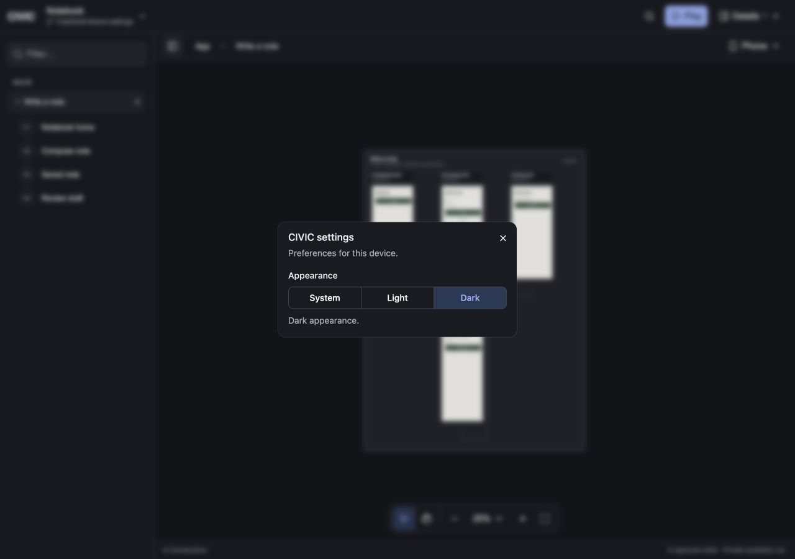
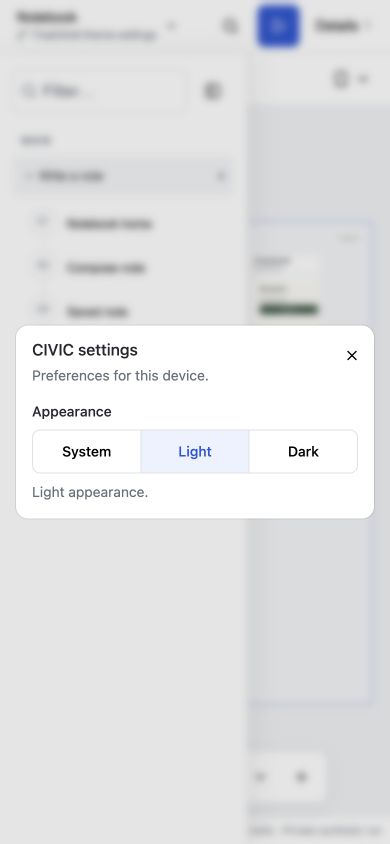
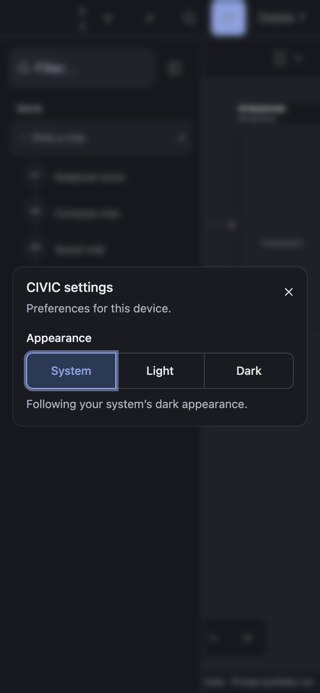

# Theme and settings acceptance

Candidate: uncommitted changes on `feat/shell-theme-settings`, based on `de10c2c5f6a528b1c7537c0e10bc16dd8048c83c`. No dependency was added, and no external application source or backend was modified.

## Behavior

- CIVIC defaults to System appearance and supports explicit Light and Dark preferences. System changes apply live; explicit preferences remain stable. Shell transitions respect reduced motion.
- Cmd+, / Ctrl+, opens the compact shared shadcn/Base UI settings dialog, including while a same-origin preview has focus. Settings is also available through Details, command search, and Electron's native application menu.
- Browser preferences persist per origin and synchronize across same-origin windows. Electron stores one validated preference in its profile, applies native window colors, and broadcasts changes to active and inactive project tabs across host origins.
- Theme changes retain the mounted preview, its own appearance configuration and unsaved draft. Closing settings restores focus, including to a preview input or an underlying project picker.
- Storage failures have an explicit status: browser changes can apply for the current window; failed Electron saves retain the previous preference.

The existing React subscription pattern and shared keyboard hook cover the requested scope. [TanStack Hotkeys](https://tanstack.com/hotkeys/latest/docs/framework/react/overview) was evaluated; adding it would not remove Electron menu handling or iframe shortcut bridging, so this change adds no shortcut or state-management dependency.

## Verification

All final commands passed:

| Check | Result |
|---|---|
| `pnpm --dir packages check` | Package TypeScript and local syntax checks passed. |
| `pnpm --dir packages test` | 81 canvas unit, 43 host/browser, 58 connector, 25 shell server, six shell unit and 23 local tests passed. Two existing Orca-source-gated local tests skipped. |
| `pnpm --dir packages/local run test:desktop-settings` | Installed Electron runtime acceptance passed. |
| `pnpm dlx react-doctor@latest --verbose --scope changed` | No findings in 13 scanned files; score 91. Root framework-specific rules were unavailable. |
| `git diff --check` | Passed. |

The five new browser checks exercise live system changes, explicit overrides, persistence, cross-window synchronization, blocked storage, contrast, reduced motion, keyboard access, focus restoration and retained preview drafts. Layout is checked at 1280, 768 and 390 px, including modal bounds and narrow touch targets. Manual browser acceptance covers the same widths, both explicit themes and the System selection.

The normal host test command now limits concurrent files to two, avoiding cold Vite startup contention without weakening assertions. The Electron test warms its disposable Vite entry points before launch and bounds process cleanup.

Local logs: `/private/tmp/civic-theme-packages-final.log`, `/private/tmp/civic-theme-check-final.log`, `/private/tmp/civic-theme-react-doctor-final.log` and `/private/tmp/civic-theme-electron-stable.log`.

## Electron

Acceptance uses installed Electron 44.9.0 at `/Users/taymoor/Projects/orca/node_modules/.pnpm/electron@44.9.0/node_modules/electron/dist/Electron.app/Contents/MacOS/Electron`, loading this checkout's `packages/local/desktop.mjs` with isolated temporary profiles and disposable hosts.

Verified native Settings menu/accelerator, desktop and 390 px settings, cross-origin checkout inheritance, updates to hidden tabs, System notifications, invalid preference rejection, persisted Dark after relaunch, sandboxing, context isolation and disabled renderer Node integration. Expected fixture cache misses occur before snapshots are generated; the rejected invalid preference is intentional test coverage.

## Limits

- This proves the source-loaded installed Electron runtime, not a newly signed or packaged binary. The existing user Electron window was left untouched; it has not been reloaded for this feature.
- System changes were exercised through browser emulation and Electron native-theme notifications without changing the Mac's global appearance setting. Physical touch devices, Windows and Linux were not tested.
- Changes remain uncommitted. No GitHub CI, commit status or publication was dispatched.
