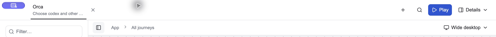

# Electron title-bar spacing and dragging — 2026-10-19

The desktop header is now 60px high at wide and narrow sizes, with 48px project tabs and vertical padding. macOS traffic lights and the Windows controls overlay follow the taller header. The tab-strip container uses Electron's drag region; interactive controls retain explicit no-drag regions. Browser header sizing is unchanged.

The previous tab-strip-wide no-drag rule prevented dragging from its empty space. The regression checks now assert a draggable tab strip, clickable header buttons, 60px header bounds and no horizontal overflow at 1440, 768, 390 and 360px.

Verification:

- `pnpm --dir packages/shell run build:styles` passed; generated styles are included.
- `pnpm --dir packages/canvas check`, `node --check packages/local/desktop.mjs` and `git diff --check` passed.
- `CIVIC_ELECTRON_BINARY=<installed Electron 44.9.0> pnpm --dir packages/local run test:desktop-settings` passed. Its current-source fixture also exercises checkout switching, picker controls, source checkboxes, settings, theme changes, draft/default persistence and renderer sandboxing. Log: `/private/tmp/civic-titlebar-electron.log`; fixture evidence: `/private/var/folders/fd/hz_x5rk15t31rk4cv4mx047w0000gn/T/civic-electron-settings-x9XypY`.
- Reopened the installed source-backed launcher on the same host/profile after normal quit. Exercised native dragging from empty header space and opened/closed its project picker. The remembered Orca checkout and registered journeys loaded. Its host and saved data were preserved.

Native window displacement was exercised through computer-use input; the automated regression checks assert Electron drag-region styles, rather than measuring OS window displacement. Windows native controls were updated in code but not executed on this Mac.

The shipping gate is `bin/signoff --no-post` against the exact committed candidate in a clean detached checkout. Its log is `/private/tmp/civic-titlebar-signoff.log`; the candidate must pass before landing on main and pushing. The unrelated untracked root `package.json` remains in the primary checkout and is excluded from the commits and signoff inputs.

