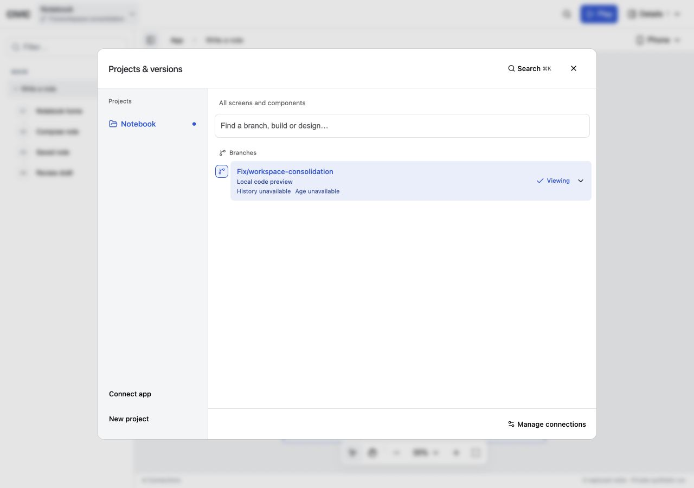
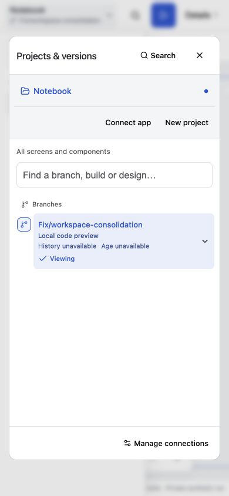
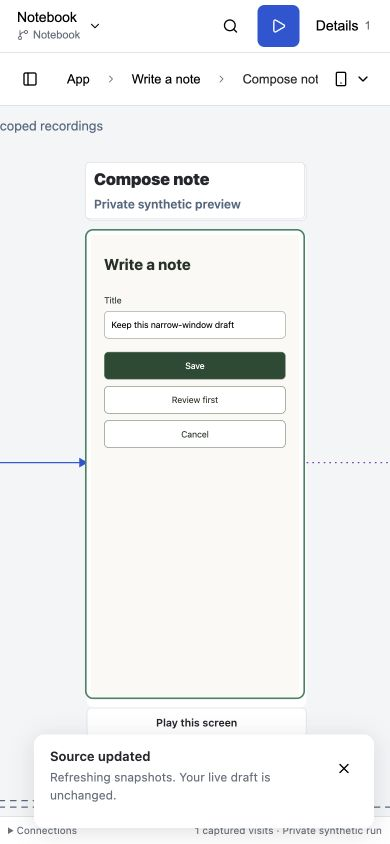
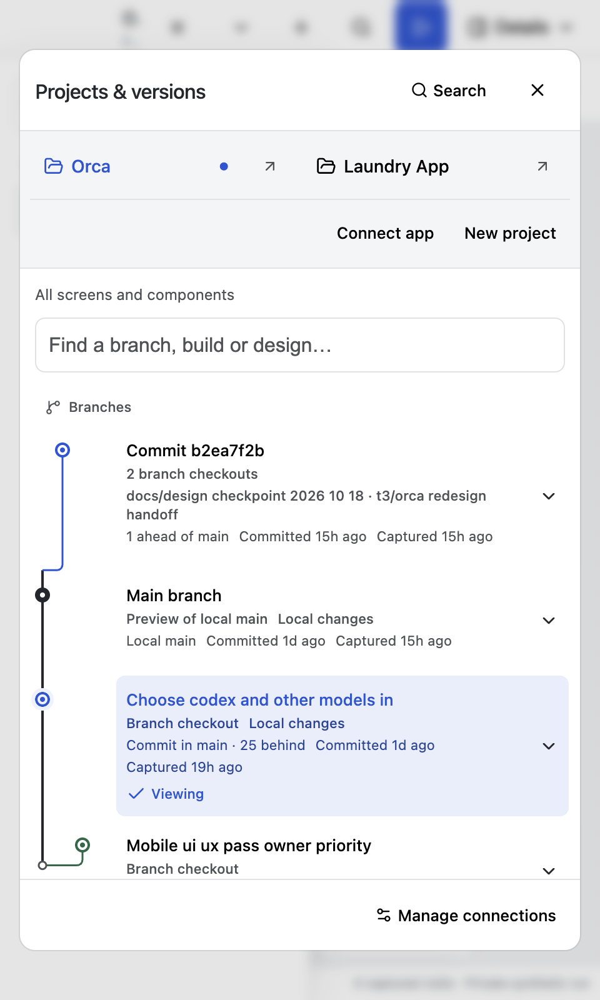

# Workspace consolidation acceptance

Code candidate: `605075c49e2384467477a003bfad1724601c7ec1`, following the already published checkout-tab baseline `b757d34`. Root implemented the six approved plans sequentially; no external application checkout or backend was modified.

## Result

- Header, inspector, commands and standalone controls share the viewport controller. Device identity survives rotation; custom dimensions clear obsolete preset identity. Resizing retains the iframe and draft.
- Review requests share project binding, cancellation and status-aware errors. Version loading is scoped to the selected app, paged at ten rows, limited to four metadata workers, and lazy about preview expansion and comparisons.
- Configured availability and source-bound mounted readiness remain separate. Unsupported resize/replay stays disabled with its reason. Orca dependency checks resolve the exact runtime snapshot without executing application code.
- Shared shadcn/Base UI primitives own control styling; shell chrome owns layout and title-bar drag regions. The existing canvas camera, arrow router, history graph, runtime protocols and package exports remain authoritative.
- AppCanvas composes separate inspector, header/map bar, scene, selection, preview-session and picker-data owners. Capture failures, pending saves, dirty drafts, listener cleanup and replay guards survive the extraction.
- Real app source edits now refresh inventory/snapshots and display a short toast without Vite reloading the mounted draft. Engine HMR remains available. This fixes a defect found during final manual acceptance.

## Verification

Integrated package typechecks and tests passed, including the real source-edit follow-up: 81 canvas unit tests, 38 host/browser checks, 58 connector checks, 25 shell server checks, six shell unit tests and 22 local checks. Two local checks requiring an explicitly supplied Orca source were skipped.

Clean-checkout `bin/signoff --no-post` passed for `605075c49e2384467477a003bfad1724601c7ec1`; full local log: `/private/tmp/civic-signoff-consolidation-code-final.log`. It includes graph, review, crawl, importers, example graphs, the civic gate, all package checks and a fresh Git-package install into an empty app. Publication waits for a successful signoff of the final documentation commit as well; its log will be `/private/tmp/civic-signoff-consolidation-final-head.log`. No GitHub CI or commit status was dispatched.

The first clean run at `e8c6639` failed on a transient Pantry React hook error; the focused reproduction and subsequent Pantry runs passed. Failure collection now retains its stack. A subsequent full host-file diagnostic found a separate test race: row count was sampled after clicking Post. `605075c` samples before the action and preserves the two-post assertion. No retry, suppression or weakened assertion was added.

React Doctor scored 74 with seven reviewed warnings: ordered fixture awaits, bounded inventory worker loops, small array lookups and index keys for immutable captured field rows. No suppressions were added. Its framework-specific rules were unavailable from the repository root; package typechecks and actual browser tests supply the React verification.

## Browser and installed Electron

The layout suite checks Notebook and guided Pantry at 1280×900, 768×900 and 390×844, including focus visibility, touch target sizing, hidden panes, popovers and a scrollable picker with its footer visible. Manual browser checks cover picker disclosure versus selection, viewport controls, Cmd+K focus return and the source-update toast. At 390 px, editing a disposable fixture file retained the unsaved draft and displayed the toast without a permanent header banner.

Installed Electron 44.9.0 acceptance passed at 1440×1000, 480×800 and the 360 px minimum width. It verifies distinct checkout tabs, same-checkout reuse, retained filtering, inactive-view polling suspension, last-lease host cleanup, dirty-close cancellation, overflow, sandbox/context isolation and disabled renderer Node integration. The title bar remains at most 40 px on desktop and 48 px in the narrow layout.

The installed runtime is `/Users/taymoor/Projects/orca/node_modules/.pnpm/electron@44.9.0/node_modules/electron/dist/Electron.app/Contents/MacOS/Electron`; it loads CIVIC's `packages/local/desktop.mjs`. This is a source-loaded launcher, not a newly signed/packaged CIVIC binary. Acceptance used the task-owned host on port 39051 and an isolated profile.

The existing user Electron window was inspected separately and remained in a loading state. Automatic approval review rejected reloading it because that could lose tab state; it was left untouched. Existing browser hosts on 3012/58966 and Electron hosts on 38951/57649 were preserved. Temporary manual browser tabs were closed and viewport overrides reset.

## Limits

- Windows, Linux, physical touch devices and actual Orca build/backend acceptance were not run. Static installed-Orca Effect resolution passed, but does not prove every external worktree can execute.
- GitHub's original 18 dependency alerts are closed. Alert [19](https://github.com/taymoork2/CIVIC/security/dependabot/19), `braces` through the Tailwind development-tool chain, remains high severity with no patched version listed at verification time; no speculative override was applied.
- Existing user-window reload remains an explicit approval boundary. Installed-runtime acceptance does not claim that preserved window has reloaded the new launcher.

## Ordered code commits and review intent

| Commit | Conventional subject / review intent |
|---|---|
| `e808acc` | `fix(canvas): share viewport state across workspace controls` — keep all viewport entry points synchronized without replacing drafts. |
| `8629a50` | `refactor(canvas): share scoped review request handling` — retain project, cancellation and error semantics in one request helper. |
| `39f9053` | `perf(canvas): bound version picker loading by project and page` — avoid indexing all projects and expanding all previews. |
| `3c86d58` | `fix(connector): preserve the shell server import boundary` — reuse the existing public server seam. |
| `f5f80ea` | `fix(preview): report source-bound readiness and capabilities` — distinguish readable configuration from a working preview. |
| `18830a9` | `fix(canvas): preserve selected device identity through rotation` — retain explicit device selection across dimensions and reload. |
| `b072d2c` | `refactor(shell): consolidate chrome and control styling ownership` — remove conflicting overrides while retaining legacy host fallbacks. |
| `ea7b986` | `fix(preview): retain draft and capture replacement guards` — stop failed captures and unsaved drafts being discarded. |
| `138813d` | `test(canvas): wait for mounted previews before fixture actions` — interact only after the adapter reports readiness. |
| `cf13506` | `refactor(canvas): separate workspace inspector presentation` — move pane rendering without changing lifecycle ownership. |
| `0a46d68` | `refactor(canvas): separate workspace header composition` — isolate header/map-bar presentation. |
| `c4998d1` | `refactor(canvas): isolate preview session ownership` — keep frame, capture and replay guards together. |
| `b4a3082` | `refactor(canvas): isolate canvas navigation ownership` — retain selection/camera coordination in one hook. |
| `1ec765b` | `refactor(canvas): separate canvas scene presentation` — preserve stable frame keys and the existing router. |
| `7d0f852` | `refactor(canvas): isolate paged project version loading` — keep cancellation, cache and request budgets together. |
| `e8c6639` | `refactor(canvas): remove obsolete workspace wiring` — remove the extraction's unused imports and props. |
| `0a2da39` | `fix(connector): preserve live drafts during source refresh` — suppress app-source HMR reloads and exercise a real file edit. |
| `605075c` | `test(canvas): count posts before submitting browser actions` — eliminate a count-after-action race and retain error stacks. |
