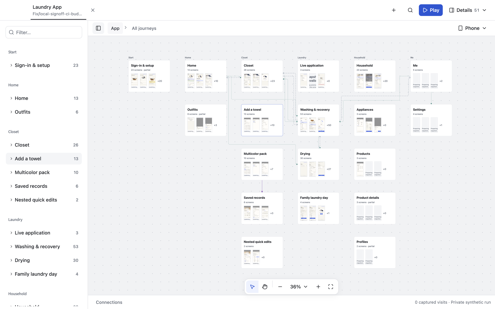
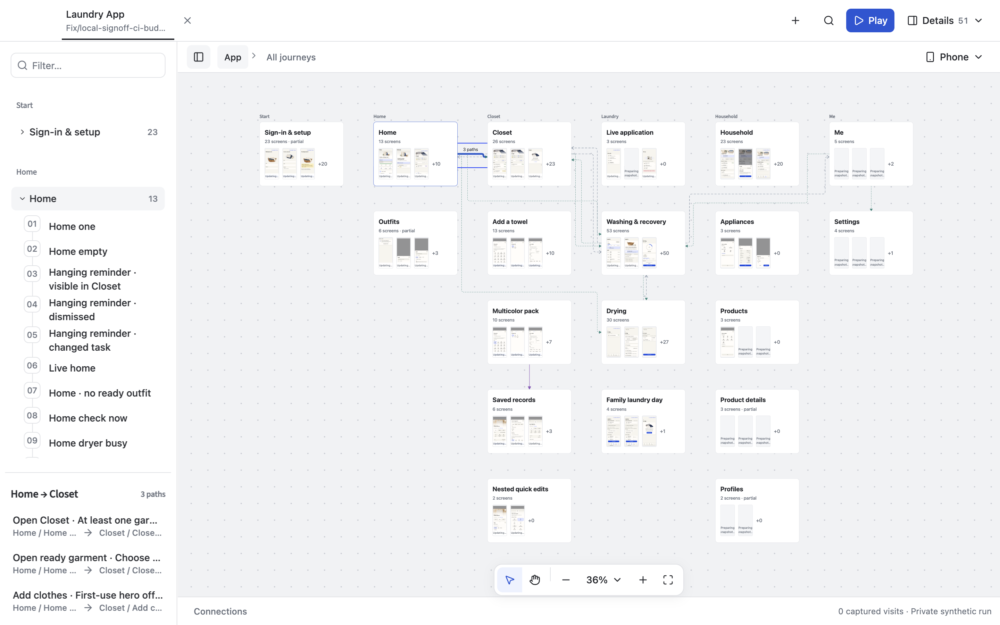
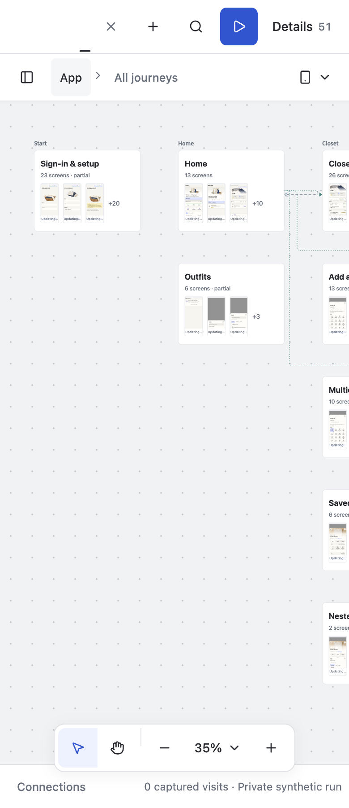
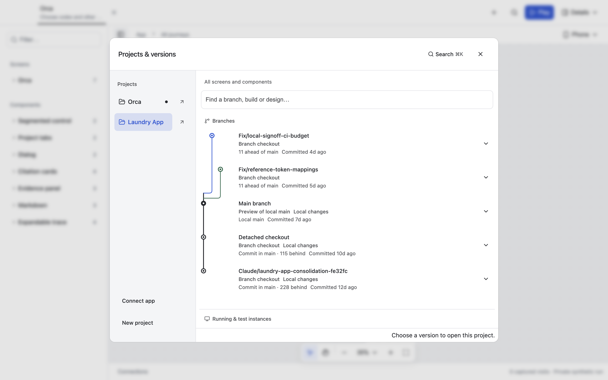

# Journey connections and history rail polish

Candidate: uncommitted changes on `fix/laundry-source-history`, alongside the existing Laundry integration work. External application sources and the original live Laundry run were preserved.

## What changed

The compact map previously rendered screen-level routes and full action labels at journey scale. Returns used the same distant gutters as the detailed canvas, producing large loops and overlapping text.

The overview now routes one relationship per journey pair, interaction type and conditional/nonconditional category. Every original screen path, action, condition and return target remains in the selectable group. The real Laundry view consolidated 25 rendered screen paths into 14 journey relationships. Navigation, updates and returns remain distinct; conditional paths are not merged into unconditional ones.

Overview returns use local obstacle-avoiding routes. Shared paths retain rounded corners and non-scaling strokes. Labels appear on hover, focus or selection, with a background stroke for readability; overview labels show compact path counts. Selecting a relationship opens its original actions in the existing shared navigation panel. Different actions and conditions remain distinguishable there, including through accessible names and full tooltips.

The Git history rail uses 20px lanes and rounded joins. Ahead branches leave main in an order that prevents an outer branch from cutting across an inner lane. Canvas and history reuse `arrowPath`; no new graph framework or dependency was added.

References consulted: [ELK orthogonal routing](https://eclipse.dev/elk/reference/options/org-eclipse-elk-edgeRouting.html), [edge/node spacing](https://eclipse.dev/elk/reference/options/org-eclipse-elk-spacing-edgeNode.html), and [React Flow edge labels](https://reactflow.dev/learn/customization/edge-labels). These were design references, not adopted libraries.

## Verification

- All 84 canvas unit tests passed. Focused tests cover original connection identities, interaction types, conditions, obstacle avoidance, compact accessible labels and noncrossing history forks.
- Canvas TypeScript checking and shared stylesheet generation passed.
- Changed-code React Doctor scan: no issues reported; existing package score remains 63.
- Isolated browser smoke check passed with a live Notebook preview and the existing caption regression.
- Actual Laundry Electron acceptance passed at 1440, 768, 390 and 360px: overview grouping/counts, no horizontal document overflow, retained paths through zoom/pan, nonempty hit geometry, mouse hover/click, keyboard focus/selection, action-list counts and opening the original screen path for review.
- Orca and Laundry history graphs passed at the same four Electron widths, including actual SVG paths and picker bounds.
- Native inspection of the installed source-backed launcher confirmed the quieter overview. A fresh window of the same Laundry checkout was opened for review; the original live run remained in its existing window.
- The focused diff was reviewed manually without rewriting or staging the earlier integration changes. No commit or push was performed.

## Limits

This is a scoped presentation/routing refinement, not a replacement DAG layout engine or a claim that every possible graph has zero crossings. Physical touch devices, Windows/Linux Electron and production environments were not exercised. Snapshot preparation/availability is separate from this change. All changes remain uncommitted.
