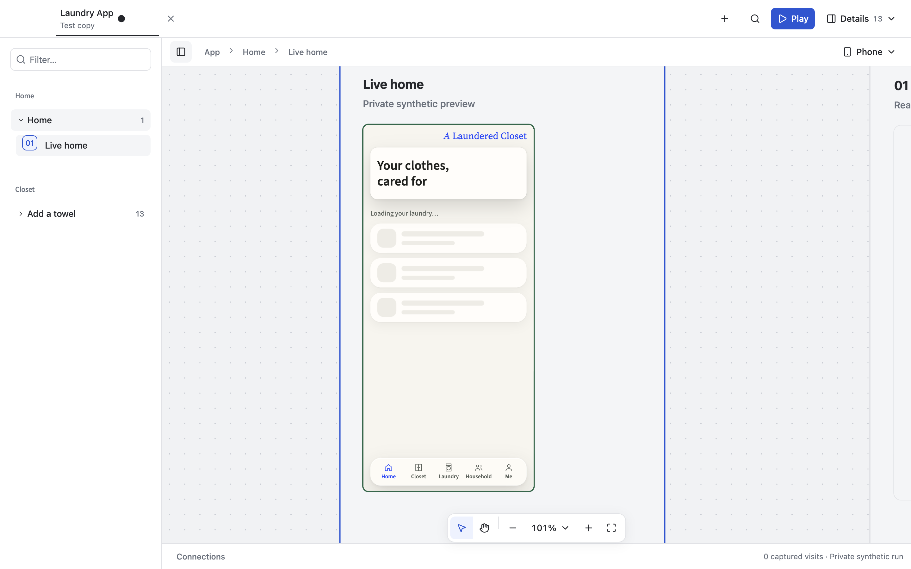
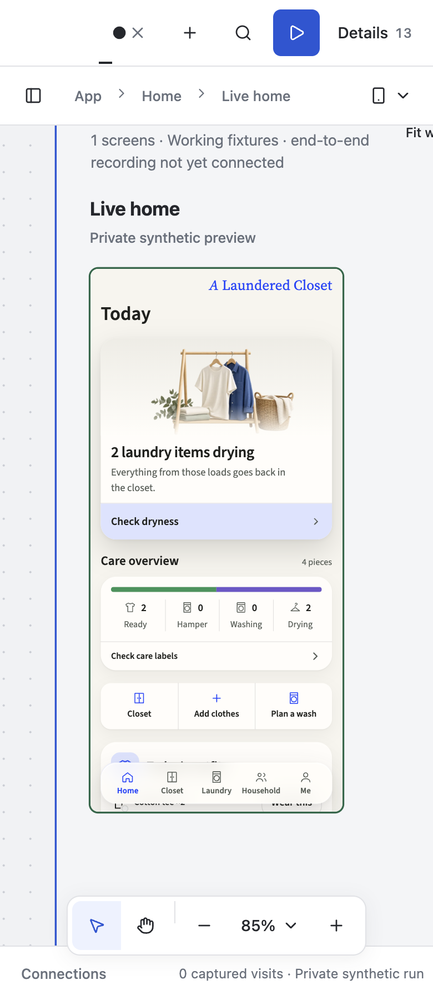

# Gondolin feasibility: one Laundry preview

**Decision: keep experimental; do not integrate into CIVIC yet.** The Linux VM can run the existing Laundry connector and isolated runtime and display Home in Electron. Read-only source, denied egress and disposable-state cleanup passed. Cold loading and refresh were unreliable, and stricter fully rendered acceptance failed. This is a completed feasibility investigation, not a product signoff.

## Scope and provenance

- CIVIC checkout: `fix/laundry-source-history`, base `9124dbf8791d6d39fb59c27270f70fb05ace1dd0`, including the existing uncommitted runtime/UI work. No application code or dependency was changed for this spike.
- Laundry source: `/Users/taymoor/.codex/worktrees/c15d/laundry-app`, commit `8ec1724605f733043feac1c708b827ecf408992b`. Git HEAD and clean status matched before and after. The actual checkout was only read; the guest saw a staged copy, with `.git`, environment files and credential configuration excluded.
- Gondolin `0.13.0`, Homebrew QEMU `11.1.2`, macOS ARM64 HVF, 2 vCPUs, 3 GiB configured RAM, disposable 8 GiB copy-on-write disk. Alpine 3.23 guest, Node 24.18.1, system Chromium 149.0.7827.53. Electron 44.9.0 used CIVIC's actual desktop entry with separate temporary user data.
- One target live scenario, `app.home`, used the real Laundry source and shared `laundryRuntime`, `dependencyAliases`, `previewDependencies` and `canvasPlugins`. The Laundry canvas extension still displayed auxiliary towel fixtures. This was not a minimal one-node shell or a full-project benchmark.
- Setup network access allowed GET/HEAD to the npm and Alpine registries. Runtime egress was denied. The host ingress bound only to loopback. Existing CIVIC host, installed app and external worktrees were preserved.

## Measurements

These are exploratory observations on this Mac, not percentile benchmarks or a comparison with a matched native-host workload. Final diagnostic runs enabled Gondolin logging.

| Measurement | Observed result | Boundary |
| --- | --- | --- |
| First image acquisition and first guest command | 14.85 s | Excludes application dependencies and Chromium setup |
| Linux dependency setup | 18.00 s | Fresh resolution; not a frozen-lockfile build |
| Cached guest ready | 0.82–0.92 s in the three saved server starts | Additional diagnostic starts reached 1.37 s; `VM.create()` itself is lazy and is not the boot metric |
| Cached server ready | 3.82–7.73 s from controller start | Uses prepared disk checkpoint; excludes opening Electron |
| Warm Electron shell | 3.16 s | Canvas mounted; does not prove every application query finished |
| Warm Home frame ready | 3.10 s after navigating to Home | `data-rehearsal-ready`; a later screenshot still caught the loading skeleton |
| Warm reloads | 2.46, 2.19, 2.30 s | Same frame-ready condition; stricter hydrated acceptance was unreliable |
| Host-edit hot reload | Failed to arrive within 15 s | Edited only a CSS marker in the owned temporary mirror; direct HTTP read saw the new content |
| Reload after that edit | Failed a 20 s readiness check | No reliable edit-to-render latency established |
| QEMU physical footprint | 1.9 GiB earlier; 2.4 GiB at final teardown | Includes guest memory that macOS process RSS misses |
| Controller physical footprint | 258–296 MiB | Rough combined VM/controller cost: 2.2–2.7 GiB, excluding Electron |
| Shutdown | 101 ms | Both owned processes gone, port closed, disk and six sockets removed |

Full cold provisioning was not timed as one reproducible operation. Browser installation added about 696 MiB of guest packages. The temporary experiment occupied 2.6 GiB before removal. QEMU and its Homebrew prerequisites remain installed; no Gondolin dependency was added to CIVIC.

## Electron verification and failures

The successful warm attempt rendered the actual Home application and exercised three reloads. Window widths 1440 and 390 passed the document-overflow assertion. The narrow screenshot shows Home content; the desktop screenshot caught the loading skeleton. These prove display/containment, not complete visual or functional acceptance. The narrow title bar also loses useful project context.

Material failures retained in the evidence:

1. Initial guest configuration returned 404s for optimized React modules with a cache directory outside the prepared workspace. Moving the cache under writable `node_modules/.vite` corrected those requests.
2. Cold frontend requests intermittently returned 502. Individual subsequent HTTP requests were fast. Attribution between ingress, source-file transport, compilation and logging remains unresolved.
3. The original capture adapter attempted the desktop Chrome channel. The spike supplied Alpine Chromium and the guest loopback origin explicitly. Earlier captures returned 503; auxiliary fixture requests still returned 400 in the successful warm attempt. Capture acceptance is incomplete.
4. CSS edits in the temporary mirror became readable but did not yield reliable automatic or explicit refresh. The live iframe document survived the initial edit wait. This does not establish safe arbitrary code updates or recorded-run reproducibility.
5. A stricter final attempt waited for actual Home content in addition to frame readiness and timed out. It also recorded a runtime 502. The successful earlier frame-ready timings therefore must not be presented as a clean application-load benchmark.

## Isolation and disposal

Guest writes to both the source mount and the application-source path returned `EROFS`. The guest received no host environment files or Git metadata. A fresh checkpoint resume had no `/work/store/.review-data`, rejected source writes and returned HTTP 403 for external access. This checks the configured boundaries; it is not an exhaustive VM escape audit.

The final preview's controller, QEMU process, loopback port, temporary overlay and sockets were verified gone. The session registry was empty. No spike-owned Electron processes remained. The prepared checkpoints, staged source, profiles, downloaded image and temporary SDK were then removed with the exact owned temporary workspace. Evidence below is retained in the repo.

## Active local worktrees

CIVIC should manage Git identity and source freshness. Gondolin should execute a supplied preview; it should not own the developer's Git operations.

- **Default for reviews and recordings:** capture the selected checkout into an immutable source snapshot, including intentional dirty-file content. Identify it with repository, commit and a content digest. Continue running that snapshot while the developer edits the host worktree.
- **Refresh:** detect a newer source digest and offer an update. Start a new preview from the newer snapshot on explicit refresh. Keep an existing recorded run tied to its original source and journal.
- **Optional development mode:** a read-only live mirror can receive host changes while guest dependencies, caches and runtime data stay disposable. This spike did not establish reliable hot reload, so that mode should remain experimental. Worktree changes do not authorize guest writes back into the host.
- Branch switches, dependency-lock changes and source deletion require rebuilding/restarting the preview, with existing runs retained or explicitly closed. Avoid continuously indexing or provisioning inactive worktrees.

Gondolin would be an optional Linux execution backend. It does not replace CIVIC's shared Git/history logic or supply native iOS/macOS execution.

## Before reconsidering integration

Use a pinned guest image and frozen Linux dependencies, make the one-preview capture path clean, and resolve the cold 502 and edit-to-render failures. A frozen copy on the guest's own filesystem is a useful next comparison against the polling host-file mount. Repeat fully hydrated Electron acceptance with debug logging disabled, then compare startup and physical footprint with a matched existing-host preview. Stop before broad project support or UI integration until those checks pass.

## Retained evidence

- [Measurements, failures, provenance and cleanup assertions](assets/2026-10-20-gondolin.json)
- [Guest configuration](assets/2026-10-20-gondolin-guest.mjs.txt), [VM controller](assets/2026-10-20-gondolin-preview.mjs.txt), [Electron diagnostic check](assets/2026-10-20-gondolin-electron.mjs.txt), [cleanup check](assets/2026-10-20-gondolin-cleanup.mjs.txt). These are captured diagnostic scripts, not a turnkey provisioning feature; setup required manual dependency-layout repairs.
- [QEMU footprint before teardown](assets/2026-10-20-gondolin-footprint-59234.txt), [controller footprint](assets/2026-10-20-gondolin-footprint-59161.txt).
- Upstream investigated: [Gondolin](https://github.com/earendil-works/gondolin).
