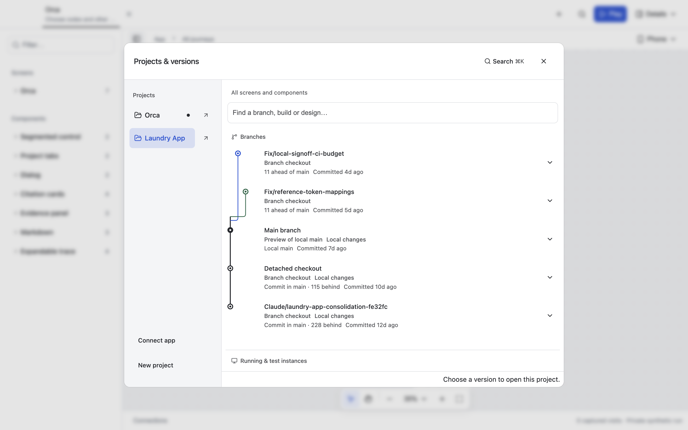
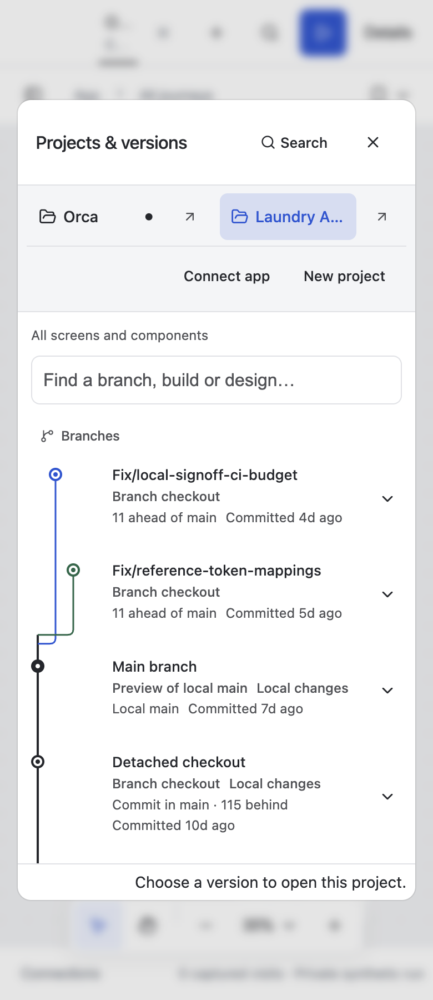

# Laundry Git history and live captions

Candidate: `fix/laundry-source-history`, based on `9124dbf8791d6d39fb59c27270f70fb05ace1dd0`. Changes are uncommitted.

Laundry now discovers implementation checkouts from `/Users/taymoor/Projects/laundry-app` through the same cached, read-only worktree discovery used by Orca. The existing isolated test copy and its saved evidence remain available. Source checkouts are never installed into or edited by preview setup.

The real `fix/local-signoff-ci-budget` checkout at `8ec1724605f733043feac1c708b827ecf408992b` ran with compatible dependencies from the managed preview installation. Its history reports 11 commits ahead of **local** main. Runtime tests mutated one synthetic run and verified that a second run's database and the source checkout were unchanged. This is synthetic runtime isolation, not a VM security boundary.

## Verification

- Connector tests passed, including per-project refresh caching and Git fallback for implementation checkouts without capture receipts. Running instances and invalid receipts do not borrow Git HEAD or fabricate capture ages.
- Local portable tests passed: 26 passed, 2 optional Orca source checks skipped. Actual Laundry runtime isolation passed against the checkout above.
- Canvas runtime tests passed, including worker isolation and TypeScript package exports.
- Electron's real Laundry picker passed at 1440, 768, 390 and 360px, with branch relationships, commit ages and no horizontal overflow. The isolated Electron settings/history fixture also passed.
- Canvas type checking and local syntax checks passed.
- The broad canvas host run had five browser-readiness timeouts under concurrent load. All five passed serially with unchanged assertions and timeouts; the other 43 checks passed in the original run.

## Caption regression

The reported doubled title came from the static screen article remaining visible beneath the persistent live-session article. The shared canvas now hides the covered static article while the live session owns that screen. The live iframe remains mounted independently as navigation changes.

A browser regression verifies one visible caption at 1280 and 390px. The real Electron Laundry `Home · no ready outfit` preview was reopened and visually checked at 101% zoom: one heading and one preview label, with the app loaded beneath them.

## Limits

Older Laundry checkouts with incompatible layouts or dependency pins are reported unavailable rather than modified automatically. The comparison uses local main; no source repository was fetched. Actual Orca source-specific checks could not pass against `/Users/taymoor/Projects/orca` because the expected settings fixture and installed Base UI package were absent. Shared worktree behavior is covered by portable regressions.

The installed Electron launcher uses this workspace's source. No new packaged installer was produced. Manual in-app browser inspection was unavailable because its URL policy rejected the local tab; isolated browser tests and native Electron checks supplied the acceptance evidence. Gondolin was evaluated but not added: Git discovery does not require a VM, and stronger execution sandboxing is separate work.
