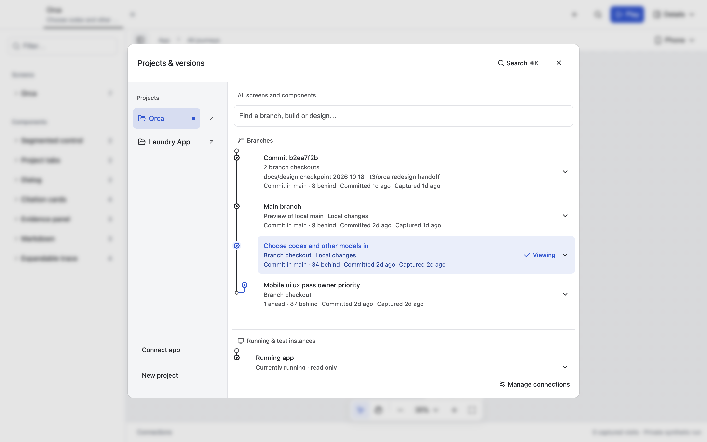
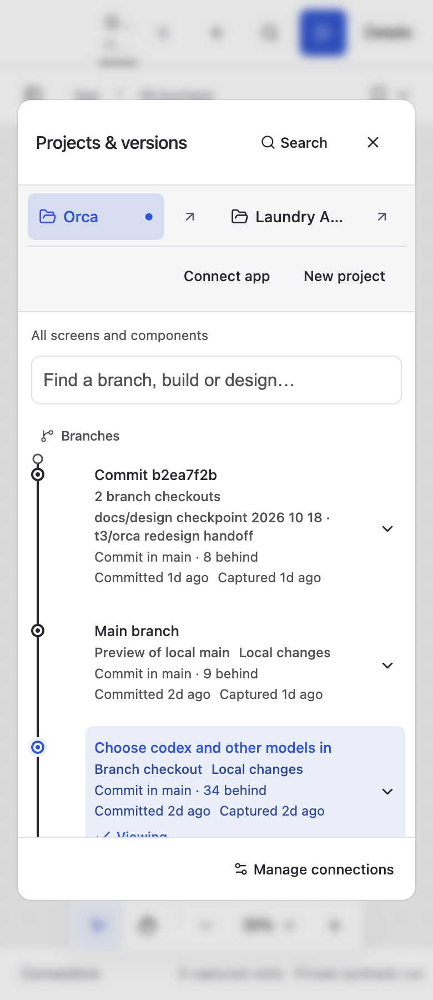

# History graph when main has advanced

The picker had verified ancestry metadata but no graph whenever current local main was newer than every captured preview. `previewVersion` correctly kept each capture's recorded revision. None of those revisions equalled `baseKey`, so `historyConnections` had no visible comparison node and `HistoryList` fell back to icons.

The shared renderer now adds a comparison reference for a verified, missing local-main revision. It is a graph anchor with a tooltip, not a selectable preview or an invented capture. Included commits keep the main lane; diverged branches retain separate lanes. Unknown ancestry produces no reference. Reference nodes have no commit timestamp and do not reorder captured versions.

## Verification

- The new focused regression failed before implementation and passes afterward; all eight history tests pass.
- Canvas TypeScript checking passes.
- Real Orca and Laundry picker checks pass at 1440, 768, 390 and 360px in an isolated Electron profile. Assertions inspect actual SVG paths, not only the accessible graph label, plus modal bounds and horizontal overflow.
- The installed source-backed Electron launcher was refreshed on its Orca tab only. Native inspection confirmed the original screenshot's branches now show a graph in their existing order. Laundry's live tab remained open.
- Review was scoped manually because the branch already contained the Laundry integration work. No unrelated source changes were staged or committed.

## Releases and environments: existing seams and proposed UI

This part was researched, not implemented or connected to external services.

`graph/src/schema.ts` already defines release lines and environment records; `graph/src/lens.ts` resolves a release/branch revision against an environment's last observed revision. The picker currently reads connected previews rather than these graph records. Reuse those records instead of adding a second release model.

Keep Branches, Releases and Environments distinct. A release can list a published version, publication age, platform/channel, asset links or digests, and a source revision where the publisher provides verifiable provenance. An environment identifies where a particular revision or release was observed. Do not infer a source SHA from a version name or a mutable branch label.

GitHub's [release API](https://docs.github.com/en/rest/releases/releases) can supply read-only release metadata; plain Git tags are not automatically published releases. Other distribution providers can map into the same records. Discovery should not install or execute assets automatically.

For deployed web apps, start with metadata or team-supplied screenshots. Interactive acceptance belongs on a preview/staging environment with test accounts and isolated backend data. CIVIC's existing web crawl driver restricts requests to same-origin GETs, but that is not a guarantee that a production backend cannot change state. A fresh [Playwright browser context](https://playwright.dev/docs/auth) isolates client state, not the remote service.

`crawl/src/appium.ts` already has Android/iOS crawl plumbing, not verified macOS/TV runners. [Appium's driver ecosystem](https://appium.io/docs/en/latest/ecosystem/drivers/) provides platform-specific options including desktop and TV. Native acceptance should use simulator/emulator builds or dedicated devices configured for test backends; creating a new automation session does not isolate production data.

No production URLs, distribution credentials, App Store/TestFlight/Play accounts, physical devices or new native drivers were exercised. Changes remain uncommitted.
