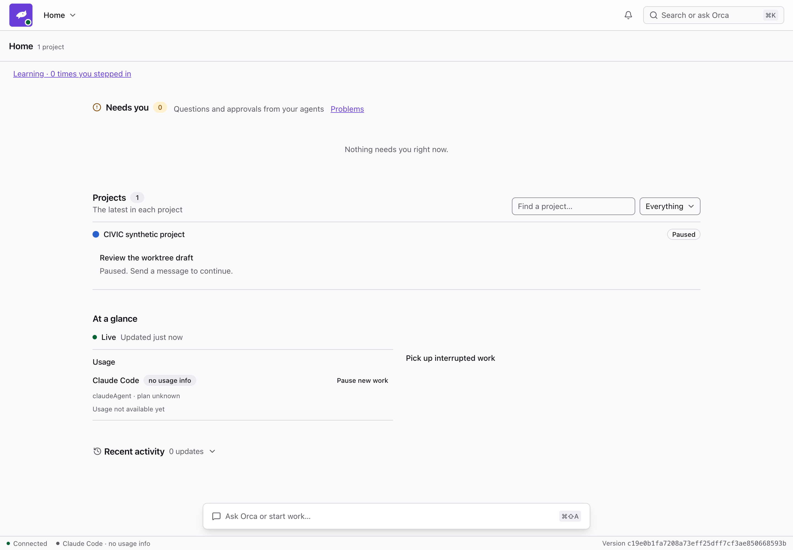
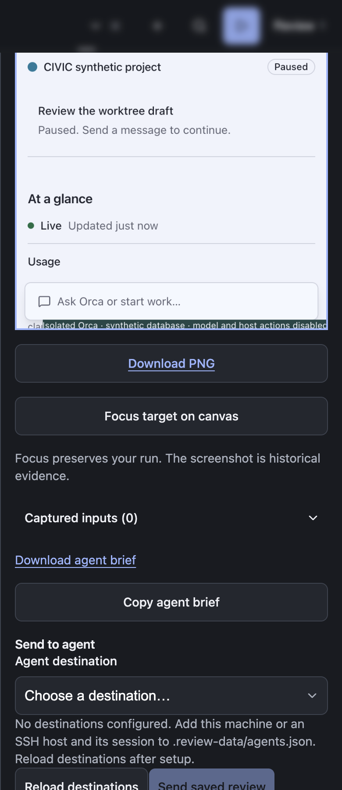

# Redesigned Orca checkout preview

The CIVIC Orca adapter now builds React/TanStack Router checkouts as frozen previews. Source, dependencies and the T3 database stay read-only. Gondolin remains experimental and is not used here.

## Source and ownership

- T3 chat: **Post-redesign backlog + dev dogfood**, `mcp:7ae9282c-2c97-4fa3-9760-e28651563369`.
- Branch: `feat/post-redesign-backlog`.
- Checkout: `/Users/taymoor/.t3/worktrees/orca/feat-post-redesign-backlog`.
- Tested content/adapter hash: `34662c298f43530dd239c85d7ffa54315a20771380ea78f2f9356880d742161e`.
- Source commit: `c19e0b1fa7208a73eff25dff7cf3ae850668593b`.
- Stable manifest: `.civic-canvas/projects/orca-worktree-817171f41d5a/civic.project.json`.

Local configuration restricts Orca preview compilation to this checkout with `orcaPreviewSources`. The installed **Running app** connection remains distinct. Reopening Versions checks the selected checkout again; it does not switch or write its branch.

## Implementation boundary

CIVIC copies allowlisted inputs, including uncommitted changes, into its own build directory. It installs the frozen lockfile offline with scripts disabled. Only that copy's `packageManager` field is removed to use the available pnpm instead of downloading another manager. React, TanStack Router and Tailwind plugins come from the captured dependencies. Solid checkouts retain their existing adapter.

Eleven supported, declared routes have real route-file identities: Home, Project and assistant, Work detail, Session transcript, Project settings, App settings, Add project, Projects, Learning, Project learning and Problems. React previews do not register the old Solid component fixtures or offer their old authored UI assertions.

Inventory, assets and runtime use the tab's explicit project connection, independently of the shared workspace selection. This matters when replacing a tab: changing its label alone cannot change which source supplies its preview. A regression check deliberately gives the workspace an unavailable default project while opening the valid explicit connection.

Each run uses Orca's actual store/runtime with synthetic SQLite and a disposable project directory. The dispatcher never starts. Provider, shell, harness, restart and outside-path commands are refused. Terminal socket requests return an explicit unavailable message. Source changes do not invalidate an already frozen preview. A failed compilation or changed-during-build attempt retains the previous preview and removes its unpublished build directory.

Learning, Problems and house rules read their real runtime views from the synthetic database; seen markers only update synthetic work items. The provider catalog returns no harnesses/accounts and never probes this Mac. Read replies do not emit replacement snapshots, preventing a read → snapshot → read loop in the React UI. Mutation replies still refresh the snapshot. Startup refusal toasts are checked separately from uncaught page errors.

## Verification

- Local adapter/controller suite: 31 passed, 3 opt-in integrations skipped.
- Connector suite: 60 passed, including shared-host/project-selection regressions.
- Separate actual-Orca runtime check: settings read/write works; query mutations, host/provider commands and outside-path project writes are refused; sessions remain detached.
- Electron 44.9.0 acceptance renders all eleven screens from the captured build and confirms synthetic project data and no running sessions.
- The final run uses commit `c19e0b1fa7208a73eff25dff7cf3ae850668593b` and exercises an explicit tab connection while its shared workspace points elsewhere.
- A Home fixture capture saves a 786 × 1704 PNG for a 393 × 852 viewport. Saved review bytes match the downloaded PNG, and agent-brief export succeeds.
- The review panel fits 1440 px and 390 px Electron windows without document overflow; no page errors were collected.
- Canvas TypeScript and local syntax checks pass.

[Machine-readable acceptance](assets/2026-10-20-orca-react-result.json) · [Exported synthetic review](assets/2026-10-20-orca-react-handoff.md)

Installed Electron was left on **Orca · Feat/post redesign backlog**, playing the synthetic Home screen: [installed window](assets/2026-10-20-orca-react-installed.png).

## Feedback loop and limits

Click the active Orca tab, find **Feat/post redesign backlog**, expand it and choose **Switch**. This replaces the current tab; **+** opens a second checkout. Capture a screen, add a comment and copy/download its agent brief. Paste that brief into the owning T3 chat, then refresh the preview to check the correction. The exported brief carries the original checkout, commit, content identity and frozen evidence.

No synthetic acceptance message was sent to the T3 chat. Direct dispatch to a T3 `mcp:` ID is not implemented. Model-routing RPCs, actual terminal/provider execution, complete backend acceptance and native Orca APIs require Orca's own checks. The exported test brief contains temporary localhost links; its host is closed after acceptance, so it is historical evidence rather than a live reopening link.

Rebuilding an already open checkout currently requires restarting its owned CIVIC server and reopening Electron. Reusing the old tab host can report a binding mismatch; it refuses to mix old runtime and new assets. Seamless refresh of that host remains a follow-up. The installed app was restarted against the final snapshot for this verification.

The Orca build reports existing CSS `::highlight`, router circular-dependency and large-chunk warnings. They did not prevent these checks. This report records acceptance before landing; Git history and the delivery summary record the final signoff and shipping candidate.
