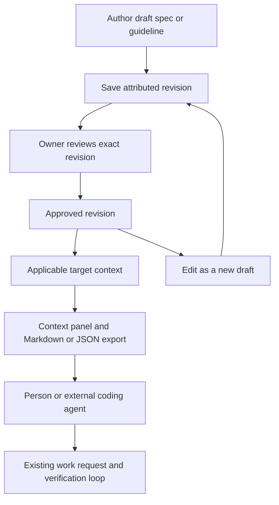

# Native Specs, Guidelines and Context Exports - Plan

## Goal Capsule

- **Objective:** Let people author versioned specs and reusable guidelines in CIVIC, then export the applicable contract for a component, screen or journey to their own tools.
- **Authority:** Founder request on 2026-10-18: scope native spec and guideline authoring, include journey and screen context exports, and update the roadmap; keep model calls external and Figma sync for later.
- **Owner and stage:** This chat owns requirements and documentation in its worktree; implementation, runtime onboarding and landing are separate work.
- **Boundary:** This artifact defines the proposed first release, not shipped functionality or authorization to implement, publish or change another project's design sources.
- **Open product blockers:** None; technical choices deferred below must preserve this contract.

---

## Product Contract

### Summary

CIVIC gains native Markdown spec and guideline authoring attached to its existing graph.
People review exact revisions, see applicable guidance beside a selected target, and export that target's context through the UI, CLI and MCP.
The first release extends the existing shared space and review loop.

### Existing foundation

At `c8e101e16628da1c024356e63ef1e1da387c20b0`, the graph already represents intent, component rules, journeys, screens, decisions, adoption and evidence.
`civic context` currently accepts semantic components only; the separate screen query and journey stories already expose some of the data the new exports need.
Neither is a native document authoring workflow.

### Key Decisions

- **Author connected product context first.** Governs R1–R5 and R10–R13. This is the founder-selected next scope after considering interactive candidate comparison and broader system tooling (session-settled: user-approved — chosen over candidate comparison first: existing stories and runtime infrastructure already provide an exploration foundation).
- **Retain external model execution.** Governs R17, carrying forward D30 and D35 rather than adding an embedded assistant (session-settled: user-directed — chosen over model calls inside CIVIC: external execution preserves the existing deterministic boundary).
- **Defer Figma synchronization.** Governs Scope Boundaries; these workflows must work without it (session-settled: user-directed — chosen over solving coordination now: native authoring is the immediate deliverable).

### Actors

- A1. Authors: Design, Design Engineering, Engineering, QA and Product roles, possibly held by one person, contribute specifications and guidelines.
- A2. Owners: people accountable for the affected contract review revisions and approve guidance within their existing permissions.
- A3. Consumers: people and external agents read the same scoped context; agents keep the authority limits in decision 0007.

### Requirements

**Authoring and applicability**

- R1. A person can create, edit, preview and save a Markdown spec attached by stable ID to a journey, screen or semantic component without leaving CIVIC's shared workspace.
- R2. A spec can express its goal, expected behavior, states and transitions, failure and recovery behavior, accessibility requirements, constraints, and individually addressable acceptance criteria, with unfilled sections visibly unspecified.
- R3. A person can author reusable guidelines containing a rule, rationale and examples, scoped explicitly to a product, journey, screen or semantic component and optionally restricted by platform and framework.
- R4. Applicability follows explicit product membership, declared or observed journey membership and component use, retaining each relationship's status; a screen's export includes its product's guidance, its containing journeys' guidance, its own guidance and guidance for components it uses.
- R5. Every applicable guideline retains its scope and source, and explicitly recorded conflicts remain visible without automatic precedence or natural-language conflict inference.

**Ownership and revisions**

- R6. Authored documents and acceptance criteria have stable identities, and saved revisions retain their author, accountable owner, time, line and change history.
- R7. New documents and edits to approved documents are drafts; approval names an exact revision, the previous approved revision remains active until explicitly superseded, and retirement stops future applicability while preserving history.
- R8. People author through the UI and CLI under existing write permissions and approve under the existing approve permission as a named owner, retaining current high-risk separation rules; external agents can read and suggest through existing annotations, comments and work requests but cannot directly mutate or approve documents in this release.
- R9. A save or approval against an outdated revision is refused visibly while preserving the author's draft, and failed writes leave the last saved revision intact.

**Connected workspace and exports**

- R10. The existing contextual workspace shows a selected target's specs, applicable guidelines, revision status and graph references, with authoring preserving the current live run and navigation state.
- R11. Read-only context exports include applicable authored context for semantic components, screens and journeys through the UI, `civic context` and MCP, with equivalent Markdown and JSON content and existing semantic-component callers remaining compatible.
- R12. A screen export includes its linked intent and acceptance criteria, applicable documents, declared states and incoming/outgoing paths, containing journeys, component and token mappings, design/source references, open decisions or concerns, and available evidence with its limitations.
- R13. A journey export includes its entry and exit screens, members and branches, each member's scoped screen context, and unresolved destinations or unreachable members without inventing a linear path through them.
- R14. Export includes the selected target's closure under R4, R12 and R13, deduplicates shared records by identity, and leaves unrelated product content out.
- R15. The default export uses approved document revisions; an explicit draft export includes the draft alongside any active approved revision, labels the difference, and never turns draft text into governing guidance.
- R16. Exports identify their graph and document revisions, selected lines and filters, relevant evidence revisions and missing or stale references, and produce identical output from identical inputs and options without changing records or running checks.

**Trust and product boundaries**

- R17. Authoring, applicability and exports make no model calls and do not launch agents, following decisions 0006 and 0007.
- R18. Authored intent references existing rules, mappings and decisions rather than silently replacing imported facts or maintaining a competing contract; saving or approving prose does not establish implementation, adoption or verification.
- R19. Document reads and exports respect existing project access, render authored Markdown as inert content, and do not execute commands or fetch linked content; referenced run data remains subject to existing credential and input-capture restrictions.
- R20. An unknown primary target fails explicitly; a missing referenced target or document is shown as unresolved by identity and never matched to a similarly named item.

### Key Flows

- F1. **Write and review a spec.** A1 selects a journey, screen or component, authors the spec and links existing records; A2 reviews the saved revision and approves it. The workspace follows R6–R10 and R18.
- F2. **Reuse guidance.** A1 scopes a guideline to a product, journey or component and optionally a platform/framework; a selected screen shows every applicable rule and its origin under R3–R5. A recorded conflict remains available to the existing decision workflow.
- F3. **Hand context to a coding tool.** A3 selects a target, platform and line, previews the approved context and copies or exports it; an external harness obtains the same context over CLI or MCP under R11–R17. It reports subsequent work through the existing review loop.
- F4. **Revise safely.** A1 edits an approved document into a draft while consumers retain the approved revision; if another save wins, R9 preserves the local draft for comparison and retry. Approval and retirement follow R7.

The contextual pane in R10 holds a document list, an editor/preview for the selected document, its approval status, and a context export action.
The journey canvas and current run remain the surrounding workspace; no new top-level destination or visual design editor is required.

### Acceptance Examples

| ID | Covers | Given / when / then |
|---|---|---|
| AE1. | R1, R2, R6, R10, R18 | An author selects a planned screen with no implementation, saves a spec and reopens it; the text and criterion IDs persist, missing intent stays unspecified, and no implementation or evidence is claimed. |
| AE2. | R3–R5, R14 | A screen belongs to two declared journeys and uses a shared component; its context includes all applicable guidance once, labels each scope, excludes an Android-only rule from a web export, and shows a recorded conflict without picking a winner. |
| AE3. | R6–R9, R15 | Revision 2 is approved and revision 3 is a draft; normal context uses revision 2, explicit draft context distinguishes both, and approving revision 3 requires its named owner and exact revision. Retiring the document removes it from new default exports while its history remains readable. |
| AE4. | R9, R10 | Two authors edit the same revision; after one saves, the other's save is rejected with their text retained and the live run undisturbed. A failed save leaves the prior saved revision unchanged. |
| AE5. | R11–R14, R20 | A journey branches, loops, shares a screen and names an unmapped destination; exports retain that shape, include each shared record once, and identify the unresolved destination without fabricating a successful path. |
| AE6. | R11, R16, R17 | A person and an external harness export the same screen and journey with the same revisions and filters; UI, CLI and MCP expose equivalent content, repeated JSON/Markdown output is stable, and no model, check execution or record mutation occurs. Existing Button context callers continue to work. |
| AE7. | R12, R16, R18, R20 | A linked design frame is missing and a run proves an older source revision; context identifies the missing frame and stale evidence, and an approved acceptance criterion remains an expectation rather than a passing result. An unknown primary target returns an error. |
| AE8. | R8, R19 | A read-only person or external agent attempts a document write or approval; the operation is refused. A document containing executable markup, a command or a remote link renders inertly, and exporting it neither executes nor fetches anything. |

<!-- ce-section: work-relationships -->
### How This Work Fits Together

This plan owns native authored context and its consumption, one coherent first release of the broader Figma-inspired exploration.
The relationships below describe current opportunities rather than commitments to build the remaining areas.

- **Depends on** the existing graph, revision/identity rules and review loop; these remain the contract authority.
- **Enables** better informed candidate exploration by supplying the intended outcome and applicable rules.
- **Shares** graph references with component stories, system diagnostics and the portal; none needs a duplicate document store or contract.
- **Can proceed independently of** Figma synchronization and native device runners.

### Scope Boundaries

The planned release covers R1–R20 for one connected product's existing graph and access model.
It does not add a general document suite, simultaneous text coediting, visual design/code authoring, candidate composition, automatic prose-to-check generation, a model provider, agent launching, or direct agent document writes.
Figma sync and export-back, cross-product guideline federation, a new hosted collaboration service, and broader portal editing are deferred.
Existing Figma imports and design references remain usable as inputs.

### Deferred to Planning

- Choose the smallest persisted representation that connects authored content to existing graph records, revision/line handling and the shared store without duplicating their authority.
- Specify compatible CLI/MCP input and output evolution for R11, including old `semantic_id` callers.
- Select editor placement, accessible controls and save-conflict presentation within R10.
- Define the deterministic export traversal, format version and fixture coverage for R4 and R11–R16.
- Pick one small connected example proving the author-to-export flow before applying it to both onboarded products.

### Sources

- `docs/product-spec.md`: D21, D24, D30–D39 and the Product Contract distinctions.
- `docs/decisions/0005-what-civic-is.md` and `docs/decisions/0006-deterministic-civic-for-agentic-teams.md`: graph ownership and deterministic execution.
- `docs/decisions/0007-review-to-agent-loop.md`: actor permissions, revisions and existing external agent handoff.
- `graph/src/schema.ts`, `graph/src/context.ts`, `graph/src/screen.ts` and `graph/src/story.ts`: existing records, component-only export and target queries.
- `review/src/access.ts` and `review/src/mcp.ts`: current scopes and component context interface.
- `packages/canvas/src/contract-panel.tsx`: contextual graph view to extend.
