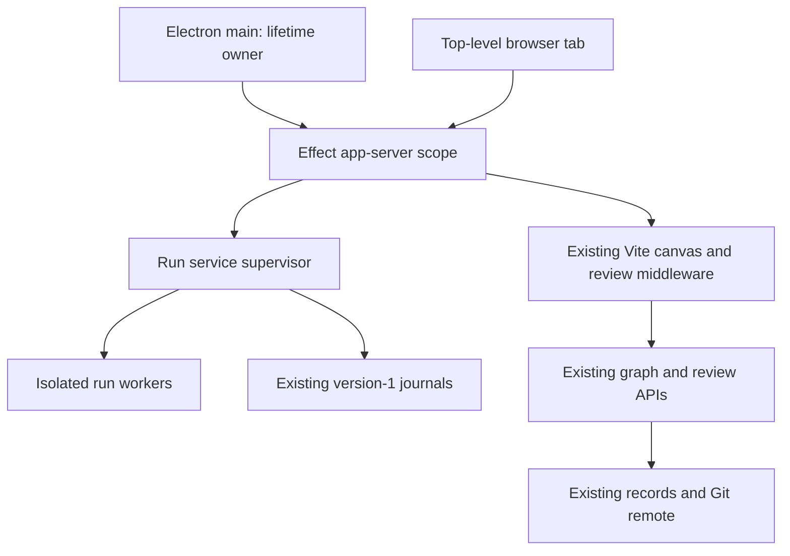
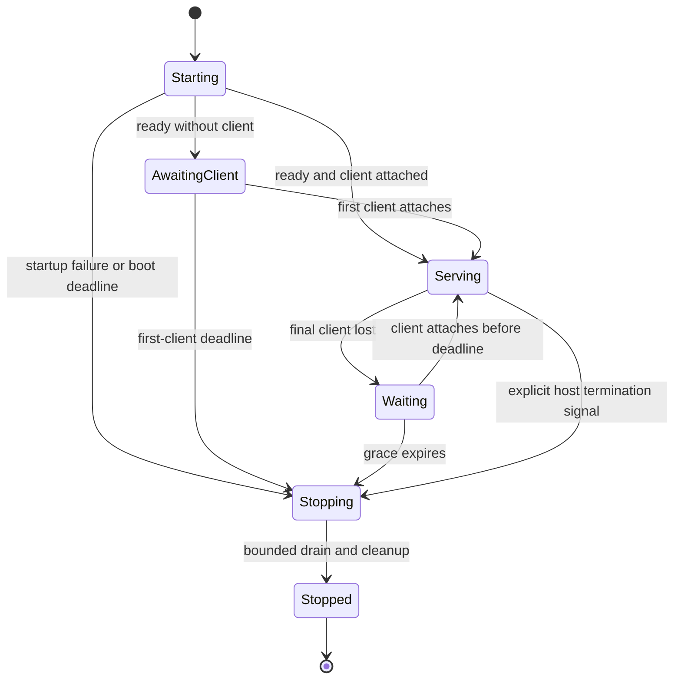

# Effect App Server and Run Lifecycle - Plan

## Goal Capsule

- **Objective:** People can use the same local CIVIC workspace from Electron and a browser, close either safely, and recover their isolated runs after reopening.
- **Means:** An Effect application host around the existing canvas and run service, with XState lifecycle decisions (KTD1–KTD4).
- **Authority:** The user's agreed lifecycle below and CIVIC's accepted architecture decisions govern implementation. This document authorizes no deployment, remote exposure, project re-onboarding or external publication.
- **Ownership:** One implementing controller owns this worktree and integration. The primary checkout's startup, onboarding and Tailscale work remain owned by the other CIVIC chat.
- **Execution profile:** Characterize journal behavior before refactoring, then deliver the six dependency-ordered units. Use bounded local verification; keep provider calls at zero.
- **Stop conditions:** Stop for a changed core schema, weakened journal/evidence rule, incompatible dependency pin, conflicting checkout ownership, or a need to mutate the primary checkout or its installed stores.
- **Tail ownership:** The implementing controller owns packaging, local acceptance and documentation. Remote access and multiplayer remain later work.

---

## Product Contract

### Summary

Add a managed local app-server that Electron and browser clients share. Keep it running while at least one client remains attached, including a windowless Electron app until Quit. When the final client leaves, allow a short reconnection interval, drain accepted work within a deadline, preserve journals and release all workers and listeners.

### Problem Frame

The current canvas server's lifetime belongs to its launcher. The Vite connector creates the run service and calls its close method when its HTTP server closes. Individual runs already have isolation, serialized operations and recovery journals, but there is no application-client ownership layer to decide when the shared process should exit.

A launcher-owned child can disappear while another client still needs it. A process with no client ownership can remain indefinitely after all apps close. The new host must distinguish those cases without changing what a completed run operation proves.

### Key Decisions

- **Same Mac first.** Independent Electron and browser clients share one local workspace; other devices and multiplayer follow later. Governs R1, R11. (session-settled: user-directed — chosen over remote-device or team access now: validate the local lifecycle first.)
- **Electron counts until Quit.** Governs R2. (session-settled: user-directed — chosen over last-window closure: an app still running in the Dock retains its connection.)
- **Preserve the existing core.** Governs R7–R10. (session-settled: user-approved — chosen over a replacement SQLite record store: the graph, journal and Git synchronization contracts already exist.)

### Requirements

**Application lifetime**

- R1. Compatible Electron and browser clients using the same canonical canvas store attach to one local app-server.
- R2. Electron main retains its client connection until actual Quit; closing or crashing a renderer alone does not release it.
- R3. Each top-level CIVIC browser tab retains its own client connection, including while hidden; preview frames, capture browsers and run workers do not retain the server independently.
- R4. Reloads and brief disconnects receive a bounded reconnection interval; expired clients cannot retain a server indefinitely.
- R5. After the final client expires, the host refuses new work, drains previously accepted work within a bounded deadline, closes resources and exits.
- R6. Quitting the launcher that created the server never stops it while another client remains; a reconnect after shutdown begins waits for a fresh server.

**Run and core integrity**

- R7. Preserve the graph, review records, signed `RecordsRemote` synchronization and the distinct Proposal, Decision, Adoption and Verification records.
- R8. Preserve version-1 run journals, completed-operation reconstruction, same-source checks, synthetic credentials, per-run isolation and intent-based duplicate-write receipts.
- R9. Incomplete or failed operations never become successful observations, completed journal entries or passing replay evidence.
- R10. Preserve the existing run takeover lease, expected synthetic actor checks, input validation, worker limits and idle-expiry behavior.

**Compatibility and scope**

- R11. Bind managed servers to loopback and retain existing origin, authentication and project-binding checks; a presence connection conveys no new record permissions.
- R12. Pin Effect `4.0.5`, `@effect/platform-node` `4.0.5` and XState `6.0.0-alpha.69`, matching Orca at research time.
- R13. Keep the current app adapters, canvas, programmatic host exports, recorder format and installed-from-Git integration working.
- R14. Opening a stopped workspace requires Electron or the local launcher; browser-only automatic wakeup and unattended background work are outside this delivery.

### Acceptance Examples

| ID | Situation | Required outcome |
|---|---|---|
| AE1 | Electron and browser share a workspace; Electron quits | Browser and its run continue. Covers R1, R6. |
| AE2 | Last Electron window closes, then the app later quits | Window closure retains the server; Quit releases Electron's hold. Covers R2. |
| AE3 | Last browser tab reloads within the grace period | Same server instance survives; the tab reattaches. Covers R3, R4. |
| AE4 | Final client closes during a mutation | New work is refused after draining begins; a result is either recorded fully or left incomplete, never invented. Covers R5, R8, R9. |
| AE5 | A completed mutation's response is lost, then the run reopens | Same intent returns its recorded receipt without another write in the reconstructed run. Covers R8. |
| AE6 | A second page reopens a run, then the old page closes | The stale close does not stop the new owner's run. Covers R10. |
| AE7 | Reopen after a source change or a journal result mismatch | Recovery is refused visibly; old evidence remains available. Covers R8, R9. |
| AE8 | All clients crash, or the launcher dies before attaching | Client expiry or startup timeout closes the host; no permanent orphan. Covers R4, R5. |

### Scope Boundaries

This delivery covers managed server discovery, client presence, run lifecycle supervision, a minimal Electron shell, browser integration and local acceptance. It retains the current project picker's single selected compilation binding. A project switch remains an explicit viewer restart, not an implicit change to another tab's active run.

Deferred: simultaneous independently compiled projects within one host, remote-device access, live team synchronization, presence UI, shared driving, offline collaborative editing, packaged installers and auto-update. Existing permitted proxy behavior remains supported by the low-level host, but this work does not configure or widen it.

The core stays deterministic and provider-free under decision 0006. Existing CLI and MCP record actions keep their permissions and do not become implicit background-server owners.

---

## Planning Contract

### Current Architecture and Research

Grounded at `baseline_commit`. Re-anchor before implementation if the branch changes.

| Existing source | Constraint carried forward |
|---|---|
| `packages/canvas/server/runtime-service.mjs` | One worker per run; eight-worker cap; per-run queue; 30-second worker-call timeout; 30-minute idle expiry; journal before/after changing operations. |
| `packages/canvas/server/runtime-service.check.mjs` | Existing recovery, fresh credentials, stale-close protection and duplicate-intent scenarios are compatibility checks. |
| `packages/vite-connector/src/review-plugin.mjs` | Owns project binding and source refresh; HTTP close currently triggers unawaited run cleanup. |
| `packages/shell/server/review-server.mjs` | Owns session/bearer authentication, exact-origin checks, project routing and recording/replay persistence. |
| `packages/canvas/src/runtime-session.ts` | Browser restores synthetic state and sends lease-bound run close. |
| `packages/canvas/server/canvas-host.mjs` | Existing `runtime` injection seam and programmatic host API can support managed ownership. |
| `review/src/store.ts`, `review/src/remote.ts`, `review/src/sync.ts` | Record storage and signed Git synchronization already exist; they are not replaced. |
| `docs/decisions/0004-graph-first-journey-engine-as-viewer.md`, `docs/decisions/0008-team-records-on-a-git-ref.md`, `docs/decisions/0009-recorded-runs-as-evidence.md` | Graph ownership, remote semantics and tape-versus-evidence boundaries remain authoritative. |

OpenCode was inspected at commit `214fb7fdbab9ad13773629839f1178382400cf97` on 2026-10-18. Its current source has moved beyond older desktop sidecar paths. Borrow the following mechanisms, not its daemon lifetime or its application domain:

- [Service discovery and ensure](https://github.com/anomalyco/opencode/blob/214fb7fdbab9ad13773629839f1178382400cf97/packages/client/src/effect/service.ts): private registration, authenticated health checks and compatibility-aware reuse shape KTD3.
- [Desktop background connection](https://github.com/anomalyco/opencode/blob/214fb7fdbab9ad13773629839f1178382400cf97/packages/desktop/src/main/service/background-service-state.ts): startup consumers await a shared connection outcome; renderer startup need not own service creation. Shapes U5.
- [Server process](https://github.com/anomalyco/opencode/blob/214fb7fdbab9ad13773629839f1178382400cf97/packages/server/src/process.ts): explicit starting/stopping status and scoped application cleanup shape KTD2 and KTD5.
- [Bounded event feed](https://github.com/anomalyco/opencode/blob/214fb7fdbab9ad13773629839f1178382400cf97/packages/server/src/event-feed.ts): subscriber cleanup and explicit overflow shape KTD6.

[OpenCode's server documentation](https://docs.opencode.ai/docs/server/) confirms the shared API plus event-stream client model. It does not establish CIVIC's last-client shutdown policy. [XState's execution model](https://stately.ai/docs/xstate/v6/how-xstate-runs-machines) supports pure transitions separated from effect execution. Use APIs verified against the pinned packages, not older Effect 3 examples or newer alpha features.

### Key Technical Decisions

- KTD1. **Keep the host inside `@civic/canvas`.** Add server-only modules and an `./app-server` export rather than another core or contracts package. Retain `startCanvas` as an embeddable low-level host; the managed launcher wraps it. Effect and XState stay out of `graph/`, `review/` and the browser bundle. Implements R7, R12, R13.
- KTD2. **One serialized lifecycle owner.** XState computes server and run state transitions; Effect owns real timers, queues, listeners and workers. Lifecycle snapshots are transient. Durable run facts continue to live in the existing journal, with no second workflow database. Implements R5, R8–R10.
- KTD3. **Discover, authenticate, then adopt.** Canonicalize the store path and keep an instance registration with PID, instance nonce, build/protocol identity and loopback endpoint in a private file. Elect the owner with an atomic per-store lock directory containing an exclusive owner record; retain it for the host's lifetime. Serialize recovery through a separate breaker claim and recheck ownership before admitting a winner. Recovery requires positive evidence that the recorded same-machine owner is dead; age, missed heartbeats or a failed health request alone never license takeover. Missing or unreadable ownership fails closed with a repair instruction. Refuse a live incompatible owner or unrelated listener instead of killing it or opening a second writer. Registration removal and lock release must match the exiting instance nonce. Implements R1, R6, R11, R13.
- KTD4. **Use renewable connections, not a decrement-only counter.** Track server-issued client IDs with connection generations. Desktop main authenticates with a private local capability; browser tickets are issued through the existing authenticated review middleware and permit only browser presence. Browser tickets are single-use, expire after 10 seconds and travel as a WebSocket subprotocol value, never in URLs or logs. Upgrades validate the exact route, trusted origin and ticket or desktop capability before retaining the host. Desktop connections without a browser Origin require the local capability and loopback transport. Validate message schemas and cap incoming frames at 16 KiB. Late releases from an old generation do nothing. Implements R2–R4, R11.
- KTD5. **Bound every unattended interval.** Initial defaults: first-client deadline 60 seconds; transport ping every 5 seconds; missing-client expiry 15 seconds; final-client grace 10 seconds; shutdown drain 30 seconds followed by up to 5 seconds for resource closure. These are internal, injectable test constants, not new user settings. Existing worker-call and run-idle limits remain per R10. A final client may therefore leave up to 45 seconds of grace and shutdown work, or up to 60 seconds after abrupt loss is detected through expiry, while the machine and event loop are running. Sleep does not create a hard real-time guarantee. Implements R4, R5.
- KTD6. **Keep operation HTTP routes; add one control socket.** The socket carries lifecycle status and run invalidations, with a bounded queue of 256 messages of at most 16 KiB per client. Full state is fetched through existing authenticated reads after reconnect; overflow closes the socket and requires resynchronization. No journal, raw form values, credentials or captures are broadcast. The server only emits a completed-operation notification after its journal receipt is saved. Implements R8, R9, R11, R13.
- KTD7. **Make shutdown one-way.** Reattachment cancels `Waiting`, but cannot cancel `Stopping`. A root shutdown first fences new operations and run creation, including in-flight startup/restore continuations. Accepted run queues drain under KTD5; finalizers then explicitly terminate workers and await closure. Journals are retained. One native root deadline watchdog outside the cancellable run scope exits the host with a failure outcome if cooperative cleanup exceeds the final deadline; no extra supervisor process is introduced. The deadline assumes a responsive event loop, per KTD5. Implements R5, R6, R8, R9.
- KTD8. **Keep the app connection independent of Vite generations.** Effect owns one stable Node HTTP listener, the control socket and server identity. The managed viewer runs Vite in middleware mode behind that listener, with HMR attached to the parent listener; its restart replaces only the viewer generation. Starting and stopping responses are explicit while ordinary review routes are unavailable. Add an awaitable generation-disposal hook rather than relying on Vite's `httpServer` close event, which is absent in middleware mode. Project/source changes retain existing refusal semantics; they never rebind an old run to new code. Implements R6, R10, R13.

Keep registration and its capability under the canonical store's `.review-data/service/`, with directory mode `0700` and file mode `0600`; do not write it into a reviewed app or a Git record. This is ephemeral local connection state, not a second product store.

Add exact dependencies to the owning canvas package and lockfile: the R12 pins plus `ws` `8.22.0` and development types `@types/ws` `8.18.2`, matching Orca. The Electron development dependency is `44.9.0`, also matching Orca. `@xstate/effect` `1.0.0-alpha.8` is recorded for comparison but is unnecessary for the chosen pure-transition host, so do not add an unused bridge. Use Effect 4 `Context.Service`, layers and scoped resource acquisition where services earn a boundary.

### High-Level Technical Design





`AwaitingClient` uses the first-client deadline in KTD5; `Waiting` uses the final-client grace. Bound the initial host boot itself to 60 seconds, and start the first-client deadline when readiness is published. Client counts and grace timers are rebuilt after process restart, never loaded from persisted XState snapshots.

The run machine has `Starting`, `Restoring`, `Ready`, `Executing`, `Stopping` and `Stopped` states. Its transient stop reason distinguishes explicit closure, expiry, worker failure and host shutdown; it is not a new graph record. Source mismatch refuses commands without pretending that the old run has become current. A stop fence prevents any pending start or restore from publishing a usable run after shutdown begins.

```mermaid
sequenceDiagram
    participant Client
    participant Host
    participant Run
    participant Journal
    participant Worker
    Client->>Host: changing operation with existing intent identity
    Host->>Run: admit before stop fence
    Run->>Journal: save incomplete entry
    Run->>Worker: execute
    Client--xHost: final client disconnects
    Host->>Host: grace expires; fence new work
    Worker-->>Run: result before drain deadline
    Run->>Journal: save completed result
    Run-->>Host: settle accepted operation
    Host->>Worker: terminate and await exit
    Host->>Host: close host resources; remove own registration
```

If the worker or persistence misses the deadline, no completed receipt is acknowledged. Existing failure cleanup may remove the failed entry; any surviving incomplete entry follows R9 and the existing recovery rule below. No completion event is fabricated. Emit success only after the operation's final source check as well as persistence; a source change after persistence yields a stale-state notification, not successful runtime evidence.

### Journal Compatibility Rules

R8 and R9 preserve the following behavior of `runtime-service.mjs`:

1. Reopening reconstructs a fresh isolated backend from its seed and complete journal entries. It deliberately re-executes those synthetic operations and compares their results; it is not continuation of an arbitrary process or an exactly-once external-effect engine.
2. Incomplete entries are excluded during restore, as today. The page's unconfirmed step remains available for explicit resend. Do not automatically retry an uncertain operation against a surviving worker.
3. A completed mutation with an intent returns its recorded result for the same operation and synthetic actor. Different arguments or actors using that identity are refused; reset forgets data and intent receipts together.
4. Preserve the journal path, version, seed, clock, timezone and source binding. Credential regeneration and sensitive-payload checks remain in place.
5. Completion is acknowledged only after persistence succeeds. A failed persistence cannot be converted into a successful client result or replay pass.

Atomic rename gives the existing process-recovery behavior; this plan does not add a power-loss durability or filesystem-fsync guarantee. Unexported browser recording steps cannot be recovered from a server journal that never received them.

### Integration and Rollout

Keep the public `runtimeService` handle/close shape through a compatibility facade. The managed host injects its owned runtime through `canvasPlugins`' existing seam. Direct low-level `startCanvas` consumers remain caller-owned until `close`, so existing tests and app-hosted integrations need no hidden presence client.

The managed `civic-canvas` launcher preserves `--project`, `--store`, `--port` and printed URL behavior, but ensures or adopts a detached host instead of owning its lifetime. It does not itself hold a client indefinitely. Port zero remains valid for embedded tests; managed reuse requires a stable registered endpoint. A conflicting port request against an already active store fails visibly. If `--project` names another project while clients are attached, refuse with an instruction to switch through the picker or use a separate store; adopting a host must not silently change its binding.

Browser main attaches once, outside component lifecycles and HMR reload loops. An already loaded tab can explain failed reconnection; a fresh browser navigation to a stopped host shows the browser's connection error until the user runs the launcher. Do not add a permanent process or service worker to disguise that boundary. Electron main attaches before creating windows and releases on confirmed Quit; renderers do not get the local capability. The minimal desktop shell uses the existing canvas, sandboxed renderers, context isolation and bounded navigation to its selected local origin. It adds no notification, updater or installer work.

One app losing its private run stops that run under the existing run lease rules; it does not close another client's runs. A source refresh or project selection restart must leave existing clients visibly stale or reconnecting, never silently operating on a different binding. Preserve the current single selected project model rather than adding per-client compiler routing.

### Risks and Deferred Implementation Details

- **Startup contention:** Per-store ownership must survive simultaneous launch, launcher death, symlink aliases and stale registrations. KTD3's dead-owner and breaker checks are an execution gate. A crash before owner metadata is written may require explicit repair; missing evidence is never permission to delete another process's lock.
- **Crash and suspension detection:** An open but suspended browser may stop responding. On return it reconnects and restores within existing source rules; a browser cannot wake a stopped Node process. Validate hidden tabs and macOS sleep with real clients.
- **Shutdown races:** Workers, persistence and restore continuations can outlive a request. Fence admission before closing scopes, await termination explicitly and report interrupted outcomes.
- **Version churn:** The pins in R12 are exact. Recheck pinned APIs and Orca before dependency installation, but do not silently change the planned versions. Block on a proven incompatibility.
- **Installed integration:** Consumers install raw source from Git. Node runtime entry loading, peer dependencies and server-side TypeScript must be verified in a clean external app, not only the workspace.
- **Compatibility fallback:** The embeddable host remains available while managed hosting rolls out. Do not start old and new hosts against the same live store; rollback closes the managed host first and retains its journals.

No blocking product question remains. Exact file subdivisions and timeout tuning may change from implementation evidence while preserving the owning requirements; report any material change to the agreed lifetime or journal behavior.

---

## Implementation Units

### U1. Characterize journal and closure boundaries

**Goal:** Bind the existing recovery guarantees before changing resource ownership.
**Requirements:** R8–R10; AE4–AE7. **Dependencies:** None.
**Files:** `packages/canvas/server/runtime-service.check.mjs`, new `packages/canvas/server/runtime-lifecycle.check.mjs`, and small deterministic test fixtures under `packages/canvas/server/check-fixtures/`.
**Approach:** Extend the current backend fixtures with controlled worker and persistence barriers. Keep tests at actual journal and worker boundaries rather than duplicating internal state-machine logic.
**Execution note:** Add characterization coverage before modifying `runtime-service.mjs`.
**Test scenarios:**

1. Covers AE5. Drop a completed write response, close and restore, then resend the same intent and obtain the same receipt with one reconstructed write.
2. Covers AE6. Reopen a live run, send its previous owner's close lease and keep the replacement owner usable.
3. Covers AE7. Change source, seed or a replayed result and refuse restore while retaining the original journal.
4. Kill a fixture worker after intent persistence but before completion persistence; restore only completed entries and require explicit resend for the unfinished step.
5. Exercise existing account, reset, timezone and credential-redaction behavior across closure and restore.

**Verification:** Existing and new journal checks establish the R8–R10 baseline; no production behavior changes in this unit.

### U2. Add lifecycle decisions and scoped execution

**Goal:** Introduce one owner for host and run transitions without another durable store.
**Requirements:** R4, R5, R8–R10, R12. **Dependencies:** U1.
**Files:** New `packages/canvas/server/server-lifecycle.ts`, `packages/canvas/server/run-lifecycle.ts`, `packages/canvas/server/lifecycle.test.ts`, `packages/canvas/server/lifecycle-scope.test.ts`, `packages/canvas/tsconfig.server.json`; `packages/canvas/package.json`, `packages/canvas/vitest.config.ts` and `packages/pnpm-lock.yaml`.
**Approach:** Implement KTD2 and KTD5 with pure XState transitions and Effect-owned schedules. Serialize state changes with attach, expiry and stop events in the same owner queue. Keep host time independent of a run's synthetic clock.
**Test scenarios:**

1. Attach two clients, release either and remain serving; expire the final client and enter waiting.
2. Covers AE3. Reattach before the grace boundary and cancel that shutdown generation; an old timer or release cannot affect the replacement.
3. Run all deadlines under an injected clock, including startup with no client and no new work after stopping begins.
4. Interrupt a scoped task and verify finalizers settle once; a second stop request returns the same cleanup outcome.
5. Advance synthetic run time without changing real client expiry.

**Verification:** State and scope tests enforce KTD2, KTD5 and KTD7 deterministically without worker processes.

### U3. Supervise the existing run service

**Goal:** Give runs bounded, awaitable closure while preserving their public contract.
**Requirements:** R5, R8–R10, R13. **Dependencies:** U1, U2.
**Files:** `packages/canvas/server/runtime-service.mjs`, `packages/canvas/server/runtime-worker.mjs`, `packages/canvas/server/runtime-service.check.mjs`, `packages/canvas/server/runtime-lifecycle.check.mjs`; a scoped execution module if needed under `packages/canvas/server/`.
**Approach:** Keep validation and journal decisions in their existing owner. Place worker acquisition, listeners, expiry and per-run queues under scoped ownership. Add the stop fence before draining and cover pending spawn/restore paths. Retain the exported handle/close facade and existing limit values.
**Test scenarios:**

1. Covers AE4. Stop during a changing operation that finishes before the deadline and save its complete receipt before worker exit.
2. Stop during a hung operation, terminate within KTD5 and retain no false completion.
3. Race stop with worker creation and restore; no worker or successfully published envelope survives the closed scope.
4. Race duplicate resume, mutation and stale close events; preserve the single queue and R10 takeover behavior.
5. Fail journal persistence and worker startup separately; return failure, retain recoverable input and release resources.

**Verification:** U1's baseline and all existing runtime backends pass against the refactored service; real fixture workers exit without leaked handles.

### U4. Build managed discovery and authenticated presence

**Goal:** Start or adopt one managed host and make its lifetime follow valid clients.
**Requirements:** R1, R4–R6, R11–R14. **Dependencies:** U2, U3.
**Files:** New `packages/canvas/server/app-server.ts`, `packages/canvas/server/app-server-main.ts`, `packages/canvas/server/service-registration.ts`, `packages/canvas/server/client-presence.ts`, `packages/canvas/server/app-server.check.mjs`, `packages/canvas/server/service-registration.check.mjs`, `packages/canvas/server/client-presence.test.ts`; `packages/canvas/server/canvas-host.mjs`, `packages/canvas/vite.config.mjs`, `packages/vite-connector/src/review-plugin.mjs`, `packages/vite-connector/src/review-plugin.check.mjs`, `packages/shell/server/review-server.mjs`, `packages/shell/server/review-server.check.mjs`.
**Approach:** Implement KTD3–KTD8 with the stable parent listener and Vite middleware mode. Retain auth in the shell and pass only the narrow presence authorization hook across the existing host seam. Add explicit parent-listener and generation-disposal hooks for the connector's listening registration, HMR and run cleanup. Close upgraded sockets explicitly, since ordinary HTTP listener closure does not dispose them. Give starts and Vite restarts a generation fence and release all partially acquired resources on failure. Remove the matching registration before releasing the ownership lock so a late finalizer cannot delete a new owner's registration.
**Test scenarios:**

1. Covers AE1 and AE8. Concurrent launchers adopt one instance; killing the initial launcher leaves attached clients alive, while an unattached launch expires.
2. Exercise same-store launches through symlink paths, different requested ports, a stale registration and a live incompatible owner; no case creates two journal writers or kills an unrelated process. Race two dead-owner recovery attempts, and keep an alive but delayed owner protected. An incomplete owner record fails closed.
3. Refuse cross-origin upgrades, absent/expired/reused browser tickets, invalid desktop capabilities and stale project bindings without retaining the host.
4. Simulate heartbeat failure and duplicate close notifications; bounded expiry works and the client count never underflows.
5. Restart Vite while a desktop connection remains; preserve root ownership, rotate viewer generation and refuse old-source operations.
6. Fill a slow client's KTD6 queue; close it, release its lease and require a fresh snapshot after reconnect.

**Verification:** Child-process tests prove singleton ownership and eventual exit, while the existing shell/connector security and host checks retain their behavior.

### U5. Attach browser and minimal Electron clients

**Goal:** Make real app instances participate in the managed lifecycle.
**Requirements:** R1–R6, R11, R13, R14. **Dependencies:** U4.
**Files:** New `packages/canvas/src/client-presence.ts`, `packages/canvas/src/client-presence.test.ts`, `packages/desktop/package.json`, `packages/desktop/main.mjs`, `packages/desktop/lifecycle.mjs`, `packages/desktop/lifecycle.check.mjs`, `packages/desktop/desktop.check.mjs`; `packages/canvas/src/main.tsx`, `packages/canvas/bin/civic-canvas.mjs`, `packages/canvas/package.json` and `packages/pnpm-lock.yaml`.
**Approach:** Attach browser main only when the host advertises managed lifecycle support. Use the native WebSocket client without importing server-side Effect or XState into `src/`. Electron main ensures the server, awaits its shared readiness outcome and retains the privileged connection independently of windows. Use actual Quit as the release point under R2. Preserve KTD3 compatibility refusal rather than replacing a running server automatically.
**Test scenarios:**

1. Covers AE2. Close every Electron window, reopen from the Dock and keep the same server; actual Quit releases its hold.
2. Covers AE1. Quit Electron while a browser remains; then close the browser and observe host exit.
3. Covers AE3. Reload a sole browser tab and survive the grace interval; hidden tabs stay attached and internal preview/capture frames do not acquire holds.
4. Crash a renderer and then Electron main; the first retains the main connection, the second expires it.
5. Open with the server already stopped and obtain it through the launcher; an already loaded tab that cannot reconnect shows a clear relaunch instruction, while a fresh URL is documented as requiring the launcher.
6. Reject external renderer navigation and keep the private desktop capability out of renderer globals, URLs and logs.

**Verification:** Model-based main-process checks plus real Electron/browser acceptance establish R2. Do not count mocked Electron events alone as macOS acceptance.

### U6. Verify installation, recovery and delivery boundaries

**Goal:** Make the managed path installable and prove it preserves CIVIC's existing integration contract.
**Requirements:** R1–R14; AE1–AE8. **Dependencies:** U3–U5.
**Files:** New `packages/canvas/server/managed-host.check.mjs`; `packages/canvas/server/canvas-host.check.mjs`, `packages/install.check.mjs`, relevant package scripts, `bin/signoff`, `packages/canvas/README.md`, `README.md`, and a new architecture decision under `docs/decisions/` using the next free number.
**Approach:** Add managed host and desktop lanes to existing local checks without posting externally. Retain the three existing Git-installed canvas packages and test the new managed export from a clean consumer. Document startup ownership, browser wakeup limits, deadlines and interrupted-run recovery. Keep deployment and installed profile migration out of this unit.
**Test scenarios:**

1. Install the committed candidate in an empty app, exercise both low-level `startCanvas` and managed hosting, and verify pinned runtime dependencies resolve outside this repository.
2. Run Notebook and Tasks browser checks plus Team Board journal recovery; retain the existing HTTP, function-backend and server-function adapters.
3. Kill the host at journal boundaries and reconnect through a fresh instance; enforce AE5 and AE7 without reusing synthetic credentials.
4. Exercise project-picker restart with two clients; stale requests fail visibly and neither client's run is silently rebound.
5. Exercise normal shutdown, forced worker cleanup and an abrupt process death; journals remain, no child survives, and old registration cleanup cannot remove a replacement's registration.
6. Run the same-Mac Electron/browser matrix for AE1–AE4, including sleep/wake and a last-client close during persistence.

**Verification:** All applicable local lanes in the Verification Contract pass on the final candidate. A skipped real-client or external-install lane is an explicit acceptance gap.

---

## Verification Contract

Planning does not execute these checks. Implementation records the final revision, dependency lockfile and actual outcomes.

| Lane | Owner / files | Required evidence |
|---|---|---|
| Type and unit checks | `packages/package.json`, each package's `check` and `test` scripts | New server TypeScript and every new test file participate explicitly; `canvas` currently type-checks only `src`, so extend coverage rather than leaving server modules unchecked. |
| Runtime characterization | `packages/canvas/server/runtime-service.check.mjs`, `packages/canvas/server/runtime-lifecycle.check.mjs` | R8–R10 survive across all existing adapters and interrupted shutdown. |
| Lifecycle and process checks | New U2–U5 tests | Controlled clocks plus real child/worker processes prove timer, ownership and cleanup boundaries. |
| Existing regressions | Shell, connector, canvas, `graph/`, `review/` | Existing auth, project-binding, graph/evidence, access, signed-sync and tape checks remain valid. |
| Installed consumer | `packages/install.check.mjs` | Candidate installed from Git outside the workspace resolves its new export and exact runtime pins. |
| Real clients | New managed-host browser lane and desktop lane | AE1–AE4 with real Electron and browser processes; macOS until-Quit and sleep/wake acceptance. |
| Final local gate | `bin/signoff --no-post` after committing the candidate under implementation authority | Existing local gates plus the added lanes cover the exact final tree. No GitHub CI dispatch or status/comment publication is required by this plan. |

Use temporary test stores and synthetic fixtures. Do not attach acceptance tests to the primary checkout's running service, production backends or personal installed data. Existing browser tests may skip when Chrome is unavailable; that skip cannot satisfy this plan's real-client acceptance. A desktop `typecheck` script that simply returns success is not evidence for the new lifecycle code.

---

## Definition of Done

- R1–R14 and AE1–AE8 are backed by inspected final-state evidence from the applicable verification lanes.
- The exact dependency pins and installed-from-Git consumer work without changing CIVIC's graph, signed record synchronization or journal schema.
- Last-client shutdown is bounded; main-process Quit behavior, startup contention and worker termination are proven with real processes.
- Completed, failed and interrupted observations retain their existing meanings. No successful replay or verification claim is inferred from an unfinished operation.
- Existing public host/runtime entry points remain compatible, and the managed CLI's changed process ownership is documented.
- All required checks participate in local signoff. Skipped platform acceptance is named rather than reported as complete.
- No experimental duplicate host, temporary protocol implementation or abandoned approach remains in the delivered source.
