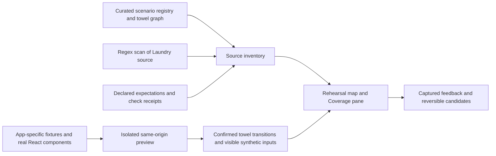

# Rehearsal: changes since the first ZIP, onboarding and a model-light direction

Prepared October 10, 2026. This is a repository-grounded report and proposed next direction, not a claim that generic onboarding or design-tool synchronization is implemented. Laundry App is integration evidence; Rehearsal is the subject.

## Findings

The first ZIP already contained the persistent horizontal canvas, branch arrows, screen navigator, cached actual-screen thumbnails, continuous towel Play, reversible presentation proposals and captured-state Review. Those are baseline capabilities, not additions since packaging.

Since that ZIP, Rehearsal gained a deterministic coverage bridge: explicit expectations, heuristic source discoveries, graph-gap checks, durable briefs/prototypes/React scaffolds, repository expectation editing, source-change updates and associated tests. The subsequent architecture correction connected that work conceptually to local Open Design / Claude Design ↔ Rehearsal ↔ Laundry App. Later passes corrected whole-app hairline framing, restored vertical branch lanes, added curated cross-route action bindings, routed arrows around cards and introduced a persistent All screens setting. The v4 bundle includes these passes and the restarted preview. Design-tool exchange and an AI implementation runner are still unconnected.

Generic user/project onboarding does not exist. Laundry App was integrated by writing an application-specific adapter and curating its scenarios and journey graph. The displayed application map is not an automatically reconstructed, exhaustive user journey.

The functioning Rehearsal runtime does not require model calls. Models/agents were used to design and build it, and remain important to the proposed design/implementation collaboration. Coverage scanning, source watching, graph checks, scaffolding, browser execution, captures and local persistence currently use ordinary code.

## Comparison method and scope

Baseline: `rehearsal-handoff-2026-10-10.zip`, 1,118 files, SHA-256 `fb1738009443993ef0dc9d7b059973747d8f9556fe54c6e9d46e997c89fca5ad`. Its ZIP integrity and every manifest payload hash were checked before comparison. Current checkout: `f0d3/laundry-app`, HEAD `0bffbbcf2e38ca3ec7e17da3eb6496b6f04f348d`, with uncommitted working source.

The comparison covers every source path packaged in the baseline, plus current Rehearsal sources/tests/documentation. The baseline's deliberately portable `AGENTS.md`/`CLAUDE.md` replacements are excluded from comparison with machine-local instructions. Private stores, credentials, conversation databases and dependencies are outside the source delta.

The coverage delivery initially produced **6 additions, 10 modifications, 0 removals**. The v3 bundle then contained **23 changed paths: 8 additions and 15 modifications**, including this report and the first canvas correction. The v4 comparison against the same original ZIP contains **27 changed paths: 11 additions, 16 modifications, 0 removals**. The new bundle carries a versioned Git-applicable patch, before/after hashes and a fresh-baseline application receipt. Earlier ZIPs and patches remain historical snapshots.

### Every changed or added source file

| Path | Change | What it adds or changes |
| --- | --- | --- |
| `apps/web/scripts/review-coverage.mjs` | Added | Validated expectation contract, coverage classification, declared-path reachability, source discoveries, durable deterministic candidates, brief/React exports and optimistic writes |
| `apps/web/src/review/coverage-panel.tsx` | Added | Coverage filtering, acknowledgement, prototype editing/testing, expectation editing, retained drafts and conflict recovery |
| `docs/design/review-product/coverage.json` | Added | Version 4 contract with 11 explicit screen/interaction/journey expectations and acceptance requirements |
| `apps/web/scripts/review-coverage.check.mjs` | Added | Five checks for classification/reachability, validation, durable generation, contract conflicts and compilation of exported TSX |
| `apps/web/e2e/review-coverage.spec.ts` | Added | Explicit isolated Chromium scenario for prototype testing/persistence, draft protection, expectation write and watched refresh |
| `docs/design/review-product/coverage-bridge.md` | Added | Current coverage behavior, ownership boundaries and the narrowed design ↔ Rehearsal ↔ app contract |
| `apps/web/scripts/review-inventory.mjs` | Modified | Includes expectations, shared packages and Convex in source identity; validates curated route-action anchors and exposes mapped/unmapped action metadata |
| `apps/web/scripts/review-inventory.check.mjs` | Modified | Checks route-action mapping, stale anchors and explicit unmapped destination states |
| `apps/web/scripts/review-plugin.mjs` | Modified | Watches coverage/shared/backend inputs, drafts on startup/refresh and makes pending inventory refreshes a barrier for API requests |
| `apps/web/scripts/review-server.mjs` | Modified | Authenticated coverage API, refresh-unavailable errors, capture/source race rejection and correctly attributed historical cached PNG responses |
| `apps/web/scripts/review-server.check.mjs` | Modified | Coverage access/origin/conflict checks and image provenance/source-change checks |
| `apps/web/src/review/app-canvas.tsx` | Modified | Coverage pane, watched updates, route Inspect, gutter-routed action/branch/return arrows and persistent Compact flows / All screens choice while retaining the live run |
| `apps/web/src/review/app-overview.tsx` | Added | Readable same-canvas overview with thumbnails and card-avoiding declared action/return links; no artificial tab-order arrows |
| `apps/web/src/review/app-map.ts` | Modified | Horizontal navigation areas, vertical related-flow/branch lanes, route-action metadata and routed internal/cross-flow connections |
| `apps/web/src/review/app-map.test.ts` | Modified | Checks screen retention, area/branch geometry, declared cross-area actions and distinct branch paths |
| `apps/web/src/review/route-actions.json` | Added | Seventeen curated source bindings with symbolic parameters, guards, return context and mapped/unmapped destinations |
| `apps/web/src/review/arrow-routing.ts` | Added | Rectilinear A* gutter routing with bend costs, separate lanes, rounded corners and no unsafe fallback |
| `apps/web/src/review/arrow-routing.test.ts` | Added | Checks obstacle avoidance, lower/return gutters, lane separation, rounded paths and blocked endpoints |
| `apps/web/src/review/app-canvas.css` | Modified | Overview geometry/thumbnail styling, retained hidden live scene and accessible canvas detail control |
| `apps/web/src/review/use-canvas-camera.ts` | Modified | Accepts the target extent when framing so a same-canvas detail/overview change does not clamp against the previous extent |
| `apps/web/e2e/review-canvas.spec.ts` | Modified | Four cases covering retained drafts/Review/Edit, branches, route context, full thumbnail count, setting persistence and narrow panning |
| `apps/web/src/review/canvas-chrome.css` | Modified | Compact coverage list, actions, prototype and expectation editor styling |
| `apps/web/package.json` | Modified | Adds coverage checks to `test:review`; no new dependency or lockfile change |
| `docs/design/review-product/PRODUCT.md` | Modified | Adds coverage capability and the narrowed endpoint/ownership contract |
| `docs/design/review-product/build-evidence.md` | Modified | Records source-bound coverage checks, browser evidence and limitations |
| `docs/plans/2026-10-03-delivery-status.md` | Modified | Adds the local Rehearsal coverage delivery and leaves AI adoption/branch execution open |
| `docs/design/review-product/2026-10-10-post-zip-report.md` | Added | This report, the adoption/onboarding recommendation and model-light integration research |

No Laundry App component, planner, backend business logic or shared-token file changed relative to this ZIP. The changed fixture hash reflects a broader hashing scope that now includes shared/backend sources, rather than a new Laundry feature. App-specific seeds and transition hooks were already present in the ZIP.

### Added product behavior

**Coverage:** separates explicit expected targets from unconfirmed surfaces found in source. It reports absent dedicated previews, partial specimens, undeclared connections between expected checkpoints and unverified execution. Reachability traverses declared intermediate steps and handles cycles. Source-file presence never proves business behavior.

**Generation:** creates one durable candidate per target, consisting of a brief, editable heading/description/action prototype and exported React input-form scaffold. Its example input is captured locally. This does not implement the requested missing product feature, exercise Laundry operations or create an isolated implementation branch. Editing does not cause the scanner to overwrite that candidate; subsequent revisions mark it stale.

**Two-way repository exchange:** an expectation can be edited in Rehearsal and saved to the fixed `coverage.json` path. Contract/source/store versions protect against stale writes. This is a real write-back mechanism for expectations, not a design-file or application-code synchronizer.

**Updates:** a running local Vite review server coalesces watched changes for 250 ms. The visible browser polls inventory/coverage every five seconds. Inventory, source labels and inactive thumbnails refresh while the current iframe, camera and unpublished edits are retained. New app behavior requires an explicit restart of the running fixture. Review-service implementation changes require restarting the service itself.

**Canvas rendering correction:** fitting every screen across one horizontal app-wide strip produced the owner's 0.7% hairline. “App” frames a compact flow overview; area order remains horizontal and related flows stack below their area. Selecting a flow returns to its complete horizontal timeline; selecting a screen focuses that real screen. The dye branch is 900 layout units below the main row, fully separated from screen height. The live frame stays mounted while the detailed scene is hidden. The persistent Canvas detail selector also offers All screens: all 176 registered thumbnails at a minimum 18% camera scale with panning. Compact framing has a 35% floor. A fresh local Open Design / Claude Design visual handoff remains pending.

**Cross-route actions:** navigation order now controls placement only. Seventeen curated source bindings retain route parameters, conditions and return context; twelve map to representative specimens and five explicitly lack a matching destination state. Examples include Home → selected plan/running wash/dryer check, Closet → Laundry, and Me → completed wash → Me. Inspect shows their source evidence and mapping status. Source-anchor presence is a bounded check, not semantic discovery or proof that a particular record was replayed. No adjacent tabs or flows are joined by invented navigation arrows.

**Arrow routing:** rectilinear A* routes around expanded card bounds through gutters, with a bend cost, separated lanes and rounded corners. Blue indicates actions, teal labelled paths indicate branches, dashed gray indicates returns, and observed towel transitions retain orange. Blocked paths are suppressed rather than drawn through a card. Routing is memoized independently of pan/zoom; it does not globally minimize connector crossings. The All screens setting changes presentation, not journey completeness.

**Evidence and notifications:** source changes during capture are rejected rather than assigned misleading current provenance. Existing historical PNGs can be retrieved by their own revision; an unavailable historical image fails visibly. Notifications are an in-app count and source-change notice. Acknowledging a candidate clears its notification, not its gap or approval requirement.

**Design collaboration:** the existing local desktop project supplied a text critique, leading to unconfirmed-discovery labels, scaffold language, contextual actions and non-interrupting notifications. Its six packaged prototype/brief/handoff files still match the baseline ZIP byte-for-byte. No new Claude Design artifact/review was obtained in this coverage pass. The architecture correction is documented, not a delivered connector.

### Current inventory and evidence

Fresh read-only inventory at preparation time:

- 34 curated working synthetic scenarios plus 139 partial/visual legacy specimens: 173 registry entries, expanded to 176 canvas nodes by the towel care substates.
- 70 regex-discovered route/sheet surfaces before filtering. Coverage contains 11 explicit expectations plus 40 unconfirmed mapping candidates. These are not 51 confirmed missing app features.
- Current v4 source identity `e514dbcd8ee04808602f81432455f43b0f43f233752e05f78c5d289edf55bb77`; previous v3 identity `6526dfd6fa336915e46a722ed03ad92e670a2acb6b78fd80f442e18476b31b3a`. Fixture identity remains `81d9c3604c5ba4b876a8d71f7fdf351fa3a16dea938dd7248f2f511741c3fc85` because fixture content did not change.
- Fresh port-3010 authenticated inventory exposes all 17 bindings: 12 representative previews and 5 unmapped destination states. The preview was started from the current checkout at the user's request; access keys and current synthetic records are excluded from the handoff.
- The existing broad `review-validation.json` receipt is stale for this source. It has not been rewritten to manufacture current coverage. The newer scoped checks are recorded separately in [build evidence](build-evidence.md).

The earlier coverage/rendering deliveries recorded broader scoped checks; those remain historical. The latest routing/full-detail pass passed types/styles, six routing/map tests, six inventory/coverage checks and four isolated Chromium cases. Desktop overview, towel branches and desktop/narrow All screens captures were inspected. The refreshed bundle's `PACKAGE-VERIFICATION.md` separates that proof, live-preview reads and packaging checks from earlier results.

## How Laundry App is connected today

1. **Local launch and access.** `review` enables a special Vite plugin and serves `/review` plus `/review-frame.html` on loopback. It creates a local access key. This is access to Rehearsal, not onboarding to Laundry App or a reusable project connection wizard. No live Convex backend is required for this synthetic environment.
2. **Curated starting states.** `scenarios.json` declares stable identities, labels, groups, renderers, components, fixture names and some edges. The scanner augments this with named pre-existing preview specimens. The independent shell reads the generated inventory; it does not invent all those fixtures from production code.
3. **Actual screen rendering.** `frame.tsx` directly imports Laundry components and supplies application-specific props and calls. It chooses intake, garment, machine, product, household or legacy renderers. It also sets persona/access/condition/appearance/width. This is substantial adapter work.
4. **Synthetic effects.** `store.ts` seeds Laundry data and implements a bounded simulation of named operations. Synthetic saves persist in browser storage. Unsupported writes fail visibly; permission simulation is not proof of real backend authorization. Photo uploads/research/planning are not generically simulated.
5. **Journey definition.** `towel-journey.json`, `journey.ts` and declared scenario edges define the towel sequence and branches. `app-map.ts` explicitly groups and orders application areas using Laundry navigation knowledge. `route-actions.json` curates cross-route actions and their guards/parameters/return context. Horizontal adjacency creates no action arrow. These declared representative connections are not observed transitions or a full continuous app session.
6. **Continuous observation.** Laundry intake exposes review state/transition callbacks. The mounted towel frame reports confirmed transitions and current synthetic form fields. Rehearsal records these with source/run/proposal provenance. A failed operation does not become a successful edge. Most other screens are individually launchable specimens rather than one continuous app session.
7. **Thumbnails and evidence.** The review service renders fixed synthetic fixtures with Chrome, captures revision-keyed PNGs and uses these for inactive canvas nodes. Design references are read from a bounded canonical project path; hashes are evidence of identity, not proof of visual alignment. Source watchers refresh the inventory and mark affected evidence stale.

Important coupling: Laundry paths, renderer names, canonical design identity, same-origin window access, component imports and synthetic operation names are embedded in the current integration. Copying Rehearsal into an arbitrary app does not make those seams work there. There is no published drop-in SDK, generic URL crawler, trace importer, adapter selector or framework-neutral host protocol yet.

### What another project can realistically provide

| Available inputs | Useful result without a model | Remaining work |
| --- | --- | --- |
| Design artifacts only | Intended frames, components, tokens and declared prototype connections where structured data is available | No running app or proof of behavior; explicit target mapping |
| Running URL only | Recorded routes, visible state changes, dialogs and transitions from permitted browser runs | No reliable component source/fixture editing; observe only the explored paths; embedding may be blocked |
| Repository only | Candidate routes, screens, components, references, tests and a source dependency graph | No confirmation of runtime reachability, permissions or user goals |
| Repository + isolated preview + tests | Declared/observed journey with revision-bound screens and assertions | Seeds/reset policy and state identities; adapter for in-place Play/Edit |
| All of these + design references | Design/implementation/behavior comparison at mapped targets | Resolve ambiguous mappings and intentional adaptations; do not mirror all files blindly |

## Proposed user and project onboarding

This sequence is a product recommendation. None of these generic connection steps is a completed onboarding UI.

1. **Create/open a project.** Name the application and choose the available evidence: local repository, isolated preview URL, existing test artifacts and optional design workspace/export. No model/provider setup is required to reach an initial map. The first local user gets a private workspace; collaborator access is a later explicit step, not the app's own sign-in.
2. **Confirm the environment.** Show the proposed start command, URL/origins, framework, source scope, ignored files, output location and fixture/reset mechanism. Read package scripts, but do not execute newly discovered commands silently. Require synthetic/test data for exploratory writes; unresolved environments begin in observation-only mode.
3. **Discover an initial inventory.** Import route metadata, existing scenarios/stories, structured tests and design node identities. Use grep as a cheap candidate filter and syntax-aware extraction where it earns its complexity. Show provenance and unresolved states rather than an invented complete journey.
4. **Record one real path.** A person runs the first useful journey, or an existing deterministic test supplies explicit transition events. Capture consented state identities, actions, screenshots and assertions. Route changes alone are insufficient: tabs, drawers and wizard steps can share a URL. Store no credentials and capture inputs only under a configured allowlist.
5. **Confirm the map.** Offer suggested grouping, entry point and branch connections with evidence. The person confirms product goals and expected-but-unimplemented states. Keep observed, declared, inferred and proposed connections visually distinct.
6. **Enable richer integration when needed.** A small app adapter supplies stable state IDs, reset/seed, real rendering or preview connection, confirmed transitions and supported reversible candidate edits. URL-only observation stays useful without forcing the adapter. Cross-origin/CSP restrictions need a supported bridge or external browser runner, not weakened app security.
7. **Stay current.** Hash sources/design exports, detect changed dependencies and rerun only affected captures/checks. Preserve active drafts. Expose separate design, implementation, execution and environment statuses, plus unmapped states and stale mappings.

The first reusable connection should be a local manifest plus a supported web adapter, not a general plugin marketplace. Extract the existing Laundry seams behind that boundary before adding another application. Validate with a second small web app that does not import Laundry code; a successful Laundry-only run cannot establish generic onboarding.

### Adoption tools for existing and greenfield projects

The following tool names describe proposed capabilities, not commands available in this build:

| Proposed tool | Existing project | Greenfield project |
| --- | --- | --- |
| Local `init` with previewed changes | Detect manifests/framework/test setup and propose one project file; retain existing configuration | Create the same project file plus an initial intended journey/acceptance contract; no invented working screens |
| Read-only `scan` | Import generated route metadata, grep/parse source candidates, existing fixture/story identities and test annotations | Validate declared states and source links as implementation arrives |
| `record` using existing browser tooling | Record a person using the isolated app, then review actions/assertions before adding journey evidence | Record the first implemented slice against its intended path |
| Test reporter/event importer | Reuse existing Playwright execution and evidence rather than add another test suite | Add state/transition annotations to the project's first tests |
| Optional web adapter | Add stable state/transition hooks and seeds only where URL/test observation is insufficient | Establish stable IDs, reset and supported presentation edits from the first real screen |
| Local design handoff importer/exporter | Connect existing artifact IDs/revisions to confirmed app targets | Import planned design states first; preserve them as planned until implemented |

[Playwright Codegen](https://playwright.dev/docs/codegen) already records human browser actions and offers visibility/text/value assertions without needing a model. Use it as an initial adoption tool rather than build a new recorder immediately. Its generated tests still need review, synthetic inputs and explicit state annotations to distinguish a user journey from a sequence of clicks. A Rehearsal importer is not implemented yet.

[Playwright's reporter API](https://playwright.dev/docs/api/class-reporter) provides step/test lifecycle callbacks for a small event integration. Existing Storybook projects can contribute declared component states; no Storybook installation should be mandatory. Prefer project-owned state IDs and framework route metadata over changing every component or adding global DOM instrumentation.

An existing project should be able to start with a useful read-only partial map and one recorded flow. Rich Play/Edit follows only when its adapter is ready. A greenfield project should start with the intended graph and acceptance requirements, then attach real sources and observed runs incrementally. In either case, no agent-generated fixture may promote an unimplemented feature into observed coverage.

## Research: lowering model/agent dependency

Recommendation: deterministic discovery and verified execution should form the default path. Optional model assistance supplies interpretation or a candidate; it should not decide that coverage is complete or that a risky operation succeeded. The techniques below are proposals except where the report identifies current code.

### TesterArmy: two different offerings

The hosted [TesterArmy service](https://tester.army/) describes AI-driven black-box web/mobile testing, test accounts and release-triggered runs. That is useful product research, but adopting its service would not itself lower dependence on agents.

Its separate [open-source `e2e` framework](https://github.com/tester-army/e2e) is Apache-2.0, uses Playwright for web, supports agent-free tests and is still evolving before 1.0. Research snapshot: commit [`449fa93670ee4da77086cfe535af047f86f4755d`](https://github.com/tester-army/e2e/commit/449fa93670ee4da77086cfe535af047f86f4755d), observed October 10. Nothing was installed or connected to a private app for this research.

The strongest applicable mechanism is its [verified action cache](https://github.com/tester-army/e2e/blob/449fa93670ee4da77086cfe535af047f86f4755d/docs/cache.mdx): successful later checks permit recorded actions to replay with stable controls and end-state checks. It stops at ambiguous/missing targets. However, `agent.assert`, `agent.waitFor` and `agent.extract` still run live. Strict-cache mode stops certain stale recordings, but new steps, gaps and store failures can still execute live. It is not a blanket zero-model guarantee. Ordinary typed values remain in cache files, so input policies matter.

Borrow this philosophy: record verified work once, replay it deterministically, retain provenance and expose a miss rather than silently guessing. For Rehearsal's provider-off mode, use deterministic assertions and enforce a hard no-provider boundary; don't equate cache hits with proof that no model was called.

The framework's [reporter contract](https://github.com/tester-army/e2e/blob/449fa93670ee4da77086cfe535af047f86f4755d/docs/reference/reporters.mdx) exposes sequenced run events and a final structured report. This suggests an optional artifact/event importer into Rehearsal, not a second default browser runtime. Its [exploration mode](https://github.com/tester-army/e2e/blob/449fa93670ee4da77086cfe535af047f86f4755d/docs/explore.mdx) still plans and acts with a model, so it belongs behind an explicit assistance budget.

Use the existing Playwright runner first. Evaluate `e2e` on the same small benchmark only if its cache/report integration reduces maintenance. Pin any trial version, measure calls rather than assuming savings, and preserve a provider-off execution mode. The repository documents CLI telemetry and an opt-out; no external telemetry was enabled in this research.

### Discovery and graph analysis

| Job | Preferred mechanism | What it cannot establish |
| --- | --- | --- |
| Find likely screens/components | `rg` candidate filter; framework route metadata; syntax-aware imports/JSX/handlers | Product intent, runtime reachability or exhaustive behavior |
| Import existing designed states | Structured design frames, components, prototype links, token collections | Actual data effects or implementation fidelity |
| Build journey connections | Explicit transition hooks, recorded runs and structured test annotations | Unvisited branches; a click's meaning without an observable outcome |
| Find disconnected expected paths | Reachability, reverse reachability, strongly connected components and requirement-to-edge checks | Whether every declared edge actually works |
| Choose bounded test paths | Short paths to unvisited declared edges, fixture guards, seeded exploration | Feasibility of arbitrary inferred states or all condition combinations |
| Refresh on changes | Content hashes and reverse source dependencies; conservative fallback for unresolved imports | Perfect impact analysis through reflection, runtime loading or external services |
| Suggest design/code matches | Stable exported IDs first; token/component references; name/structure similarity as suggestions | Authority to retarget a review automatically |

The current regexes find named `function ...Sheet(...)`, literal `createFileRoute(...)` and known Laundry preview catalogs. They miss other declarations, aliases, computed routes and conditionally rendered states. Don't expand them into an unmaintainable pseudo-parser. [Tree-sitter](https://tree-sitter.github.io/tree-sitter/) offers incremental syntax trees across languages; its parser/binding cost should be benchmarked before adding it. Framework-generated route metadata is often a cheaper first input.

Existing [Storybook interaction tests](https://storybook.js.org/docs/writing-tests/interaction-testing) can supply component states and deterministic play/assertion steps if a project already has them. Component stories alone are not a full user journey. [GraphWalker](https://graphwalker.github.io/) demonstrates directed graph models, guarded paths, seeded replay and coverage stop conditions; borrow the model-based testing approach without requiring its runtime for our first small graph.

[Playwright traces](https://playwright.dev/docs/trace-viewer) expose actions and before/after DOM snapshots, screenshots and network context. Importing those is useful evidence, but a trace is one recorded execution, not a universal journey specification. Prefer a small explicit state/transition event envelope for ongoing ingestion; retain the trace as supporting evidence. Trace capture needs synthetic data/redaction because it can contain sensitive content.

### Statistical analysis with honest limits

Use statistics to rank exploration and detect unusual changes, not to decide intended design or safety rules:

- Report per-state/edge attempt counts, successes, failures and observed transitions, split by fixture, role, platform and source revision. Test runs are a selected sample, not customer analytics.
- Estimate `P(next state | current state, action, condition)` only for observed samples, showing the denominator and uncertainty. This describes the tested environment, not all user behavior or permission to invent an edge.
- Track repeated-run failure rates with confidence intervals and run seeds; distinguish reproducible failures, flaky outcomes and unavailable environments. Small samples must remain visibly uncertain. Retries are not independent successes.
- Rank work using transparent facts: an expected unvisited branch, a changed dependency, an unmapped state, a repeat failure or an unresolved design mismatch. Avoid a fabricated percentage of semantic confidence.
- Use screenshot/DOM structural diffs for change detection, masking known dynamic content and reporting the mask. A visual difference is not automatically a regression; a small difference is not automatically alignment.
- Report coverage denominators explicitly: observed edges / declared applicable edges for a named condition set. Never label that "entire app covered" or substitute line coverage for user-journey coverage.

Start with counts, rates and graph reachability. Clustering/ranking can come later if it improves a labelled benchmark. Similarity clusters must remain suggested groups until confirmed; two screens that look alike may have different permissions or effects.

### Figma and other design tools

Figma can provide more structured input than arbitrary app source: its [node model](https://developers.figma.com/docs/rest-api/file-node-types/) includes frame identities, prototype starting points and interactions. Its [component/style endpoints](https://developers.figma.com/docs/rest-api/component-endpoints/) expose published library metadata. This supports importing designed states and reference relationships without a model, where the file actually contains those relationships. A complete app journey still needs mapped goals, conditions and runtime evidence.

[Figma Variables](https://developers.figma.com/docs/rest-api/variables/) can represent reusable design values and support design-system synchronization. The documented REST API currently has Enterprise/seat/access restrictions; don't make it a required capability for local/account-free Rehearsal. [Webhooks](https://developers.figma.com/docs/rest-api/webhooks/) can signal file events but require appropriate access and a reachable endpoint. A local explicit export/pull is sufficient initially; a loopback-only server cannot receive hosted webhook calls directly.

Tokens, component designs, product screens and prototype journeys can be related in one design workspace or across library files. They remain different target types. Use [DTCG's token format](https://www.designtokens.org/tr/drafts/format/) as a portable exchange candidate where supported; do not claim every tool exports it or that it generates components. Select one owner per token set and use versioned proposals for writes in the other direction, avoiding circular synchronization.

Immediate scope remains local Open Design / Claude Design ↔ Rehearsal ↔ Laundry App. For local HTML/CSS artifacts, explicit frame/state IDs, references and completed handoff metadata would make deterministic ingestion easier; these are proposed additions, not verified native tool APIs. Claude Design currently contributes through inspected artifacts/handoffs, not a discovered automated connector. Figma/Paper support should use the same exchange envelope later, after access and export capabilities are confirmed.

## Proposed delivery sequence and acceptance

This is a researched recommendation, not new implementation performed in this reporting pass. Root Codex owns this report/package; a future implementation owner remains to be assigned. No new provider, remote account, tool install, deployment or automatic application-code adoption is authorized by the handoff alone. Quota/cost forecasts are unknown; benchmark actual calls and runtime before making savings claims.

| Slice | Smallest useful delivery | Acceptance |
| --- | --- | --- |
| 1. Make the integration explicit | Extract Laundry-specific manifest/adapter seams; local project connection with clear evidence capabilities | Existing Laundry runs retain inputs; a second small web app connects without Laundry imports; unsupported features stay visibly unavailable |
| 2. Ingest journeys without models | Import curated manifests/structured tests and record permitted user runs through a stable state/transition envelope | Tabs/drawers/branches sharing a URL remain distinct; failed/cancelled operations are not successful edges; unknown states remain unmapped |
| 3. Refresh and check deterministically | Dependency-bound invalidation, explicit applicability and bounded path generation/replay | Provider-disabled source refresh, capture and replay complete with zero calls; changed dependent states invalidate; unrelated drafts survive |
| 4. Complete the local design round trip | One towel Fabric issue linked to a real design artifact, returned proposal, actual adapter/code and evidence | Both design and app bases checked; conflicting returns preserve candidates; separate design/adoption/verification statuses |
| 5. Add optional assistance | Bounded interpretation/design/code requests only for unresolved work; optional `e2e` report importer | Every invocation has attribution, budget and recorded reason; deterministic fallback stays usable; repair cannot silently change expected results |

Test discovery with a labelled set of supported route/component patterns, dynamic routes, computed handlers, duplicate labels and renamed targets. Measure inventory precision/recall only against that explicit set. Benchmark both towel ownership branches plus a save failure/retained-input retry, a same-URL dialog and an intentionally stale locator. Every path needs explicit fixture reset and outcome assertions.

Track cold/warm runtime, captures regenerated, model calls, replay successes/misses, unmapped observations and branch coverage by condition. The acceptance target for ordinary refresh/replay is zero model calls, enforced by disabling providers. No reduction percentage, exhaustive coverage claim or performance estimate is justified before measurement.

## Remaining limits

Generic onboarding, framework-neutral adapters, automatic trace/design import, statistical ranking, exact historical replay, full continuous app journeys, isolated AI implementation branches and multiplayer synchronization remain open. Native/device acceptance and production deployment are not established by this work. The new ZIP carries source and synthetic evidence, not private saved review records, credentials or collaborator conversation databases.
