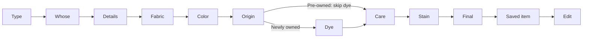

# Journey exploration and collaboration

Status: revised design proposal, October 9, 2026. The owner prefers the displayed Focus Workbench and Observation Folio and requested clearer orientation, branching journey exploration and multiplayer readiness. This proposal combines those directions; it does not approve the visual or implement synchronization, maps or runtime tracing.

The later [screen-canvas revision](screen-canvas.md) supersedes this document's separate Map / Try it navigation and selected-step side pane with actual screen nodes and Edit / Play. The branching, alignment, proposal and multiplayer contracts below continue to apply.

## First glance

The opening screen answers three questions: which app/journey is this, which step is selected, and what can I do next? A fresh journey opens in Map; a returning person can resume their last view. A step link selects that step, without silently replacing an existing application draft.

Map and Try it share the same journey, selection and review context. Map gives an overview and a selected-step inspector with one primary action, Open this step. Try it gives most of the space to the real application and retains a compact path strip. Review changes is a contextual overlay/filter in both views. Feedback details open when requested. Context controls, evidence and proposal metadata do not all compete on the first screen.

Desktop uses a readable map beside the selected state. Mobile uses an equivalent outline with nested branches; the full graph remains available without shrinking the desktop canvas to unreadable text. All known branches can be expanded, searched and reached by keyboard. Collapsed subflows disclose that they contain more states, including gaps. The complete map and readable local detail are different zoom levels of the same model.

## Static map and actual traversal

The model is a graph of states connected by labelled actions and conditions. It supports forks, joins, return paths, retries, cancellation, subflows and alternate outcomes. A happy-path sequence alone cannot represent a journey. Variant conditions belong on edges or scoped state variants, rather than multiplying every node for every persona, device and appearance combination.

This is a grounded subset of towel intake, with the ownership fork confirmed in the current application. It is not an exhaustive graph of error/cancel/save outcomes:

Three kinds of information must remain distinguishable:

| Information | Meaning |
| --- | --- |
| Known paths | Declared possible states, actions and conditions at a particular revision. Some may have incomplete fixtures or evidence. |
| Proposed change | A selected candidate overlay that shows added, changed or removed states, edges or shared components. It does not rewrite the approved baseline. |
| Observed path | Transitions actually reported by the running application during a particular preview session, including its target, fixture, conditions and revisions. |

Selecting a node inspects it. Open this step deliberately loads its fixture, after protecting an unsaved draft. The UI says Jumped, not traversed. Earlier edges remain unobserved. Replay from start, when supported, executes actions and records their results; it cannot be substituted with a series of fixture jumps.

Runtime state/transition events from the application adapter advance the trace. DOM proximity or the most recently clicked control is insufficient evidence of a transition. A state or transition missing from the declared map appears as Off map with its captured context; it never snaps to the nearest known state. Back/retry loops preserve their order in the trace even when the overview only draws one edge.

Known, selected and observed are independent of working/partial fixture status and verification status. The generated image illustrates layout; its dashed-node legend and Skip dye box are not an approved graph schema. In implementation, Skip dye is an edge condition, and line styles need text labels as well as color. The inventory of 34 working scenarios and 93 partial specimens does not establish complete branch coverage.

## Proposals and platform differences

A change proposal can target a journey, screen, component, primitive or token. A design proposal uses this same record with a visual candidate and rationale. Relationships expose where shared components/tokens are used, so a small-scope change can reveal large impact without creating disconnected proposals for each occurrence. The user selects the scope; the map reveals affected journeys and targets.

Each candidate records the problem, before/after states, intended effects, affected target variants, source/design revisions, author, decisions and evidence. Approval names an exact candidate revision and target scope. A material candidate revision reopens affected decisions. Application adoption and verification remain separate from approval.

A target is an implementation/runtime plus review conditions. Platform names such as Android or iOS are only one part; viewport, input method, appearance, enlarged text and relevant fixture/permission/evidence conditions remain explicit. Shared contracts cover meaning, task outcomes, validation, data preservation, permissions and accessibility. An approved platform variant can adapt presentation while preserving these contracts.

| Alignment label | Meaning |
| --- | --- |
| Aligned | Current evidence matches the applicable approved contract/variant. |
| Approved adaptation | An intentional, scoped platform difference has been approved. |
| Accepted limitation | A compromise has an owner, impact, rationale and review trigger; acknowledgement alone is not approval. |
| Unreviewed drift | An observed difference has no applicable decision. |
| Awaiting adoption | The change is approved, but this target has not implemented it. |
| Unknown / evidence stale | Available evidence cannot support an alignment judgment. |

A library or platform constraint is evidence for a proposal, not automatic permission for drift. Reviewers can restore the approved behavior, propose an adaptation or accept a bounded limitation. These labels do not imply native Android/iOS implementation or device testing exists in the current review integration.

## Multiplayer contract

Multiplayer is a product requirement. The smallest useful delivery shares durable comments, proposal versions, decisions and frozen evidence across identified collaborators. People and agents have visible attribution; edit, review and approval authority are explicit. An agent critique is not product approval. Sharing one local access key is not this authorization model.

Preview navigation, camera position, fixture data and unsaved application drafts are personal by default. Another person's click cannot reset mine. A shared comment references a frozen capture and revision, not whichever state another person's live preview currently displays. Opening its reproduction link creates or deliberately loads my own session.

Updates carry expected versions. A stale save or decision produces a recoverable conflict instead of silently overwriting someone else's work. Preserve pending writes through a disconnect and make failed/stale writes visible when reconnecting. Removed or renamed target IDs retain history; affected records become stale and require explicit re-anchoring. Displaying a newer design must not silently migrate an older approval.

Optional presence, Follow someone and an explicitly shared review session can follow the shared-record slice. Following controls the view only with consent; it does not transfer fixture ownership or application side effects. Leaving, reconnecting and draft protection must be clear. A shared interactive session requires one visible driver/side-effect owner and controlled handover before it can safely control the same application state.

No extra chat, audio, team administration, freeform editor or generic plugin framework is needed to satisfy this brief. Laundry App remains the first integration; its adapter supplies maps, fixtures, runtime events, anchors and revision identity. The independent shell owns navigation, proposals, collaboration and evidence. Backend/synchronization choices remain implementation work.

## Completed collaborator review

Codex sent the owner's feedback and this bounded brief to the existing private Claude Design conversation and the existing local Open Design desktop project. Both returned text-only recommendations; neither was asked to redraw or edit the application.

| Question | Claude Design | Local Open Design | Combined direction |
| --- | --- | --- | --- |
| Opening view | Map with the current state visible alongside it. | Map scoped to You are here; resume the person's last view later. | Map with selected-step preview and Open this step; explicit deep-link/resume behavior. |
| Orientation | Keep a slim path strip across views; Review changes is a filter. | Two views plus overlay, rather than three destinations. | Map / Try it, with Review changes overlay and preserved context. |
| Branch complexity | Label the actual ownership fork; collapse secondary branches. | Expand branch stubs/subflows and keep an equivalent outline. | All known branches reachable; relevant fork visible; expand detail without deleting possibilities. |
| First multiplayer slice | Shared versioned records, attribution, stale status and approval rights. | The same, with explicit conflicts and private previews. | Shared records first; optional presence/follow/shared driving later. |
| Hidden risks | Unmapped states and fixture jumps overstating traversal. | False observation and anchors drifting after ID changes. | Explicit Off map/Jumped states, runtime events, retained identities and re-anchoring. |

Both collaborators used the phrase observed spine for initial readability. Codex rejected that label for a fresh fixture session: known possibilities cannot become observed merely because they are displayed.

Claude Design conversation: `cse_01RDvjo76ZzDMpw5FDXAGhQT`, initial artifact `09ab05e9-aca3-4553-a601-a42fc144eddd`. Local Open Design project: `c2383e11-71dc-463a-aea0-a7f2aaefac7f`, conversation `7960b5e2-1eb2-4f06-b42f-c715c9bfa042`. Its completed `MULTIPLAYER-JOURNEY-BRIEF.md` was read. SHA-256 comparisons confirmed `index.html`, `app.html`, `HANDOFF.md` and `FOLLOWUP-BRIEF.md` unchanged.

## Revised visual

The combined Image Gen proposal was displayed once after the owner preferred original concepts 1 and 2. It attached those two inspected images and the actual Fabric preview screenshot. It incorporates both collaborators' completed critique. The image shows desktop Map and its mobile outline companion; dynamic exploration and synchronization are proposed behavior, not demonstrated functionality.

Image: `/Users/taymoor/.codex/generated_images/01a12354-2b94-7df3-aff2-45fe8e90641e/exec-63de2f52-e6dc-46e7-b1ac-64b85db5d401.png`.

The percentages remain in the actual fixture's material-text fields with separate percentage fields empty. The sample observation is illustrative. Care instructions, pass counts and multiplayer implementation proof are absent. Product Design's feedback workflow requires selection of this revised visual before replacing the application UI.

Verification in this pass: collaborator responses inspected, local brief saved, original local artifact hashes matched, current journey/fixture code inspected, and documentation diff checked. No application tests, accessibility measurements, real multiplayer conflicts or physical-device acceptance were performed for this documentation/visual pass.
