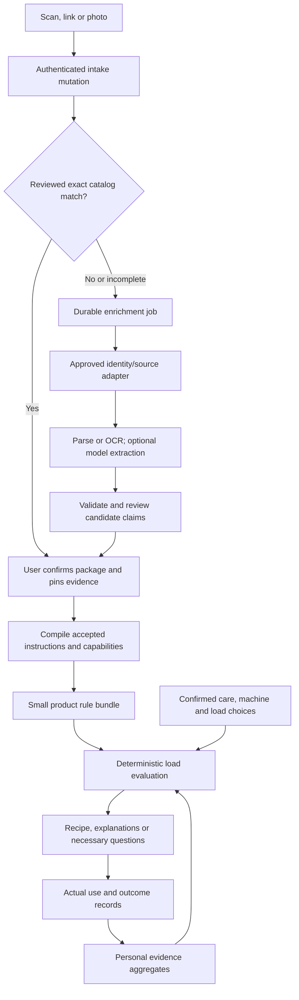

# Repeatable product intake and fast laundry intelligence

Research captured October 4, 2026. Status: backend design and provider research; implementation and performance measurements remain pending. Initial market assumption: United States. Other markets require separately matched variants and instructions.

Owner constraint, October 4: this is a simple local trial with **no paid API services**. Keep all provider findings as future options; no subscription, paid OCR, paid model extraction or provider purchase is authorized. The local trial uses the saved evidence packet, reviewed local catalog and manual/private package input. Free external lookups are optional enrichment, subject to access and reuse terms, and cannot become an acceptance prerequisite. Unknown evidence remains unknown; the budget constraint does not relax dosing or compatibility rules.

Build a catalog of reviewed product facts and executable instructions once, then evaluate the products relevant to each load locally. Retrieve missing evidence in the background. A routine load must not wait for a manufacturer page, barcode service, OCR service or model response. Precompile product rules; do not precompute every possible product combination.

This document extends A1 in the [current delivery list](../plans/2026-10-03-delivery-status.md), the [catalog ingestion contract](../plans/2026-10-04-catalog-ingestion.md), and U1–U6 in the [chemistry and learning specification](../plans/2026-10-03-chemistry-recommendations-and-learning.md). Those documents remain authoritative for implementation ownership and delivery. The main controller owns schema changes and integration. This side conversation owns these research artifacts only.

## Captured evidence and reproducibility

The [owner evidence report](2026-10-04-owner-product-evidence.md) and [structured packet](2026-10-04-owner-product-evidence.json) retain seven owner-selected references: five chemical products and two accessories, with 17 source records. These are source matches, not photographs of the physical packages or completed laundry acceptance. The [pipeline/provider manifest](2026-10-04-product-intelligence-workflow.json) records the proposed stages, provider access, questions and acceptance cases. It is a design manifest, not an executable or runtime catalog import.

The research followed this process:

| Stage | Inputs and operation | Persisted output / decision |
| --- | --- | --- |
| Capture | Save the owner's original names, URLs and product distinctions before searching. Reuse existing evidence before asking again. | Intake ID, original input, household ownership, source references, unresolved fields. |
| Resolve identity | Normalize a scanned GTIN as a string, validate length/check digit, retain the original symbology and leading zeros. Reconcile linked product IDs. | Candidate brand, variant, form, scent, size, market, identifiers; never silently pick a near match. |
| Retrieve | Inspect exact manufacturer ingredient, usage and safety panels; collect separate family guidance and regulatory context. | Source URL, provider ID, retrieval/update dates, document type, access/reuse status, permitted summary and digest. |
| Extract | Preserve ingredient names, CAS identifiers, disclosed function, dose wording, stage, route, timing, exclusions and warnings. | Field-level claims, source locations, conditions, ambiguity and unavailable evidence. |
| Validate | Check identifiers, units, scope, source conflicts, missing tables, duplicate entries, and ingredient disclosure limits. | Validated candidates or quarantined fields; no invented conversions or silent correction. |
| Review | Accept specific claims and executable rules separately from extracted candidates. | Immutable revision, append-only review, accepted claim IDs and rule compiler version. |
| Match | Show the exact candidate to the owner and resolve only differences that affect use. | Private holding pinned to the selected reviewed revision; package confirmation remains distinguishable from URL selection. |
| Evaluate | Assemble confirmed garment, machine, selected-product and load context. Apply deterministic constraints, then benefit ranking. | Plan, exclusions, necessary questions and explanations tied to evidence revisions. |
| Observe | Record what actually happened, then optional outcomes. | Immutable actual-use history; separate personal aggregates and optional shared learning. |

Automation must preserve the failures encountered here:

- The Tide URL selected an 80 fl oz pack rather than an older 115 fl oz candidate. Downy selected fragrance-free Free & Gentle rather than Cool Cotton. Product family/name similarity is insufficient.
- The Oxi Free URL contained legacy ID `40002383`, while the disclosure identified material `42019647`. Store aliases with provenance; do not change the input URL or conflate formulations. White Revive Paks are distinct from Free powder and White Revive powder/liquid.
- The selected Lysol page identified a discontinued product. A later EPA master label is useful context but does not replace the owner's revision or calibrate alternative cap sizes. An API that removes retired records needs a separate historical evidence path.
- Downy's title used “fabric softener,” while its operating guidance described a rinse replacing softener. Classify by reviewed operational evidence, retaining the conflicting title. Do not copy generic ingredient-function language into a fragrance claim.
- The Free FAQ contained apparent template carryovers about fragrance/blue crystals. Exact formula disclosure and generic FAQ must retain separate scopes.
- Downy's recorded propylene-glycol CAS `57-55-7` failed its checksum. Preserve the source value and quarantine that identifier. Another product's valid `57-55-6` does not authorize changing it. Preserve duplicate ingredient entries rather than silently deduplicating the source.
- Tide cap bars, Lysol cap lines and Oxi scoop marks were not calibrated to ml/grams. Printed dose marks remain usable without invented conversions. Synthetic fixture amounts are not manufacturer evidence.
- SDS URLs were discovered, but PDF retrieval failed or required login. Record `unavailable` with its cause; do not infer SDS contents, bypass login, or substitute a different formula. An SDS is supplementary hazard evidence, not a complete formula or dosing table.
- Ingredient/capability evidence did not establish every combination. Generic wool-ball advice did not prove this owner's ball count, lifespan or heat suitability. Downy Ball instructions did not establish permission to use the owner's rinse aid or sanitizer in it.

Store the procedural trace as structured transitions and evidence pointers, not model reasoning transcripts. Each attempt records input digest, adapter version, response status, permitted response digest, parse result, validation findings, accepted review, cost and next retry time. This makes reruns auditable after a disconnect and prevents completed stages from being lost.

## Provider/API findings

Documentation checked October 4, 2026. Credentials, commercial rights, real product coverage and provider uptime have not been tested. No account or subscription was created. The one public UPCitemdb lookup attempt for the two supplied UPCs could not be completed: the web tool could not access the endpoint and the shell could not resolve its hostname. This is an environment/access failure, not evidence that the products are absent.

| Provider | Useful role | Access and important limit | Recommendation |
| --- | --- | --- | --- |
| Label Insight SmartLabel | Candidate manufacturer product data by UPC or manufacturer ID. | REST GET; `X-API-KEY` plus path authorization key from provider. Default 5 requests/sec. Published/live products only; retired products removed. Cross-brand coverage and downstream reuse rights unverified. | Future licensed option, deferred for this local trial. Later request coverage samples for the five selected chemicals; do not assume all P&G, Reckitt and C&D pages are represented. [Overview](https://developers.labelinsight.com/reference/overview), [UPC endpoint](https://developers.labelinsight.com/reference/get_api-v4-accesskey-data-upc-upc). |
| UPCitemdb | Identity candidates, brand/title/pack and source discovery. | Free, no signup: 100 combined requests/day, 6 lookup requests/minute, at most 2 UPCs/request. Paid headers/limits differ. Public terms grant limited operational use; durable redistribution/caching rights need confirmation. | Bounded evaluation provider; identity evidence only. [Plans](https://www.upcitemdb.com/wp/docs/main/development/plan/), [terms](https://www.upcitemdb.com/terms). |
| Barcode Lookup | Alternative identity metadata, images and available descriptions. | API key; Starter listed at $99/month for 5,000 calls. Terms cap calls at 100/minute without permission and require deletion of supplied data, including cached/backed-up copies, on termination. | Compare actual laundry coverage before purchase. Keep licensed metadata separable from independent package evidence. [API](https://www.barcodelookup.com/api), [terms](https://www.barcodelookup.com/terms-and-conditions). |
| GS1 US APIs | GTIN/license validation and product attributes. | Subscription/API keys; listed $6,500 API add-on plus other subscription/license requirements. GTIN identity does not supply verified laundry directions. | Optional later identity-quality service, not a prerequisite for first intake. [GS1 API information](https://www.gs1us.org/tools/gs1-us-data-hub/gs1-us-apis). |
| Open Products Facts | Community product identity/photos; possible supplementary disclosures. | Experimental project. Shared documentation supports v3 cross-project lookup using `product_type=all`; Open Products Facts uses its own host. ODbL database, DBCL contents, CC BY-SA images; actual project coverage and license integration need evaluation. | Optional, separate provenance/license partition. No automatic publishing of private photos. [Project APIs](https://openfoodfacts.github.io/openfoodfacts-server/api/tutorials/scanning-cosmetics-pet-food-and-other-products/), [licenses](https://openfoodfacts.github.io/openfoodfacts-server/api/tutorials/license-be-on-the-legal-side/). |
| PubChem PUG REST | Resolve validated ingredient identifiers into candidate chemical entities/metadata. | Public REST; usage policy asks no more than 5 requests/sec. CAS searches can be ambiguous, particularly mixtures/polymers. | Background enrichment only. Molecular metadata cannot approve a branded-product combination. [PUG REST](https://pubchem.ncbi.nlm.nih.gov/docs/pug-rest). |
| Google Cloud Vision | OCR of cropped directions/ingredient panels, with word locations. | Authenticated, billed image API. `TEXT_DETECTION` and dense `DOCUMENT_TEXT_DETECTION`; no product-label semantics supplied. | Evaluate against actual package images; choose only after privacy, retention and cost review. [OCR documentation](https://docs.cloud.google.com/vision/docs/ocr). |
| Amazon Textract | Document/table/form extraction candidate for directions panels. | AWS-authenticated service; table/form analysis is a different concern from product identity. | Alternative OCR benchmark, not a second mandatory service. Curved bottles require measured accuracy. [Document analysis](https://docs.aws.amazon.com/textract/latest/dg/how-it-works-analyzing.html). |

Example request templates, not tested integrations:

```text
GET https://enterprise-sl-api.labelinsight.com/api/v4/{accessKey}/data/upc/{upc}
    X-API-KEY: server-side credential
GET https://api.upcitemdb.com/prod/trial/lookup?upc={upc1},{upc2}
GET https://api.barcodelookup.com/v3/products?barcode={barcode}&key={serverSideKey}
GET https://world.openfoodfacts.org/api/v3/product/{barcode}?product_type=all
GET https://pubchem.ncbi.nlm.nih.gov/rest/pug/compound/name/{encodedIdentifier}/cids/JSON
POST https://vision.googleapis.com/v1/images:annotate
```

Use published response schemas and field allowlists; minimize identity responses to the fields needed. SmartLabel UPC responses can contain a list, so a hit still needs disambiguation. The Open Products Facts cross-project request may redirect; permit only expected provider hosts. Configure provider-wide quotas across workers, not independently per action. Do not expose path/query keys in client code or logs.

### Manufacturer retrieval and storage permission

SmartLabel's public website terms prohibit scraping/extraction and commercial republication without permission. P&G's terms restrict automated copying and commercial use. Do not deploy a general SmartLabel/P&G crawler based on the fact that a page is publicly readable. Those website terms do not establish the rights granted by a separately licensed API agreement, nor automatically establish the terms of every linked manufacturer site. Record the agreement applicable to each adapter. [SmartLabel terms](https://smartlabel.org/terms-of-use/), [P&G terms](https://termsandconditions.pg.com/en-us/).

Local-trial order: saved evidence/reviewed local catalog → owner package capture → optional permitted free lookup or manufacturer adapter. Licensed feeds and paid OCR remain future options. Retailer and community metadata can discover identity, but do not override matched label directions. Regulatory sources are scoped to registration, market, date and actual package wording. Wikipedia provides general accessory context, not exact-pack operating instructions.

Each provider policy must record access mode, allowed fields, attribution, retention/TTL, redistribution/derived-data basis, images policy, deletion obligations, and terms revision. Unknown rights disable automated import for that provider; another permitted path can continue. `robots.txt` is a crawl signal, not a license. Factual summaries need a recorded basis too; changing a snapshot's name to “summary” is not permission to automate acquisition or republish restricted data. This research packet is not approval for a production scraper.

## What users supply, and when

Prefer camera scan, pasted manufacturer/SmartLabel link, or a front-label photo; manual brand/name remains available. Do not require all three. Ask the market once, with a visible household default and correction option. Barcode plus front-label evidence resolves most identity questions; only ask for size/scent/form when the candidate is ambiguous.

| Situation | Product-facing request | Completion rule |
| --- | --- | --- |
| Initial intake | “Scan a barcode, paste a product link, or take a photo.” | Save the attempt immediately; return a candidate or pending status. No search work is lost on reload. |
| Exact candidate | “Is this your [brand, variant, form, size]?” Show the distinguishing fields. | Confirm identity or choose another candidate. An ambiguous hit never auto-matches. |
| Missing directions | “Photograph the directions and warnings on the back. Include the dosing table.” | Extract a draft; ask for another crop only when required text is illegible. |
| Mark-based dose | “Include the cap/scoop markings shown in the directions.” | Retain printed marks. Ask for volume only if actually printed or independently measured; never require invented ml. |
| Conflicting package/source | “Your package appears to say [A]; the linked page says [B]. Which matches this bottle?” | Save the package evidence and conflict; defer affected instructions pending review. Don't make the user choose which chemistry is scientifically correct. |
| Selected treatment lacks a fact | “To use this product, we need [specific missing instruction]. Add a label photo or leave it out of this load.” | Reevaluate only after explicit selection change or sufficient evidence. Do not silently drop a chosen product. |
| Sanitizer | “Does this rinse keep the clothes in contact for the required time?” Offer known machine evidence first. | Verify dose, route and actual contact time for a sanitizing claim; wash duration alone is insufficient. |
| Generic accessory | “Wool dryer balls” can be saved without a brand. | Ask for exact instructions only when needed for a specific count, claimed performance or product/machine restriction. |
| Load context | Ask about soil/stain or a goal only when it changes the plan; reuse confirmed care and machine information. | Unknown remains a visible option. Do not ask about every ingredient, pH or every shelf product. |

Explain review in ordinary language: “We found these instructions. Check they match your package.” Show the important dose/stage/exclusion facts and source, with editable correction. User confirmation establishes which package they own and what it says; it does not turn a speculative compatibility rule into reviewed shared knowledge. Separate private transcription from administrator acceptance into the public catalog.

Do not block saving a product because full ingredients or every variant attribute is missing. Separate `identity_ready`, `instructions_ready`, `capabilities_ready` and `use_ready_for_context`. A product can be on the shelf while an optional treatment remains unavailable. Compatibility and allergy/fragrance requirements can need ingredient evidence that a basic detergent dose does not. “Not listed” is different from verified absence.

Product ownership never chooses an additive for a load. Preserve the existing optional-product/pretreatment choices. A plan using no extra product is useful. Keep initial garment and machine intake separate: garment care restrictions and fabric/colorfastness, machine model/HE class/dispensing/cycle capabilities, and required timing. Ask about water hardness only when recorded instructions or a supported dosing rule use it; unknown is not an invented hardness value. Photo collection must stay proportionate to the decision.

## Proposed backend flow



Use the existing Convex backend and pure planner. A mutation captures intent and schedules a small external-fetch action; the action writes results via internal mutations. Assemble planning data in a bounded query/transaction; actions should not compose a plan from inconsistent reads. Convex queries cache/react automatically, and external fetch belongs in actions. Scheduled actions are not automatically retried, so persist explicit attempts and recovery status. [Actions](https://docs.convex.dev/functions/actions), [queries](https://docs.convex.dev/functions/query-functions), [scheduler](https://docs.convex.dev/scheduling/scheduled-functions).

Proposed contracts, **not existing exports**:

- `requestProductIntake`: authenticated household mutation; validates scan/link/photo reference, returns a stable request ID and available candidates, and atomically schedules enrichment. A per-household idempotency key returns the same request on replay.
- `productIntakeStatus`: authenticated query returning only that household's request, candidates, missing fields and next action. Progress survives client disconnects.
- Internal `retrieveProductEvidence` / `extractProductEvidence`: bounded actions with adapter versions, provider quota reservation, timeout and safe retries.
- Internal `compileReviewedProduct`: deterministic mutation/compiler creating a versioned rule artifact after claim review. It must reject unsupported conditions rather than convert them into unrestricted defaults.
- Existing `catalog.find`, `catalog.detail`, `catalog.match`, and internal `catalog.ingest` / `catalog.review` remain the evidence boundaries. Extend the existing plan assembly and planner rather than add an independent AI approval endpoint.

Start with persisted jobs and the native scheduler. A background sweep recovers jobs whose leases expired or whose action ended without a terminal receipt; respect the attempt budget. Add Workpool/Workflow only if measured queue throughput, concurrency or multi-step recovery warrants a component. Initial retrieval must handle 429/5xx/timeouts with bounded exponential backoff plus jitter and `Retry-After`; 401/403 suspends that provider until access is repaired. A 404/empty result is not chemical absence. Do not retry a login wall as an anonymous scrape.

## Data and compiler boundaries

Existing catalog sources carry provider, URL, date, permission, summary/text kind and SHA-256. Existing claims have `key`, scalar/list `value`, source IDs and **textual** `conditions`. Product keys currently allow `function`, `ingredients`, `lipaseDisclosure`, `directions`, `restrictions` and `rinseMinimumContactMinutes`. Revisions are immutable, reviews append-only and private holdings pin accepted claim IDs. The current archive extractor is deterministic but does not retrieve new manufacturer documents.

The planner already has structured `DirectionsTable` / `CompiledRule`, mark-based measures, machine/load/soil conditions, and capability evidence. `product-benefits.ts` separates benefit from permission and treats unknown overlap cautiously. These are the integration targets. A string-valued catalog direction is not yet a compiled application rule. Do not feed arbitrary extracted prose into an unrestricted rule or silently add unsupported keys to `catalog.ingest`.

Proposed additions should be a reviewed schema/compiler extension:

| Record | Required content and invariant |
| --- | --- |
| Intake / enrichment job | Private household input references, stage, lease, attempts, input digest, adapter versions, quota/cost receipts, terminal outcome. Global product fetches must not reveal other households' requests. |
| Identifier aliases | Symbology, original string, normalized GTIN where valid, legacy/current manufacturer IDs and evidence. GTIN is an identity index, not the formulation revision key. |
| Parsed evidence | Claim-level text/location, source/panel kind, field scope, validation findings. OCR confidence is extraction quality, not confidence that a product is compatible. |
| Accepted structured instructions | Product revision, route (wash/rinse/presoak/pretreat/dry), placement, timing, conditional dose rows, measurement marks, fabric exclusions, water/temperature/contact requirements and quantified versus unspecified fields. |
| Compatibility constraints | Reviewed predicates, effect (`prohibit`, `require`, `allow_with_conditions`), scope, applicable classes/exact revisions, source claim IDs and rule version. May inspect the complete selected treatment set and stage sequence, not only a product pair. |
| Compiled product bundle | Accepted review/claim set, compiler version, supported predicates, normalized capabilities and rule digest. Unsupported conditions stay unavailable with their reason. |
| Actual-use record | Chosen and actually used product revisions, amounts as measured, placement/stage/cycle, evidence bindings and deviations; immutable with correction events. |

Each rule needs both a source fact and an explicitly reviewed interpretation where necessary. Keep an authored, small rule vocabulary with strict validation; no dynamic JavaScript, model-authored executable code or arbitrary expressions. Class membership such as oxygen bleach needs accepted formulation evidence. Exact product rules can narrow a generic class rule; an “allow” must not erase a source-backed prohibition. Unresolved conflict yields unknown/blocked for the affected use.

Keep ingredient records granular: source name, identifier text/checksum status, disclosed function, explicit concentration when supplied, scope and absence status. Do not infer final pH, concentrations, reaction products, sanitizing efficacy or wash-water chemistry from an ingredient list/order. Class rules and label constraints provide operational guidance; a molecular database is supplementary identity evidence. Broad incompatibility knowledge must be reviewed independently, not invented from an LLM or a shared CAS number.

Preserve private package photos/transcriptions separately from licensed shared catalog data. Strip EXIF, support cropping, authorize reads/deletion by household membership, and avoid names/location/background imagery in enrichment requests. External identity providers receive a barcode/market, not the household's clothes, health preferences or history. OCR/model providers receive only the necessary crop after the product's data-processing choice is disclosed. Public contribution or shared outcomes require separate opt-in; adding a product does not grant it. Store field provenance so a provider termination can remove its licensed payloads without erasing independently collected facts. If deletion terms preclude retaining a licensed historical payload, revoke its active artifacts and retain only independently permitted history/receipts; never promise immutable third-party content retention in violation of its license.

## Fast load evaluation and learning

For each candidate load:

1. Assemble current garment care, required detergent options, explicitly chosen additives/pretreatments, machine evidence and user requirements. Filter irrelevant shelf products before validation/questions. Existing planner code treats detergent candidates differently from optional additions; this design does not claim a new selection implementation is present.
2. Resolve evidence readiness and revocations. Determine applicable routes and doses from accepted rows using load size, soil, HE class and any other recorded condition. Preserve “large OR heavily soiled” versus “large AND heavily soiled.” Unknown row inputs require clarification; do not choose the smallest or largest dose by guess.
3. Enforce garment, product, delivery and timing constraints, including aggregate treatment-set/sequence requirements. A dose or antimicrobial claim cannot survive an unsupported rinse contact time or incompatible dispenser route.
4. Produce a valid base plan or necessary questions. Suggest explicitly leaving out an optional conflicting/unknown product, then reevaluate after the choice. Do not silently remove a product the user selected. A required-product or garment care conflict can prevent starting that load.
5. Rank only eligible choices for the recorded goal using reviewed capabilities and comparable personal outcomes. Benefit is a separate result from compatibility. Detergent-only/no-additive remains available. Missing benefit evidence is not proof of ineffectiveness.
6. Persist the generated plan and evidence versions; revalidate inputs and active revocations before start. Capture actual execution and subsequent outcome separately.

Expose three evidence states: **Allowed by the recorded label**, **Not specified by the recorded label**, and **Compatibility not established by recorded instructions**. A recorded prohibition is an exclusion with its source. Do not present “safe,” a computed chemical score, or a green compatibility badge simply because no conflict was found.

Personal intelligence can be fast too: increment small aggregates after actual use, grouped by comparable garment/care/soil/goal/product/machine context. Read these aggregates during ranking; do not run a model over history for each load. Separate “not observed” from poor outcome, respect small sample sizes and confounding, and never let a good outcome override label restrictions. Apply U4–U6 for the outcome model, corrections and consent; this document does not introduce an independent learning subsystem.

### Why all combinations are the wrong cache

For 10,000 products, pairwise combinations already number 49,995,000. Arbitrary subsets number `2^10000`; market, revision, garment, dose, route, sequence and machine conditions multiply that space. A stored “A + B compatible” answer is insufficient even for a pair if one product moves from presoak to rinse or its package revision changes.

Precompute validated product facts, parsed conditions, class membership, capability bundles and rule indexes. Evaluate the small selected set at runtime. Use a general rule vocabulary plus exact exceptions, with explicit evidence gaps. Demand-driven catalog growth and targeted refresh of common owned variants deliver more useful coverage than a universe crawl. Licensed bulk feeds can expand identity discovery later without generating an all-product compatibility graph.

The chemistry subproblem should scale with garments `G`, selected products `P`, and applicable rules `R`, not global catalog size `N`. Product/fabric checks may be `G × P`; selected-pair checks may be `P(P−1)/2`; aggregate/sequence rules also need evaluation. Index applicable rules and bound their count. These are design complexity targets, not a claim about the entire existing planner's packing algorithm or measured latency.

### Performance targets and cache keys

Proposed targets, to benchmark before promising them:

| Path | Initial target | Measurement boundary |
| --- | --- | --- |
| Chemistry constraint evaluation | p95 under 50 ms | Accepted bundles and input already in memory; up to 100 garments, 20 selected chemical products, 500 applicable rules. Include pair and aggregate checks. Measure on the supported phone and backend. |
| Warm load preview | p95 under 500 ms | User change to rendered result, normal supported network, including backend read/planner/render. Record complete planner cost separately. |
| Intake acknowledgement | p95 under 500 ms | Intent saved and request ID/status returned; external enrichment excluded. |
| Cold enrichment | Asynchronous, no initial time promise | Measure provider/OCR/review latency separately; never display an unreviewed rule as ready to hit an intake target. |

Prefer native reactive query caching and in-memory compiled-bundle caches first; no Redis or vector database is required for this stage. A product bundle cache key includes exact variant, evidence revision, review, accepted claim IDs, compiler and policy versions. A private plan cache key additionally includes garment/care revisions, machine/cycle/dispensing revisions, product selections and routes, load/soil/stains, timing, preferences/requirements, personal aggregate version, and revocation epoch. No global cache of household-specific plans keyed solely by product IDs.

An age-based refresh does not silently replace a pinned package revision. Refresh creates candidates, reviewed changes notify affected holdings, and an active safety revocation invalidates derived plans immediately. Authorization is checked before returning cached private data. A cache is a speed optimization; validation remains necessary when starting a load, especially after inventory or machine changes. Same-input replay must be deterministic for the same evidence/policy/learning versions.

## Retrieval hardening and model boundaries

Adapters should accept an approved host/URL shape and return a bounded typed result. P&G tab-rendering, Reckitt usage panels and C&D ingredient tables need separate parser fixtures. CSS/HTML changes, absent panels or implausibly empty ingredient lists create parse failures, not a successful empty disclosure. A permitted browser-rendering fallback belongs in isolated background infrastructure only.

User-supplied URLs are not unrestricted server fetch targets: allowlist hosts and ports, validate redirects and resolved addresses, reject loopback/private/link-local/metadata destinations, prohibit credential-bearing URLs, and apply DNS/egress controls across redirects. The existing catalog URL validation is not a complete SSRF defense for a new retriever. Limit bytes, pages, redirect depth, decompressed size and time; isolate document parsing. Redact query/path credentials from logs. Treat page/PDF/OCR instructions as untrusted data.

Use deterministic parsing for known layouts; OCR for private panel images; a model only when language/layout ambiguity remains. A model drafts a bounded structured candidate with source locations and explicit unknowns. Validate identifiers, units, row conditions, schema bounds and evidence coverage after the call. Record provider/model/prompt/schema versions and output digest, with per-job token/cost limits. Reject unsupported claims and prompt-injection attempts; no model tool execution. Cached deterministic extraction avoids repeated calls; stochastic reruns become new drafts, not silent replacements. Review is mandatory before shared safety-critical rules become active. There is no model call in routine compatibility approval or load start.

## Bounded implementation sequence and proof

This is an A1/U1 integration appendix; package assignment and scheduling belong to the current controller.

1. Map the seven owner records into reviewed candidates, retaining exact formula, unavailable SDS, invalid identifiers and missing physical confirmation. Keep the authored packet as evidence; do not treat this design JSON as accepted catalog claims.
2. Add durable private intake/status and one approved identity adapter. Demonstrate duplicate submission/disconnect recovery, then measure the two known UPCs and missing/ambiguous results. Manufacturer automatic retrieval stays disabled until applicable access/reuse terms are established.
3. Extend reviewed structured direction/constraint storage and the compiler into existing planner contracts. Prove the manual transcription and extracted equivalent yield the same rules; reject unsupported conditions and uncalibrated conversions.
4. Add the approved manufacturer adapter or private-label OCR path, with claim-level review and drift/quota/error handling. No universal crawler or mandatory LLM first.
5. Benchmark the complete warm planning journey, instrument the chemistry portion, and add caches only where measurements justify them. Integrate comparable-outcome aggregates under U4–U6 separately.

Acceptance cases derived from the research:

| Case | Required result |
| --- | --- |
| Exact barcode but multiple pack/market revisions | Candidate list/confirmation; no auto-accepted latest revision. |
| Cool Cotton versus Free & Gentle | Distinct variants; no fragrance claims transferred. |
| Discontinued Lysol versus newer master label | Separate revisions/scopes; no dose/cap/contact-time substitution. |
| Invalid CAS or unavailable SDS | Quarantined identifier/unavailable source; other supported facts retained. |
| Ingredient not listed | `not_listed` or unknown; no verified absence, allergy clearance or invented concentration. |
| Tide cap bar / Oxi scoop mark | Original measurement; no synthetic ml/gram conversion. |
| White Revive Pak presoak missing ratio | That route unavailable; supported wash route can remain available. |
| Oxi Free plus Downy rinse | Recorded bleach restriction applies; no “separate stage therefore safe” inference. |
| Downy plus Lysol in one rinse / shared dispenser | Compatibility not established; no automatic combination or splitting doses. |
| Lysol rinse shorter than required contact | No sanitizing claim or startable sanitizing recipe. |
| Unchosen shelf chemical | No dose, treatment constraint or blocking question solely because it is owned. |
| Chosen unknown optional chemical | Specific clarification or explicit leave-out choice; no silent omission. |
| Three individually unobjectionable products with aggregate/sequence rule | Evaluate the set/sequence; pairwise pass alone cannot approve it. |
| Duplicate job, crash, timeout, 429, expired lease | Bounded idempotent recovery; no duplicate active revision/review or unbounded calls. |
| Source/label/compiler/policy/revocation changes | Correct invalidation; pinned history and independently permitted evidence preserved. |
| Private URL/photo/outcome access from another household | Denied; no leak via job status, dedupe responses, cache, provider payload or logs. |
| Repeat identical reviewed inputs | Same plan/explanation for identical versions; zero external/model calls. |

Measure identity hit rate on a stratified sample of common and uncommon laundry variants; exact-match precision; field/dose/condition extraction errors; review time; questions per intake; reuse rate; provider calls/cost per new variant; cache hit rate; p50/p95/p99; evidence freshness and job recovery. Report missing coverage as missing, not an incorrect match. Test multilingual/curved/low-light labels before widening capture support. A zero-invented-dose result on these acceptance fixtures is necessary but does not establish accuracy for untested products.

## Completion boundary

The product research, process capture, API evaluation and backend design are saved. The owner has requested that this packet be sent to the main chat and the acceptance blocker reconciled. The product-identification/source-research portion is complete: seven owner-selected references and their supported facts are retained, so the owner does not need to find those sources again. This does not establish that a physical package revision was inspected, that machine contact times were verified, or that the phone/physical laundry trial passed. The main controller owns updating the delivery list and integrating/reviewing the packet; this side conversation does not mark T3 accepted.

These artifacts do not implement an ongoing retriever, import household products, accept chemical compatibility rules, or prove latency/physical laundry outcomes. Paid provider licensing and OCR choices are deferred and do not block the local trial. The next implementation package should use the saved evidence and manual label path while extending A1, rather than begin with all-product/all-combination scraping.
