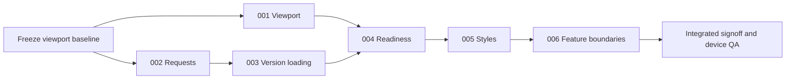

# CIVIC consolidation plans

Prepared on 2026-10-18 against `b99d37b2` plus the viewport-picker working changes recorded below. This combines the focused cleanup and broader reorganization into one sequence. These are implementation plans; no implementation work, workers, commits, or publication were started by this planning stage.

## Ownership and authority

The root controller owns integration, this index, test-runner changes, generated CSS, final verification, and completion. One writer owns each execution checkout. Bounded workers own only their assigned plan's paths; they must preserve other work and report results to the root. Source checkouts outside CIVIC, saved reviews, connection keys, recordings, and runtime journals remain untouched.

Planning is authorized. These documents do not grant additional authority to publish, merge, change production data, install dependencies into external source checkouts, or weaken runtime protections. No new framework, query library, state library, or model calls are required.

Execution tooling observed in this session: local shell, pnpm, Node, Vitest/node:test, browser automation, and an Electron launcher. Two agent slots are advertised, including the root. External harness availability, remaining quotas, provider costs, and historical cost estimates were not queried and are unknown; they are not prerequisites. Recheck capabilities before dispatch. Follow applicable repository instructions; use sequential execution when those instructions disallow workers.

## Baseline: retain the current viewport work

The commit alone is insufficient. These four files already contain approved viewport work and must accompany the execution baseline:

The digests include subsequent viewport polish, navigation cleanup and the approved Electron checkout-tab work. Preserve the accompanying picker, shared InputGroup, desktop bridge/controller, host-lease API, tests and shell CSS when establishing the execution baseline. The rail has local filtering; coverage remains in Details, and bundled paths appear only when selected. Electron tabs retain separate checkouts of the same project, while matching content remains grouped under one commit in the picker. These historical baseline fingerprints were reconciled before executing the broader plans; they are not current file digests.

| Path | SHA-256 at baseline refresh |
|---|---|
| `packages/canvas/src/app-canvas.tsx` | `3d417ecaa3d9391c360634548264f4c73bfe4043206baa12cd0e92b3a6b4328c` |
| `packages/canvas/src/workspace-tools.tsx` | `044a495de8eac4718544c891dfeaa6d022e54cae20087c6c09310a93379b6977` |
| `packages/canvas/src/workspace-tools.test.tsx` | `b6a1959d8b2aabb4f5fb58a024aab6a68ca7591612794982fc31c8edd19438fc` |
| `packages/shell/styles/ui.generated.css` | `647bd7562521ebbd7a6bd8188d492e437d021143ba25b195c2f7d3be44556409` |

Before execution, root establishes an isolated baseline containing those changes and records its commit or file digests here. Reconcile changed inputs rather than overwriting them. The untracked root `package.json` is unrelated: leave it out of commits and execution copies. Do not stash, discard, or reformat other work to obtain a clean signoff.

## Order and status

Sizes: S = hours, M = roughly a day, L = several days, including verification; estimates are coarse. Risk refers to the change itself. Findings were established by source review; planned regressions must establish runtime behavior before changing it.

| Plan | Outcome | Original finding | Stage | Depends on | Owner / status |
|---|---|---|---|---|---|
| [001](001-shared-viewport-controller.md) | One viewport controller | 1 | Focused | baseline | Root / DONE |
| [002](002-shared-review-requests.md) | Shared request handling | 3 | Focused | baseline | Root / DONE |
| [003](003-bounded-version-loading.md) | Bounded version loading | 2 | Focused | 002 | Root / DONE |
| [004](004-connection-readiness.md) | Honest readiness and capabilities | 4 | Broader | 001, 003 | Root / DONE |
| [005](005-shell-style-ownership.md) | One owner for shell styles | 5 | Broader | 004 | Root / DONE |
| [006](006-workspace-feature-boundaries.md) | Smaller workspace components/controllers | 6 | Broader | 005 | Root / DONE |

Status values: TODO, IN PROGRESS, DONE, BLOCKED with a reason, REJECTED with a reason. Root updates the index after reviewing evidence; workers do not concurrently edit it.

## What can run in parallel

- Run 001 and 002 in separate checkouts with separate file ownership. After 002 integrates, 003 may run alongside unfinished 001. Root owns the small shared test-runner edits in `packages/canvas/package.json`; workers submit the needed runner addition instead of racing on that file.
- Read-only CSS inventory and browser-test preparation for 005 can run during focused implementation, but CSS deletion waits for 004. Only root/the current shell owner regenerates `ui.generated.css` after integration; never merge independently generated versions.
- Do not run 004 against an old picker or old viewport controller. It changes their shared contracts.
- Serialize 005 and 006: layout extraction during CSS cleanup would create overlapping ownership and invalidate visual evidence.
- Unit tests can run independently. Tests that switch projects, use the installed Electron launcher, or touch the same CIVIC host/store run serially under root. Browser fixtures use their own temporary stores and dynamic ports, not the user's active 3012/58966 hosts.

## Verification and completion

Each plan specifies its focused commands. Root registers new browser suites in the canvas package's existing `test:host` script, reviews the final diff, and runs `rtk pnpm --dir packages check` and `rtk pnpm --dir packages test` after integration. Generate styles with `rtk pnpm --dir packages/shell run build:styles` only when source classes/styles change.

When the final tree is committed under the execution task's authority, use a clean checkout of that exact candidate for `rtk bash bin/signoff --no-post`. Include `--browser` when the demo dependency/evidence paths change. Verify a fresh Git-package install through the existing signoff gate. Publish statuses, commits, pushes or a PR only when authorized by the execution request. No GitHub CI dispatch is required.

Final human-facing acceptance covers 1280px desktop, 768px narrow window, 390px phone window, and the installed Electron launcher at desktop and a narrow native window. Check focus return, keyboard search, disclosure versus selection, preview resize without draft loss, arrows during pan/zoom, notifications, and independent project windows. A skipped device/browser is a recorded limit, not a pass. Preserve Electron sandbox, context isolation, and disabled renderer Node integration.

Known environment gap: the selected Example worktree failed to resolve `effect/Effect` during the preceding viewport dogfood. That does not authorize modifying Example's checkout or production backend. Recheck it at execution time; use owned Notebook/Tasks fixtures to distinguish CIVIC regressions from external dependency readiness, and keep actual Example acceptance separate.

Stop the affected stage on conflicting ownership, unexplained baseline drift, source/evidence identity changes, required external-source writes, broadened permissions, or repeated failures after one focused repair. Unaffected read-only work may continue. Prerequisite-plan changes are expected drift: root refreshes downstream excerpts and scopes before dispatch, then records the new baseline.

## Considered and rejected

- A new state/query framework: existing React hooks, project-scoped fetch, and the runtime bridge are sufficient for these changes.
- Merging read-only and isolated execution into one permissive runtime: these protect different data and action boundaries.
- Indexing every project's screens for Cmd+K: retain current-instance scope and the existing ten-result bound.
- Rewriting the shared arrow router/history graph: both already have reusable primitives; preserve their behavior and tests.
- Flattening independent graph/importer/crawl/review installs into the engine workspace: not necessary for this cleanup and conflicts with existing ownership boundaries.

## Open questions

None block these bounded plans. Increasing custom viewport limits, changing runtime authority, adopting a new architecture framework, or redesigning the navigation information architecture requires separate scope. Readiness initially checks configuration/dependencies and observes actual frame startup; it must not claim unexecuted backend behavior is verified.
