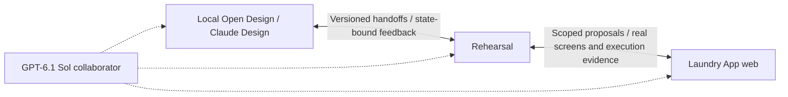

# Design ↔ Rehearsal ↔ Laundry App bridge

Owner scope correction, October 10, 2026: connect the existing local Open Design and Claude Design workflows, Rehearsal, and Laundry App's web implementation. GPT-6.1 Sol participates as a design/implementation collaborator. Figma, Paper, a separately distributed component library and native platform adapters remain outside this first integration.

Rehearsal connects design intent, testable proposals and observed application behavior. Its implemented coverage bridge compares expected product behavior with the scenario registry, source-discovered routes/sheets and revision-bound verification receipts. The Coverage tab lives in the existing right pane; it does not introduce another workspace view. Repository expectation editing is one part of the bridge, not the complete design-tool round trip.

## End-to-end ownership and exchanges

| Endpoint | Owns | Supplies to the bridge |
| --- | --- | --- |
| Design workspaces | Intended appearance, interaction proposals and design rules | Referenced artifacts, completed handoffs, intended states/branches and design revisions |
| Rehearsal | Journey/target mapping, private runs, proposals, feedback and acceptance evidence | Reproduction packets, observed renders/inputs, missing-state requests and decisions |
| Laundry App | Executable components, business behavior, application data and implementation revisions | Real synthetic fixtures, confirmed transitions, source changes and scoped check results |
| Human and agent collaborators | Attributed proposals and work within their assigned authority | Design critique, bounded implementation changes and evidence; generation itself grants no approval |

Design workspaces remain separate authorities: the existing Laundry App canonical project owns its design; the Rehearsal desktop project owns proposals for the independent shell. Claude Design artifacts are referenced alongside these projects, with their own provenance. The [shared design contract](../opendesign.md) still governs application reconciliation. A critique from the desktop app's agent is not a Claude Design handoff.

For now, Laundry App's shadcn components, Tailwind styling and shared tokens sit behind its app adapter. Rehearsal should map a screen/component/primitive/token target to its existing source and design reference. A separately versioned component-library endpoint becomes useful only when that library is independently owned or distributed; SwiftUI would belong to a future native integration.

The exchanges have distinct jobs:

- Design → Rehearsal imports a completed, revision-bound handoff and maps its intended states and variants to stable targets. A design reconstruction remains illustrative until connected to the real app fixture.
- Rehearsal → design exports a feedback packet: target and artifact references, captured state and synthetic inputs, observed/expected behavior, branch context, screenshots and unresolved decisions. Completed designer responses return with a new artifact revision.
- App → Rehearsal refreshes source inventory and affected fixtures/evidence, retaining the current private run and unsaved edits. An unknown runtime state is a mapping gap; it is not silently matched to a nearby screen.
- Rehearsal → app supplies a scoped candidate and acceptance requirements. An authorized coding collaborator implements it separately, connects the real scenario/transition and returns checks and captures. Previewing, accepting intent, adopting code and verifying behavior are separate events.

## A shared change record, not mirrored files

The next bridge slice should link the existing proposals, coverage targets and feedback records through a stable change ID. This is a proposed contract, not an implemented unified store. Each exchange needs:

- Target identity and scope: journey, screen, component, primitive or token; shared instances and affected variants are explicit.
- Design project/artifact reference plus its actual hash or revision; app source revision; parent proposal version and fixture/condition references.
- Attributed request, acceptance requirements and decisions, with separate design, candidate, adoption and verification states.
- Evidence references and unresolved conflicts, including intentional platform adaptations and acknowledged limitations.

The existing repository contract continues to own machine-readable coverage expectations; tool artifacts own design content; app sources own implementation. Rehearsal links these sources rather than creating a competing copy of every document.

Compare both design and app base revisions before applying a returned change. If either changed, retain the proposal and surface the competing changes for reconciliation. A code change may make a capture stale; it does not revoke an accepted design. A design change may make implementation alignment stale; it does not prove the app is broken. Accepted platform exceptions remain visible and scoped. Repeated imports must update the same exchange identity rather than duplicate proposals or trigger an endless regeneration loop.

Automatic detection can prepare briefs, proposed missing states and implementation candidates, then notify in Rehearsal. They remain proposed until reviewed and connected to real behavior. Planned product features cannot be inferred exhaustively from source code. Laundry safety rules and confirmed care evidence remain application constraints on every generated candidate.

## First complete round trip

Use the existing towel Fabric target to connect one actual design artifact to one actual app state: capture a composition-field issue in Rehearsal; send its state-bound packet to the existing design collaborators; import the completed revised handoff as a proposal; test supported presentation edits on the real towel screen; have the coding collaborator implement unsupported behavior in an isolated candidate; return branch-specific checks and before/after evidence. Keep design reconciliation and app verification visible separately, and invalidate only evidence affected by later revisions.

This is the bounded next integration, not a claim that the design adapters or candidate runner already exist. Start with explicit artifact import/export and agent handoffs using the current storage/API seams. Add automatic design-tool watching only once artifact access, completed-handoff detection, stable revisions and conflict handling are verified for each local tool. Multiplayer transport and broader connector architecture can follow the same exchange identities without being prerequisites for this round trip.

## Implemented repository coverage exchange

`coverage.json` in this directory is the canonical machine-readable expectation contract. Its stable targets declare screens, interactions or journeys, expected scenario IDs, optional component references and acceptance requirements. The delivery list still owns roadmap priority and release status. These are different responsibilities; updating an expectation does not release a feature.

- Repository → Rehearsal: inventory scanning reports unresolved IDs, missing dedicated previews, partial specimens, undeclared expected transitions and absent execution evidence. Source-discovered surfaces are explicitly unconfirmed: they may already occur inside broader specimens. File presence never proves behavior.
- Rehearsal → repository: Add/Edit expectation writes only this fixed contract path, with contract-version and source checks. It cannot choose a filesystem destination or modify application code. Repository edits refresh the report.
- Proposal → implementation: export the brief and React candidate for a coding agent. The agent supplies the real app adapter/behavior separately, registers scenarios and transitions, then records scoped checks. Source changes invalidate old receipts and candidate provenance. Acknowledging a notification does not resolve a gap or approve adoption.

The initial contract includes the first complete care cycle, multicolor pack, garment routine, deletion confirmation, washer recovery and six post-trial product areas. Unwritten requirements must be declared; code cannot discover a feature that has never been specified or implemented.

## Automatic updates

While the isolated Vite review server runs, its watcher tracks web sources/review scripts, shared packages, Convex source, the expectation contract, validation receipt and selected package/lock inputs. Changes are coalesced for 250 ms, hashed, and inventoried before subsequent review API requests. Automatic drafting runs on startup and source refresh. The visible browser polls the authenticated inventory and coverage endpoints every five seconds; polling pauses while hidden.

The camera, mounted app iframe and unpublished proposal drafts remain intact. Current inventory and inactive fixture snapshots refresh; the old live iframe remains tied to its rendered revision. Applying newly compiled behavior to that running draft remains an explicit fixture restart. Current source checks reject stale proposal writes. Snapshot capture rejects a source change during capture rather than labelling mixed captures as current. Failed snapshot preparation exposes Retry snapshots.

Review service/plugin changes require restarting the review server; Vite cannot replace the Node service implementation through inventory scanning. This is a running local-server watcher, not a background daemon, GitHub webhook, deployed monitor or OS notification service.

## Generation outputs

New coverage targets receive one deterministic, durable scaffold in `.review-data/coverage-candidates.json`. Source changes mark it stale and preserve edits; they do not continuously overwrite it. Automatic drafting can be disabled. A target without a candidate offers explicit scaffolding.

Each scaffold includes:

1. A source-bound brief and acceptance requirements.
2. An editable heading/description/action prototype, with an example input captured locally when its action is tested.
3. An exported React TSX candidate with the same local input behavior.

The prototype captures only its example input; it does not exercise Laundry App business operations. Code exports remain separate from the application. No AI implementation provider, isolated Git branch runner, automatic PR/adoption, design-tool round-trip or native generation is connected. The exported scaffold is a starting artifact for those workers, not a substitute for their implementation. The authenticated `GET /api/review/coverage` exposes the report, candidate IDs, source versions, briefs and code for agent retrieval. `POST` operations use optimistic store/source versions; rejected saves retain the browser draft. Temporary disappearance of a target retains its candidate with `targetPresent: false`.

Notifications use an in-app count of unacknowledged current candidates and a source-change status line. They do not interrupt a private app run. Persisted acknowledgement only clears a notification.

## Design and verification

The existing local desktop Rehearsal project (`c2383e11-71dc-463a-aea0-a7f2aaefac7f`, conversation `7960b5e2-1eb2-4f06-b42f-c715c9bfa042`) supplied an October 10 text-only critique. Adopted: unconfirmed source discoveries, scaffold wording, contextual actions, no interruption and acknowledgement distinct from resolution. Expected placeholders on the canvas and staged application of inventory remain suggestions, not implemented features. The existing Claude Design comparison remains the foundation; a fresh critique in that separate product was not obtained in this pass.

Checks cover coverage classification, path validation, durable generation, edit preservation, stale/concurrent writes, canonical contract updates, escaped candidate copy and candidate TSX compilation. Existing review API tests cover access/origin restrictions and unavailable inventories. The browser case exercises prototype editing/testing/persistence, real expectation save, watched-source refresh and retained towel inputs/iframe. Physical devices, production access, multiple service processes and full multiplayer authorization are unverified.
